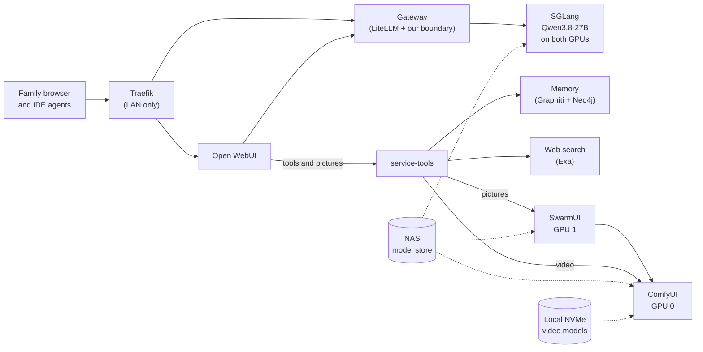

# Arch Linux Threadripper AI Workstation

This repository installs and runs a home AI workstation: an Arch Linux host with a
Threadripper 9960X and two AMD Radeon AI PRO R9700 GPUs (32 GB each). It serves a private
assistant for the family, with chat, pictures and short videos in one browser window, and a
coding endpoint for IDE agents. Everything runs on single-node Kubernetes (K3s) on the host.

The repository holds configuration, tools and tests. Model weights, credentials and site
values are staged separately and are never committed.

**New here?** Read [how it fits together](#how-it-fits-together), then the
[documentation guide](docs/README.md).

## Running now

A snapshot from 12 November 2026. The locks and the serving profile linked below are the
source of truth; this table is a summary.

| What | Today |
| --- | --- |
| Mode | **Shared**: chat, pictures and video together ([modes](docs/MODES.md)) |
| Chat model | Qwen3.8-27B MXFP4 with a DFlash2 speculative draft, split across both GPUs by SGLang |
| Context | 100,768 tokens per conversation, two conversations at once (262,112 in large mode) |
| Chat speed | About 86 tokens/s for one conversation; 135 tokens/s on the single-stream benchmark |
| Pictures | SDXL, one generator per GPU; a warm 1024×1024 picture in 6.6–7.2 s |
| Video | Wan 2.2 T2V A14B, 5-second 832×480 clips in about 80 s, made from the chat |
| Serving stack | SGLang main (0.5.23 + 957) with the [gfx1201 patch series](https://github.com/Drgr33nSenior/Spry.ai-rdna4-serving/tree/main/serving/patches/sglang-main), PyTorch 2.16 nightly for ROCm 10.3.0-dev (HIP 7.18); see [stack.lock](infrastructure/ai-stack/stack.lock) |
| Apps | Open WebUI 0.13.3, ComfyUI 0.45.0, LiteLLM 1.109.1 behind our gateway |
| Platform | Arch Linux, kernel 7.3.4, K3s v1.36.6, AMD GPU operator v1.5.1 with the ROCm DRA driver v1.0.1; GPUs capped at 235 W |
| Serving profile | [qwen3.8-27b-mxfp4-tp2.json](infrastructure/ai-stack/serving/qwen3.8-27b-mxfp4-tp2.json): `qualified`; arms UQSB (shared) and UQLB (large), with UQS, UQL and Y kept as fallbacks |

## How it fits together

- **Chat** goes from Open WebUI through the gateway, which checks the user's key and
  limits, to SGLang.
- **Tools** (document search, memory, web search, task handoffs and video) are an MCP
  server, `service-tools`. It checks every call against the signed-in user's own
  permissions.
- **Pictures** go through `service-tools` to SwarmUI, which runs one ComfyUI on each GPU.
  **Video** goes straight to the ComfyUI on GPU 0.
- Kubernetes [DRA](docs/HOME-LAB.md) lets the chat model and a generator share each GPU.

More detail: [architecture](docs/ARCHITECTURE.md) and [the family assistant](docs/ASSISTANT.md).

## Find your task

| You want to… | Read |
| --- | --- |
| Use the assistant: chat, reasoning effort, pictures, video, voice | [Family assistant](docs/ASSISTANT.md) |
| Switch between shared and large mode | [Service modes](docs/MODES.md) |
| Check, restart or recover the AI service | [Operations](docs/OPERATIONS.md#ai-service), [service recovery](docs/SERVICE-RECOVERY.md) |
| Look at GPUs, power and serving in Grafana | [Monitoring](docs/TELEMETRY.md) |
| Connect Qwen Code or another coding agent | [Coding clients](docs/AGENT-HARNESSES.md) |
| See which models are installed and why | [Models](docs/MODELS.md) |
| Build or refresh the serving and picture images | [AI serving stack](infrastructure/ai-stack/README.md) |
| Install or rebuild the host | [Installation](docs/INSTALLATION.md), [ISO](docs/ISO.md) |
| Back up and restore | [Operations](docs/OPERATIONS.md), [service recovery](docs/SERVICE-RECOVERY.md) |

The [documentation guide](docs/README.md) lists every document and has a glossary.

## Commands

Run these from a reviewed checkout unless a guide names an installed launcher.

| Entry point | Purpose |
| --- | --- |
| `bin/bootstrap-arch` | Live-ISO preflight, installation and installed-system checks |
| `bin/workstationctl` | Service render and provisioning, workload sessions, telemetry, builds. On an installed host it is also on `PATH` as `workstationctl` (the packaged copy) |
| `bin/k3s-lab` | The optional AlmaLinux VM lab (separate from the AI cluster) |
| `bash infrastructure/iso/release.sh` | Package preparation and installer ISO assembly |
| `make check-strict` | All source checks; reports failures and unexpected skips |

Rendering, planning and tests never touch the live cluster. Applying manifests, changing
host packages and switching sessions are owner actions on the workstation.

## Before changing the host

- `bootstrap-arch --execute install` **erases both configured disks**. The default dry run
  checks disk IDs, serials, UEFI and RAID member sizes first. An interrupted install can't
  be resumed.
- The root filesystem is RAID 0 over two NVMe drives: fast, with no redundancy. Keep tested
  off-array backups, independent unlock credentials and the stable/LTS recovery boots
  before experimenting.
- No swap, zram or hibernation is configured. The host has 64 GB of RAM (about 62 GiB
  visible to Linux); the node reports about 50 GiB allocatable to pods.

See [security boundaries](docs/SECURITY.md) and the
[installation acceptance checklist](docs/INSTALL-READINESS.md).
