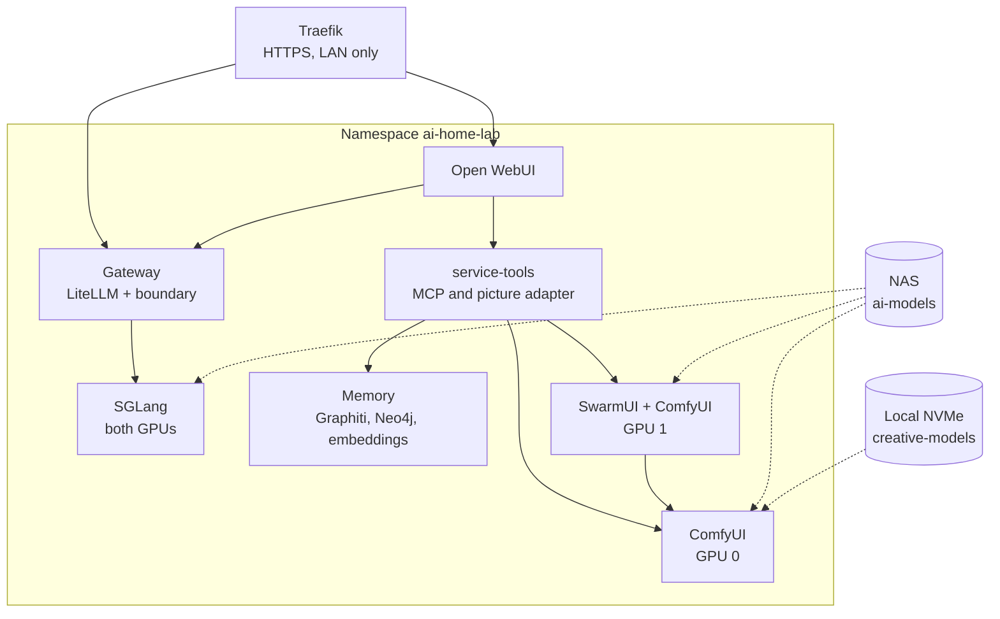

# Architecture

The workstation is one Arch Linux host that owns the hardware and runs a single-node K3s
cluster. The family AI service, monitoring and an optional game-streaming workload are
Kubernetes workloads; the host itself stays headless. This page covers the AI service's
components and storage, then the host's boot, storage and GPU design. The
[stack overview](STACK.md) shows the same system as layers, and [service modes](MODES.md)
shows what each GPU holds.

## The AI service

Everything runs in the `ai-home-lab` namespace (Pod Security `restricted`, default-deny
network policy). Monitoring runs in `workstation-observability`, and AMD's GPU operator in
`kube-amd-gpu`.



| Component | What it does | Source |
| --- | --- | --- |
| Open WebUI 0.13.3 | The family's chat window, accounts, knowledge collections and voice input | [`apps/base/open-webui`](../apps/base/open-webui) |
| Gateway | LiteLLM behind our boundary: maps each user to a key, enforces limits, admits pictures only when the mode allows | [`boundary.py`](../apps/base/shared-api/boundary.py) |
| SGLang | Serves Qwen3.8-27B MXFP4 across both GPUs | [`apps/base/sglang`](../apps/base/sglang), [serving profile](../infrastructure/ai-stack/serving/qwen3.8-27b-mxfp4-tp2.json) |
| service-tools | MCP tools (documents, memory, web search, handoffs, video) and the picture adapter; checks every call against the user | [`service_tools.py`](../apps/base/shared-api/service_tools.py) |
| Memory | Graphiti with Neo4j and a local embedding model | [session memory](MEMORY.md) |
| SwarmUI, ComfyUI | Qwen-Image pictures on GPU 1; a second ComfyUI on GPU 0 also makes video | [`apps/base/swarmui`](../apps/base/swarmui), [`apps/base/comfyui-gpu0`](../apps/base/comfyui-gpu0) |

### Where data lives

| Volume | Stored on | Holds | Backed up |
| --- | --- | --- | --- |
| `ai-models` | NAS over NFS (10 GbE) | Chat model and draft weights | No; restaged from the pinned catalogue |
| `creative-models` | Local NVMe | Wan video weights (`Video/`), Qwen-Image picture weights (`Image/`), SwarmUI `Data/`, `Models/` and `Output/` | `Data/` and `Output/`; the weight trees `Models/`, `Video/` and `Image/` are restaged |
| `webui-rag-qwen3-data` | Local NVMe | Open WebUI database, uploads, knowledge index | Yes |
| `webui-rag-qwen3-models` | Local NVMe | Embedding, reranker and speech models | No; restaged |
| `gateway-postgres` | Local NVMe | Gateway keys, budgets and usage | Yes (database dump) |
| `service-tools-state` | Local NVMe | Picture markers and task handoffs | Yes |
| `graphiti-neo4j` | Local NVMe | Family memory graph | Yes, when present |

"Local NVMe" is the host's encrypted RAID 0 root. The live claims use the `workstation-retain`
storage class (a render keeps whatever class an existing claim has), so these volumes
survive pod restarts and re-renders but share the disk's lack of redundancy.
[Service recovery](SERVICE-RECOVERY.md) covers backup and restore. Video weights live
locally rather than on the NAS because ComfyUI streams them from disk on every step: the
NVMe reads at 22 GB/s, the NAS at about 1.1 GB/s.

## Headless host

The default host runs a multi-user target, upstream GPU drivers and server tools.
GNOME/GDM and local Steam are optional, not dependencies of AI, KVM or K3s.
A qualified gaming workload must supply its own graphics session and encoder
access. Removing the host desktop does not resolve its admission or GPU-sharing
requirements. No existing host is automatically converted.

## Host storage and boot

```text
UEFI firmware
  ├─ ESP 1: signed stable, LTS, git, and recovery UKIs
  └─ ESP 2: identical signed UKIs and fallback path
          ↓
mdadm RAID0 (two equal NVMe member partitions)
          ↓
LUKS2 (Argon2id passphrase + owner-enrolled FIDO2 touch + recovery key)
          ↓
XFS root
```

The ESPs are independent. They protect against an ESP or firmware-entry
failure, but they cannot make RAID0 survive an NVMe failure.

Hardware-key enrollment is owner-local, after passphrase-only boot tests.
New-install examples select `BOOT_UNLOCK=fido2` with touch required and no PIN.
See [YubiKey enrollment](INSTALLATION.md#6-enrol-a-yubikey-for-touch-only-unlock).
TPM+PIN remains an explicit alternative under
[the TPM/PCR procedure](HOME-LAB.md#2-secure-boot-tpm2-and-pin).

The first installed boot paths are official Arch stable and LTS kernels. A
reviewed, commit-pinned `linux-git` package is built later in a clean chroot.
Its UKI is first generated and signed on encrypted root, then copied to both
ESPs. Kernel promotion changes BootOrder but never deletes a fallback.

The packaged ALPM hook covers mkinitcpio's kernel and initramfs regeneration
triggers. It explicitly signs and verifies the regenerated UKIs before mirroring
stable, LTS, recovery and fallback images. Manual synchronization verifies
existing signatures unless signing is explicitly requested. Before copying,
the shared validator requires exact `/efi` and `/efi2` mounts matching fstab,
distinct GPT ESP identities and different parent disks. Firmware entry selection
also checks the expected ESP PARTUUID and loader, not just its display label.
Git-kernel promotion stays manual so an untested tree cannot become
preferred merely because a package was updated.

## GPU layers

Both R9700s stay on the Arch host using upstream `amdgpu`, official firmware and RADV.
Kubernetes reaches them through AMD's DRA driver: each card is a standalone claim (`gpu-0`,
`gpu-1`) selected by PCI address, and several pods can hold the same claim, which is how
chat and a picture generator share a card. There is no VRAM isolation between them; the
serving profile sizes SGLang's cache to leave room. See [home lab](HOME-LAB.md#4-gpu-operator-and-allocation). Native builds and ccache are user-scoped;
hardware detection supplies the single ROCm code-generation target. See
[ROCM.md](ROCM.md) for implemented validation and the remaining reproducible
TheRock build/packaging milestone. Official and experimental generations have
separate environments and signed package snapshots.

## Optional VM lab

Separate from the AI cluster above: an AlmaLinux K3s VM for experiments.


```text
Trusted host ── libvirt NAT management NIC ── K3s API and SSH

Public IPv4/IPv6 ── router firewall ── tagged DMZ bridge ── VM DMZ NIC
                                                     └─ TCP 443 → Traefik
```

The host has no Layer-3 address on the DMZ bridge. The VM receives an access
NIC, not a VLAN trunk. Kubernetes Pods and Services remain IPv4-only. Public
IPv6 terminates at the VM boundary, and the router remains stateful.

The VM is one AlmaLinux K3s server with 8 vCPU, 16 GiB fixed memory, an 80 GiB
system overlay, and a separate 120 GiB data overlay. Flannel uses the management
NIC. Traefik is the only ingress controller. K3s, Rancher Manager, and the
future GPU worker are separate lifecycle decisions. The current two R9700s are
reserved for host AI workloads, not VM passthrough.

The VM keeps embedded etcd for its snapshot/restore workflow and SELinux
enforcement through the pinned K3s policy RPM. The bare-metal AI home lab uses
K3s's default SQLite datastore. Both use the same Kubernetes version lock;
neither single-server topology provides high availability.

## Configuration and provenance

The three `config/*.conf` files contain only literal, non-secret deployment
values. Parsers use an explicit key allowlist and never evaluate configuration
as shell code.

`versions.lock` is the authoritative external-input lock for cloud images,
manifests, OCI images, vendor archives, and AUR source commits. Refresh it only
through a reviewed change that verifies upstream signatures or checksums.

Rootless AI containers, libvirt guests, and K3s containers share the host
kernel where applicable; none can repair a bad host kernel, firmware, IOMMU, or
PCIe configuration. That is why stable/LTS boot paths precede all container and
VM work.
