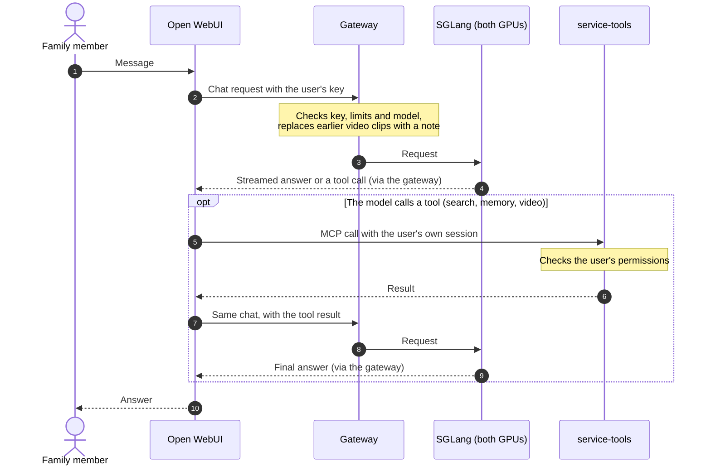
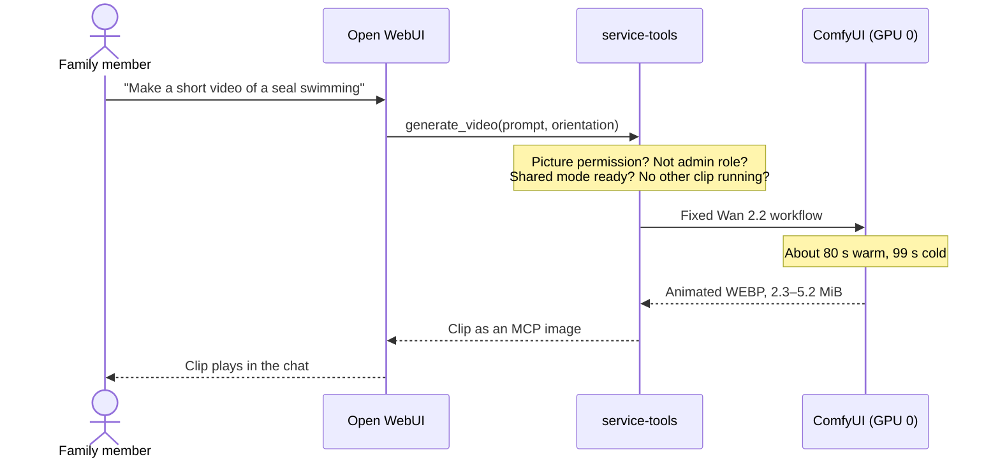

# Family assistant

The family assistant is a private, ChatGPT-style service running on the workstation. In one
Open WebUI chat window, family members can talk to Qwen3.8-27B, make pictures and short
videos, speak instead of typing, search the web and have the assistant remember things.
Nothing leaves the house except web searches and the public pages they read. This page explains what it does, who may do
what, how requests flow, and how it is configured.

It runs in **shared mode** today. [Service modes](MODES.md) explains the alternatives.

<a id="current-delivery-scope"></a>

## What the family can do

| Feature | How to use it | Who |
| --- | --- | --- |
| Chat | Chat with `Qwen3.8-27B-MXFP4` (thinks briefly). To change how long it thinks: the **Reasoning effort** slider in the message box (Off, Low, Medium, Max) | Everyone with an account |
| Pictures | Ask for a picture, or use the image button; SDXL makes it in about 7 s | Accounts with picture permission (Admin and Parents) |
| Short videos | Ask for a short video; a 5-second clip appears in the chat after about 80 s | Accounts with picture permission and the normal `user` role (the Parents' daily accounts); shared mode only |
| Voice input | The microphone button; speech is transcribed on the workstation | Everyone |
| Web search | Automatic when a question needs current public information (Exa) | Everyone |
| Memory | Ask it to remember something; it recalls it in later chats | Every daily (non-admin) account, private to each person |
| Documents | Upload Markdown or text (up to 8 MiB) to a knowledge collection and ask about it | Everyone, per collection permissions |
| Coding agents | Qwen Code and other IDE agents use the same model through an API key | Accounts given a key; see [coding clients](AGENT-HARNESSES.md) |

**Accounts and groups.** Each person has their own Open WebUI account; sign-up is closed.
Parents are in the `Parents` group and the children in `Family`; everyone can set Reasoning
Effort in Chat Controls. Picture permission is granted per account, to the Admin and Parents
accounts. The tools server (video, memory, search, documents through MCP) refuses every call
from an account with Open WebUI's `admin` role, so the owner uses a daily account for those;
the admin account is for administration and pictures.

## How a request flows

A chat message, including a tool call the model decides to make:



A short video:



If any check fails, the model gets a short error it can explain, such as `video_busy` or
`video_permission_denied`.

## Request paths

| Use | Path | Current boundary |
| --- | --- | --- |
| Conversation | Open WebUI → per-user gateway key → SGLang | Preserve the selected model identity and existing context limits |
| Documents | Open WebUI → CPU Qwen embedding model → embedded Chroma | Preserve document permissions; answer/citation quality remains unqualified |
| Web research | Open WebUI/Qwen Code → shared Exa adapter | Auto search and public-page extraction; one durable request ceiling; Tavily optional |
| Memory | Browser and coding clients → service-tools memory tools → Graphiti on Neo4j | Live in the `assistant-memory` experience; per-user memory groups; facts are stored only when someone asks |
| Image creation | Open WebUI → service-tools image adapter → SwarmUI → ComfyUI on either GPU | SDXL only; two pictures at once in shared mode (one per GPU), one in split mode |
| Short videos | Open WebUI → service-tools `generate_video` (MCP) → `comfyui-gpu0` | Wan 2.2 T2V A14B; shared mode only; one clip at a time; picture permission |
| Voice input | Browser microphone → Open WebUI → local faster-whisper | CPU transcription on the workstation; audio never leaves it |
| Creative controls | Operator → SwarmUI; ComfyUI remains its embedded backend | No new public ComfyUI port or unauthenticated creative Ingress |
| Spoken answers | Open WebUI browser speech synthesis | Quality and voice availability depend on the browser and operating system |

The family profile adds a common name, four prompt suggestions and an explicit
default model. Signup remains closed. Each person needs a WebUI account and a
mapped gateway key. Image permission remains a separate per-user grant.
Configuration comes from source rather than persisted administrator settings.

The [web-search guide](WEB-SEARCH.md) covers provider-key provisioning, budget
limits, shared coding-client tools and the separate direct Codex OAuth path.
Web results remain temporary prompt evidence; the existing local RAG store and
document permissions remain authoritative. End-to-end search is not yet qualified.

## Select and render

Use the existing [service setup](AI-SERVICE.md) for private DNS, TLS, credentials,
retained storage, account bootstrap and owner handover. Supply actual site values
and existing claim metadata; do not apply example DNS or invent a new identity.

```sh
./bin/workstationctl service render /private/service-site.json /private/assistant-large \
  --experience assistant --mode large --existing-claims /private/service-pvcs.json
./bin/workstationctl service render /private/service-site.json /private/assistant-split \
  --experience assistant --mode split --existing-claims /private/service-pvcs.json
```

The live service is rendered with `--serving-profile` (see the [serving contract](#serving-contract)
and the shared-mode command in [service modes](MODES.md#switch-modes)).
The two commands above, without a profile, are the older compositions: `large` with the
Qwen3.8-27B-FP8 image and no pictures, and `split` with Qwen3.5-9B on one GPU and SDXL on
the other. Neither silently swaps the chat model to make room for a picture.

Both renders keep application replicas at zero. Use `service plan` with fresh
resource evidence and the selected telemetry composition before activation.
The workstation has 64 GB installed RAM. The retained Linux-visible observation
is about 62 GiB.
Existing split limits exceed the reviewed CPU budget; this change does not lower
them to obtain admission. Shared UI configuration is not physical GPU ownership.

### Admin Panel settings

Open WebUI keeps its Admin Panel settings across restarts and deployments
(`ENABLE_PERSISTENT_CONFIG=true`). The settings the deployment sets itself stay owned by
the deployment. Before Open WebUI starts, `apps/components/assistant/pin-config.py`
re-applies them from the environment:

- the gateway connection and its keys;
- sign-up and the default role;
- the default user permissions;
- the tool server, web search and page loader;
- model defaults and prompt suggestions;
- the reviewed RAG profile.

About 56 of Open WebUI's roughly 450 settings are owned this way. Change those in
source (`assistant.env`, `webui.yaml`, `rag.env`), not in the Admin Panel: an
Admin Panel change to one of them lasts only until the next deployment. That is
also how a rotated key or a changed permission default reaches Open WebUI. Every
other setting (interface, banners, image options, evaluations and so on) is
changed in the Admin Panel and kept.

The render (`lib/workstation/service.py`) names every variable it gives Open WebUI in
`WEBUI_PINNED_ENV`, names only. The script reads the installed Open WebUI's `config.py`
to find which settings those variables feed. Its first log line lists them. Group
permissions, model records and access grants were always stored in the database
and are unaffected. With persistent config on, the database also holds the
connection keys, so treat `webui.db` backups as secrets.

<a id="native-candidate-integration"></a>

## The served model

The chat model comes from the [AI serving stack](../infrastructure/ai-stack/README.md): an
image built from [`stack.lock`](../infrastructure/ai-stack/stack.lock) (SGLang main with the
gfx1201 patch series, PyTorch 2.16 nightly for ROCm 10.3.0-dev) and the
[serving profile](../infrastructure/ai-stack/serving/qwen3.8-27b-mxfp4-tp2.json), which is
`qualified`: arm `UQS` for shared mode and `UQL` for large mode, both on 11 November 2026.
The earlier op234 candidate is described under [History](#history-the-op234-candidate).

### Serving contract

`service render --serving-profile` reads the AI-stack serving profile, its model
catalogue and `stack.lock`, and builds one contract
(`serving-contract.json`). Every consumer in that render comes from it: the
persistent SGLang Deployment, the gateway policy, the LiteLLM route, the Open
WebUI defaults, the Qwen Code client values (`client.conf`) and the
`service-tools` contract metric. The serving owner's files are read, never
edited, and their `render.py` builds the launch argv and environment, so the
Deployment starts exactly what the qualification Job starts.

```sh
./bin/workstationctl service render /private/service-site.json /private/assistant-contract \
  --experience assistant --mode large --existing-claims /private/service-pvcs.json \
  --serving-profile infrastructure/ai-stack/serving/qwen3.8-27b-mxfp4-tp2.json \
  --runtime-image registry.lan.thespry.family/local/sglang-gfx1201@sha256:DIGEST_FROM_SERVING_OWNER
```

| Contract field | Source |
| --- | --- |
| `contract` (`<profile>.<arm>`), `selection` | Profile name and the arm the profile marks `default`, unless `--arm` names one |
| `model` (alias, checkpoint and draft revisions) | Profile `served_model_name`; model catalogue |
| `tokenizer`, `chat_template` | Catalogue file identities; accepted reasoning values from the template itself (below) |
| `runtime` | `--runtime-image` (lab registry or its `ghcr.io` copy, pinned by digest); SGLang commit, patch series and GPU target from `stack.lock`; digest of the launch argv and environment |
| `parsers` | Profile `--reasoning-parser`, `--tool-call-parser`, `--grammar-backend` |
| `reasoning` | Profile `--default-chat-template-kwargs`; template-accepted efforts; client mapping |
| `budgets`, `concurrency`, `deadlines` | Profile context, pool and running-request limits; `--output-tokens` (default 12,288, at most half the context, unqualified); gateway admission 4; deadline 1,200 s in large mode and 600 s in shared mode, so Think (effort `xhigh`, which runs to the context limit with no output cap) can finish; ordinary replies keep the 12,288 cap |
| `assets`, `requirements` | Model and draft paths from the argv; `ai-models` claim from `k8s/models.yaml`; GPU count, groups and node label from the profile, `render.py` and `stack.lock` |

`status` is `incomplete` while a deployment input is missing, `provisional`
when the inputs are present but the profile is not `qualified` or the catalogue
is not promoted, and `active` only when both are. An incomplete render still
writes every consumer so it can be reviewed, but the Deployment image is
`registry.invalid/…:CONTRACT-INCOMPLETE`, replicas stay zero, and
`evidence.json` lists `missing_inputs`. The catalogue's promoted value is
assumed to be `selected`; any status other than `candidate` or `selected` is
refused until the serving owner names it.

The render cannot silently target the older FP8/32K profile. It replaces the
FP8 LiteLLM route, gateway allowlist, Open WebUI default, memory extraction
model and client model, drops the unused FP8 `sglang-profile` ConfigMap, and
then refuses to write anything if `Qwen3.8-27B-FP8` remains in the rendered
configuration or any layer disagrees with the contract (route, gateway and
client context, output cap, input budget, deadline order, request defaults,
Deployment argv). The gateway reads the rendered `gateway-policy.json` at
startup and replaces its source defaults, so an FP8 request is refused as
`unknown_model`. The 9B split route is kept. The contract needs both GPUs, so
`--mode split` is refused. Virtual keys allowlisted only for the FP8 alias do
not reach the new alias: issue keys for `Qwen3.8-27B-MXFP4` with
`service provision` (the alias is now in its allowlist) and revoke the old ones
as before.

### Reasoning effort

There is one chat model; a **Reasoning effort** slider in the message box chooses how long it
thinks: **Off**, **Low** (the default), **Medium**, **Max**. The slider comes from the model
itself: the gateway declares the levels it accepts in its model list (`supportedReasoningEfforts`
with display labels, and `defaultReasoningEffort` from the serving contract), and our Open WebUI
build (the `webui` [AI-stack stage](../infrastructure/ai-stack/README.md), from the fork
`Drgr33nSenior/open-webui`) turns that declaration into Model Controls. An admin who defines
Model Controls for the model in Workspace → Models replaces the declared slider. The older
**Chat Controls → Advanced Params → Reasoning Effort** field still works. The gateway accepts:

| Value | Request |
| --- | --- |
| *(unset)* or `low` | the contract default: thinking at `low` effort, output capped at 12,288 tokens |
| `medium` | thinking at `medium` effort, same cap |
| `high` or `xhigh` | thinking at `xhigh`, no output cap: runs until done, the context is full, or the deadline (10 min shared, 20 min large) |
| `none` | no thinking (`enable_thinking: false`) |

Any other value is refused with `invalid_reasoning_effort`. Chat Controls and Params are
enabled for every user (`USER_PERMISSIONS_CHAT_CONTROLS`/`_PARAMS`, pinned in
`apps/components/assistant/assistant.env`), so the Family group has the control too.

The earlier `· Think` and `· Fast` model presets are retired. A deployment that still has
them keeps them in Open WebUI's database: an admin deletes them under **Admin Panel →
Settings → Models** (or Workspace → Models). Nothing re-creates them.

### Shared mode (chat and pictures together)

`--mode shared` keeps the two-GPU contract model and adds image generation in the VRAM
it leaves free on both cards. It renders the profile's shared default arm, UQS (`--arm`
can still choose another); the large mode renders the general default, UQL (FP8 KV, the
model's full 262,112-token context). Each arm has its own qualification record on its own
image, so each mode's contract is `active`:

```sh
./bin/workstationctl service render /private/service-site.json /private/assistant-shared \
  --experience assistant --mode shared --existing-claims /private/service-pvcs.json \
  --serving-profile infrastructure/ai-stack/serving/qwen3.8-27b-mxfp4-tp2.json --arm UQS
```

- Arm `UQS` caps the KV pool at 163,840 tokens (81,888 per conversation). That left
  9.04 GB free per card in qualification and leaves about 8.35 GB live.
- SwarmUI and its self-started ComfyUI use `gpu-1`. A second ComfyUI
  (`apps/base/comfyui-gpu0`) uses `gpu-0`, the matching gap SGLang leaves there, and
  SwarmUI reaches it as a remote `comfyui_api` backend.
- The rendered gateway policy lists the contract model in `image_models`, so the gateway
  accepts `ready <model> --images` for it. Other modes keep images on the 9B split profile.
- Image access stays per user: bind the Admin and Parents accounts with
  `service browser-bind --images`. Video uses the same permission, but as an MCP tool it
  also refuses the `admin` role, so videos need a daily account.
- Shared mode needs the `assistant` or `assistant-memory` experience and a serving
  profile.

Moving between shared and large mode needs a fresh render and apply first; see
[service modes](MODES.md). Within a shared render, start it with `session switch shared` once
the host config sets
`SESSION_IMAGE2_DEPLOYMENT=comfyui-gpu0` beside `SESSION_IMAGE_DEPLOYMENT=swarmui`
(docs/AI-SERVICE.md step 8). The switch:
- refuses unless the running contract model is `Qwen3.8-27B-MXFP4` on `gpu-0` and
  `gpu-1`, with each image generator on one of those cards and on different cards;
- checks CPU and memory for all three pods together, before anything stops;
- starts SGLang first, so it sizes its KV pool before any image VRAM is in use, then
  SwarmUI, then the second ComfyUI;
- admits images at the gateway only after all three are ready. If either generator
  fails to start, the session is marked failed and the gateway stays closed.

`maintenance`, `split` and `ai` stop the second generator with everything else.

#### Short videos (shared mode)

In shared mode the assistant can make a 5-second silent clip in the chat. `service-tools` lists
an MCP tool, `generate_video`, when `VIDEO_ENABLED=true` (the shared overlay sets it). The model
calls the tool when someone asks for a video. The clip appears in the chat as an animated WEBP:
Open WebUI stores an MCP `image` result under the requesting user and shows it inline.

**Model and settings.** The model is Wan 2.2 T2V A14B (catalog entry
`infrastructure/ai-stack/models/wan2.2-t2v-a14b.json`):

- the two 14B experts in ComfyUI's fp8-scaled repack;
- lightx2v's 4-step distill LoRAs (`1217`);
- umt5-xxl fp8 as the text encoder;
- the Wan 2.1 VAE.

The operator-owned workflow is `apps/base/shared-api/wan-t2v-workflow.json`. `video.py` checks
it against `video-profile.json` at startup. Its settings:

- 4 steps, split 2 + 2 between the high-noise and low-noise experts;
- euler/simple sampler, shift 5, CFG 1;
- 81 frames at 16 fps.

Callers choose only the prompt and an orientation: landscape 832x480, portrait 480x832 or
square 624x624. No size has more pixels than the measured 832x480.

**Access.** Video access follows picture access:

- only users bound with `service browser-bind --images` may call the tool, and like every MCP
  tool it refuses the `admin` role, so in practice the Parents' daily accounts;
- the gateway must be `ready` with images on the contract model;
- one clip runs at a time.

Open WebUI stores each clip as a chat file, so its `RAG_FILE_MAX_SIZE` cap (8 MiB) bounds the clip; a
5-second clip is 2.3-5.2 MiB at WEBP quality 80, larger for busy scenes. The profile's `max_bytes` matches that cap, so a
larger clip fails as `video_artifact_too_large` instead of an upload error in the chat.

On every later turn Open WebUI resends each clip in the chat to the model as base64. The gateway
accepts chat bodies up to 64 MiB (other routes keep 1 MiB) and replaces each animated WEBP with a
one-line note before the model sees it; still images, such as an uploaded photo, pass unchanged.
A chat with many clips can still reach 64 MiB and fail with `request_too_large`: start a new chat.

Busy, not-ready and permission refusals come back as tool errors the model can explain. Like
every service-tools MCP tool, an account with the Open WebUI `admin` role is refused; use the
daily account.

**Where it runs.** The clip runs on `comfyui-gpu0`, so pictures and videos on `gpu-0` share
one queue. That ComfyUI reads the Wan files from the local-NVMe `creative-models` volume
(`Video/`), not from the NAS. With `--fast-disk` it streams the experts from disk on every
step instead of holding 28.6 GB in RAM.

**Staging the models.** Stage them once on the workstation, as root, then hand them to the
pod's user:

```sh
sudo python3 infrastructure/ai-stack/models/stage-video.py \
  infrastructure/ai-stack/models/wan2.2-t2v-a14b.json \
  /var/lib/rancher/k3s/storage/<creative-models pv>_ai-home-lab_creative-models/Video
sudo chown -R 1000:1000 /var/lib/rancher/k3s/storage/<creative-models pv>_ai-home-lab_creative-models/Video
```

Add `--check` to verify the staged files without downloading. The stage is about 36.8 GB,
fetched from pinned revisions and checked against each file's sha256.

**Measured on 2026-11-12** (R9700, shared mode, a 5-second 832x480 clip, chat idle at
86 tok/s):

| `comfyui-gpu0` setting | Clip | Chat decode during the clip |
| --- | --- | --- |
| ComfyUI 0.45 defaults + `--fast-disk` | 92–102 s | 13–14 tok/s |
| + `--use-ck-attention` | 71–76 s | 21–24 tok/s |
| + `HSA_CU_MASK=0:0-47` (shipped) | 78–82 s | 34–35 tok/s |

- **Why chat slows.** SGLang's two TP ranks run in lockstep, so a clip that saturates one card
  slows every chat token. The compute-unit mask keeps 16 of the 64 CUs out of ComfyUI's reach.
  A 32-CU mask was worse on both measures (104 s, 15 tok/s).
- **ck attention.** It is not bit-identical to PyTorch attention: same-seed frames differ by
  14–17 dB PSNR, and an SDXL picture by 25.8 dB. Side by side, the clips (including faces) and
  the SDXL portraits were of the same quality, and SDXL time did not change (about 9.4 s in
  the test pod).
- **Other options tried.** FP8 matmul (`--fast fp8_matrix_mult`) gave no gain, and `--fast`
  with every feature took 203 s. AOTriton flash attention is already in use: 0.28 s per
  attention call, whatever the layout.
- **LoRA choice.** The Comfy-Org v1.1 LoRAs run at the same speed as the `1217` LoRAs.
- **Memory.** Anonymous memory peaked at 7.3 GiB with SDXL and Wan in one process. Each clip
  reads 25–47 GB from the NVMe. Clips measure 2.3–5.2 MiB.

To check `comfyui-gpu0`'s queue before blaming the tool, use the `/queue` command in the
picture recovery steps below. A cancelled chat request drops its clip from the queue, or
interrupts it if it is the job running now (ComfyUI's `/interrupt` with that `prompt_id` only).

#### Reasoning parameters

The catalogue's `chat_template.jinja` (git blob `c0c686f9…`, 8,952 bytes; the
same bytes as the FP8 checkpoint's template) was read directly:

- thinking is on unless `enable_thinking` is false;
- `reasoning_effort` defaults to `xhigh` and accepts only `xhigh`, `medium`
  and `low` (lines 46–49); any other value, including `high` and numeric
  efforts, raises a template error;
- it also reads `preserve_thinking` (line 116), which clients may not set.

SGLang at the pinned commit (`fcb32746…`) accepts the tiers `none`, `minimal`,
`low`, `medium`, `high`, `xhigh`, `ultra` and `max`, or a float from 0 to 0.99
(`entrypoints/openai/protocol.py`, `ReasoningEffortTier`), and passes the
effort to the template as `reasoning_effort` (`serving_chat.py`
`_apply_jinja_template`). The template, not SGLang, therefore limits the
values, and the gateway's `high` → `xhigh` mapping is still required. The
contract derives that mapping from the template's accepted list.

The pinned `serving_chat.py` lets `--default-chat-template-kwargs` override a request's
effort at render time. On 11 November 2026 a server-default `reasoning_effort: low` was
confirmed to replace every per-request choice (identical output at `low` and `xhigh`). The
profile's server default is therefore only `{"enable_thinking": true}`, and the gateway
applies the default effort (`low`) to requests that name none, so Think's `xhigh` now
reaches the template. Sampling is left to the checkpoint's generation defaults.

### Request profile and transport

The baseline recipe is thinking enabled at low effort with greedy decoding.
The selected arm was throughput-measured with a sampled profile (temperature
0.7, top_k 20, top_p 0.95); the menu labels that as a separate recipe.

| Layer | Behaviour at the pinned versions |
| --- | --- |
| Open WebUI 0.13.3 (fork) | Copies `DEFAULT_MODEL_PARAMS` (sampling only: no effort or thinking switch, which would contradict the slider's Off) to the top level of each request; the reasoning slider adds `reasoning_effort`; sends `max_tokens`; drops prior reasoning on the next turn |
| Gateway boundary | Accepts `reasoning_effort` `low`, `medium`, `high` and `xhigh`; sends `high` as `xhigh`, the nearest level the template accepts. Turns `none` (an IDE's *Thinking off*) into `enable_thinking: false` with no effort, and refuses it with `enable_thinking: true`. Accepts `chat_template_kwargs` with only a boolean `enable_thinking`; refuses other fields |
| LiteLLM 1.109.1 | `drop_params: false`; forwards `reasoning_effort` and `max_completion_tokens` unchanged; passes `top_k` and `chat_template_kwargs` through `extra_body` |
| SGLang 0.5.21 (op234, historical) | Passes `reasoning_effort` and `chat_template_kwargs` to the template |
| SGLang `fcb32746…` (AI stack, live) | Same, plus server defaults from `--default-chat-template-kwargs`; see [Reasoning parameters](#reasoning-parameters) |

Without parser flags, SGLang returns reasoning and tool-call markup in
`content`, and `finish_reason` stays `stop`. The persistent descriptor adds
`--reasoning-parser qwen3 --tool-call-parser qwen3_coder`. These are the
parsers of the existing service profile and match the template format. The
descriptor records them as a labelled deviation from the measured CLI. The
frozen serving benchmark contract is unchanged.

Admission and execution are separate limits. The gateway admits four
concurrent requests, and the native runtime runs two. With four active
requests, two wait in the native queue and count against the client deadline.

### Acceptance suite

The menu is [assistant-quality.json](../infrastructure/sglang/assistant-quality.json).
It has 15 unique tasks: the eight original cases and seven held-out tasks.

- Python and Go bug fixes, each with real tests.
- Terraform and Ansible compatibility fixes, checked with `terraform validate`
  and `ansible-playbook --syntax-check`.
- Kubernetes troubleshooting from supplied evidence.
- Version selection.
- Incident analysis.

Repetitions are counted separately from tasks. Human-rubric items stay
`needs-review` until a person decides.

```sh
./bin/workstationctl service acceptance plan /private/acceptance-plan.json \
  --model Qwen3.8-27B-MXFP4 --tokenizer-dir /private/model-tokenizer
./bin/workstationctl service acceptance run /private/gateway-run.json \
  --boundary gateway --base-url https://API_HOST --model Qwen3.8-27B-MXFP4 \
  --key-file /private/virtual-key
```

Each run names one boundary: `direct`, `gateway` or `webui-api`. An
unreachable endpoint gives `NOT RUN`. The report contains the following:

- Task pass rate, tool round-trip success, grounded-answer accuracy,
  abstention, truncation and time to a usable answer.
- Request and response hashes, finish reasons, token counts and the elapsed
  time for each attempt.

Code and configuration answers pass only when the task's real tests or
validators pass inside the network-free Linux sandbox. That sandbox uses the
serving project's pinned grader design: bubblewrap with every namespace
unshared, a cleared environment and a timeout. On other hosts, those tasks
are `NOT RUN`. The coding-client and browser scenarios in the menu are manual
checklists for the preferred client (Qwen Code): repository edits, a
failed-test-to-fix cycle, interrupt and resume, and context compaction.

## Pinned inputs and gates

The new experience pins Open WebUI **0.13.3** from the workstation fork
(`Drgr33nSenior/open-webui`, commit `21bc3e3da87d25e988b412710bafcefd4b4261db`: upstream
`b0e6098e9409` plus provider-declared Model Controls and four dependency fixes), built,
scanned and signed by the `webui` AI-stack stage as
`registry.lan.thespry.family/local/open-webui:2f743ea641c7@sha256:ec62ad7e6610614f48846889a0ebf7fa1586043f3d40bef1e0441d2e10ed7560`.
The legacy `service` experience retains its previous selection. The older RAG
functional gate is evidence for its recorded image, not qualification of 0.13.3.
Run a fresh UI/account, upload/ACL, retrieval, web-search/tool and image-return
gate before use.

`apps/base/shared-api/image-profile.json` records the existing SDXL revision,
weight hash, workflow, dimensions and sampling settings. The adapter loads and
checks the operator-owned workflow at startup, copies it for each request and
records its hash in health/in-flight evidence. Clients cannot choose a workflow,
checkpoint, URL or unqualified model. Declared hashes do not prove installed
weights; the existing creative staging and runtime checks remain required.
Cancellation uncertainty retains the durable in-flight marker and blocks another
job. An interrupt acknowledgement is not proof that GPU work has stopped.

The adapter runs one picture at a time, or two in shared mode (`IMAGE_CONCURRENCY=2`
on `service-tools`), one per SwarmUI backend. Each running picture owns its own
marker under `/state`: `image-inflight.json` for the first and `image-inflight-1.json`
for the second. A marker no running request owns blocks new pictures in every mode
(HTTP 503 `image_backend_needs_operator_check`, no `Retry-After`; a full adapter
returns 429 `image_busy` instead). `/health` reports `image_active`, `image_slots` and
`image_recovery_required`. A cancelled picture also keeps its marker, because
SwarmUI acknowledging an interrupt does not prove the GPU work stopped.

To recover, confirm both backends are idle, then remove the stale marker:

```sh
kubectl -n ai-home-lab exec deploy/comfyui-gpu0 -c comfyui -- /SwarmUI/dlbackend/ComfyUI/venv/bin/python -c \
  "import json,urllib.request; q=json.load(urllib.request.urlopen('http://127.0.0.1:7821/queue',timeout=5)); print(len(q['queue_running']), len(q['queue_pending']))"
kubectl -n ai-home-lab exec deploy/service-tools -c tools -- ls /state      # which image-inflight*.json
kubectl -n ai-home-lab exec deploy/service-tools -c tools -- rm /state/image-inflight-1.json
```

Check SwarmUI's own backend the same way (its server log shows no running generation).
Restarting either image backend while pictures are in flight leaves a marker. A mode
switch therefore waits, once draining refuses new pictures and videos, until service-tools
reports none running (`image_active`, `video_active` on `/health`; up to
`SESSION_MEDIA_DRAIN_SECONDS`, default 1260). If any are still running then, the switch
fails before stopping any workload; as with a chat drain that does not finish, the
gateway stays closed until the switch is run again.

Requested sizes snap to SDXL's native sizes: an exact `512x512`, or the nearest aspect
of 1024x1024, 1152x896, 1216x832 or 1344x768 (and their portrait forms). Open WebUI's
`generate_image` tool lets the model choose any `WIDTHxHEIGHT`; refusing those made it
retry in a loop. None of the sizes has more pixels than the measured 1024x1024.

## Speech and later model experiments

Voice input is local: Open WebUI's built-in faster-whisper (`Systran/faster-whisper-base`,
CPU int8) loads the pinned, hash-checked model from the RAG models volume
(`rag stage-whisper`, docs/RAG.md), and the microphone is allowed for every account.
Audio never leaves the workstation. Server speech synthesis is not deployed; browser
speech recognition can use external services and is not a local-ASR substitute.
No hosted speech credentials or automatic model downloads are configured.

The refreshed official Qwen sources have incompatible dependency pins:

| Candidate | Pinned source / model revision | Requirement |
| --- | --- | --- |
| Qwen3-ASR-1.7B | Source `7c6daf77a2421100f5fb066495372c00129d39ff`; model `7278e1e70fe206f11671096ffdd38061171dd6e5` | qwen-asr 0.0.6 requires Transformers 4.57.6 |
| Qwen3-TTS-12Hz-1.7B-CustomVoice | Source `022e286b98fbec7e1e916cb940cdf532cd9f488e`; model `0c0e3051f131929182e2c023b9537f8b1c68adfe` | qwen-tts 0.1.1 requires Transformers 4.57.3 |

Use separate environments when packaging these Apache-2.0 candidates. Do not
override their pins or install either into the serving/creative environment.
Their OpenAI-compatible provider wiring, runtime build, quality and resource
admission remain unfinished. This configuration makes no voice latency claim.

Gemma 4, Qwen-Image, FLUX and LTX remain model experiments. Each needs a complete
pipeline memory plan, version-compatible workflow and local quality checks.
Image understanding also needs a qualified multimodal serving route; uploading
an image does not establish that the current text-serving configuration can read
it. No new model collection was downloaded for this starting point.

## Validation and rollback

Run `HOME_LAB_PYTHON=<prepared-python> bash tests/test_assistant_stack.sh` and
`tests/test_shared_service.sh`, then the repository checks. Tests resolve the
generated ConfigMap references and environment precedence, inspect both image
references, preserve ownership/policies/storage, and reject substituted workflows.
These are software checks; browser behavior and physical inference remain separate.

Before first deployment, rollback is a fresh `service render` without
`--experience assistant`. Preserve the generated evidence and previous package.
After an actual WebUI upgrade, use the [backup/restore procedure](SERVICE-RECOVERY.md)
for the database and uploads. Do not point an older image at a migrated database
as a shortcut. No rollback requires deleting a model, cache or PVC.

Sources refreshed 1 November 2026:
[WebUI 0.13.3](https://github.com/open-webui/open-webui/releases/tag/v0.13.3),
[image connector source](https://github.com/open-webui/open-webui/blob/b0e6098e940942281d9c83f3529ea117287a3a22/backend/open_webui/routers/images.py),
[ASR dependencies](https://github.com/QwenLM/Qwen3-ASR/blob/7c6daf77a2421100f5fb066495372c00129d39ff/pyproject.toml),
[TTS dependencies](https://github.com/QwenLM/Qwen3-TTS/blob/022e286b98fbec7e1e916cb940cdf532cd9f488e/pyproject.toml).

## History: the op234 candidate

Before the November 2026 reinstall, the planned chat model was the op234 candidate: the
serving project's selection of 7 November 2026, on SGLang 0.5.21 and Torch 2.14. The
reinstall wiped that runtime, and the AI serving stack replaced it. These notes are kept for
reference; nothing here describes the live service.

### Selection

The serving project records the owner's interim selection until Qwen4 work
resumes. The workstation imports it through
[serving-project.json](../infrastructure/sglang/serving-project.json), which
pins the public records by SHA-256:

| Item | Value |
| --- | --- |
| Serving revision | `3f5ba24` (import `splitk-selection-20261107`, current) |
| Selected arm | Operation 234 `mtp` (physical `kv4`, start 2): three-member cap16 plus S4 split-K down/out |
| Rollback | Operation 232 `mtp` (physical `bf16`, start 1), the previous selection |
| Private pointer | `2fda6127…`; superseded pointers `4e19fc56…` and `fe92916c…` are refused as stale |
| Frozen verdict | `INCONCLUSIVE_PARK`; selection is an owner decision |
| Weights / KV | Qwen3.8-27B Quark MXFP4; explicit BF16 target and draft KV; DFlash width 8; TP2 |
| Limits | Context 131,040; aggregate token pool 262,144; two running requests |
| Native alias | `fp8-serving-screen` (historical name; not the weight precision) |
| Client alias | `Qwen3.8-27B-MXFP4` (proposed; not yet routed) |
| Retained deviations | cap3 recurrent path, `LLVM_PATH`, mandatory startup numerical probes |

The 1 November import of the earlier C4 candidate remains in the tracking file
as a historical import. Its bytes describe that candidate only.

This is a private experimental selection. It is not an installed service.
Natural-answer grades exist for the rollback arm (operation 232) and the
cleanup packet (operation 207). The selected arm has only BetterBench results,
which have no answer-quality oracle. Neither qualifies the browser or
coding-agent workflow; the acceptance suite below does that.

### Runtime identity

The measured runtime was SGLang 0.5.21 at `e00930c5`, Torch 2.14, TheRock
SDK 10.2.0.dev20261020 and Python 3.14.4. Its launch overlaid separately
built site-packages, devel and composition trees on the base image
`1d3ebef7…`, so a version tag cannot identify it. The contract records the
package manifest, model and tokenizer digests, the composition argv digest and
the runtime environment instead.

The checkpoint revision op234 used has no separate `chat_template.jinja`. Its
template is in `tokenizer_config.json` (`b11349aa…`). The template:

- opens the thinking block in the generation prompt, so raw output has no
  opening `<think>` tag;
- accepts `reasoning_effort` values `low`, `medium` and `xhigh` only, and
  raises an error for others, including `high`. The gateway therefore sends
  `high` as `xhigh`, so clients that offer `high` do not get an error;
- renders tool calls as `<tool_call><function=…><parameter=…>` XML and tool
  results as `<tool_response>` blocks.

The AI-stack revision `5233554c…` ships `chat_template.jinja`, listed in the
[model catalog](../infrastructure/ai-stack/models/qwen3.8-27b-mxfp4.json).
The serving research found that it renders identically to Qwen's template and
reads `enable_thinking`, `reasoning_effort` and `preserve_thinking`. Its
`chat_template.jinja` has the same git blob as the template read for this
section, so the accepted values and the `high` to `xhigh` mapping hold for
`5233554c…` (see [Reasoning parameters](#reasoning-parameters)).

### Integration planner

The planner is offline. It authenticates the pointer against the imported
selection, then the package files through the pointer's manifest digest:

```sh
./bin/workstationctl service candidate-plan /private/CANDIDATE-POINTER.json \
  /private/assistant-candidate-plan --pointer-sha256 EXACT_64_HEX_DIGEST \
  --package-root /private/SELECTED-PACKAGE-V2 --output-tokens 4096
```

It writes these files:

- `candidate-contract.json`: allowlisted identities, limits, request defaults,
  parser status, deviations and rollback.
- `candidate-render.json`: inactive gateway, LiteLLM, Open WebUI and client
  values, all derived from that contract, with cross-layer checks.
- `candidate-sglang.yaml`: an inactive persistent Deployment (zero replicas).
- `candidate-runtime.json`: deviations, blockers, readiness and rollback.
- `integration-plan.json`: the comparison with the active profile and the
  evidence levels.

It refuses a stale or superseded pointer, mixed arms, CLI and resolved-limit
drift, a changed package member and any launch flag outside the reviewed set.
It never prints credentials, machine paths or arbitrary CLI values. The status
shows the remaining gate: `blocked-missing-evidence` without `--package-root`,
otherwise `blocked-integration`. `deployment_ready` stays false.
`runtime_observed` stays false until the acceptance suite runs on the native
endpoint.

The active profile (`Qwen3.8-27B-FP8`, 32,768 context, 4,096 output) is not
changed. Rollback before activation is to leave the render unapplied and
re-render the active profile with `service render`.

### Endpoint blockers

These rows describe the op234 package (historical). For the successor, the
AI-stack image replaces the composition image, `render-fetch.py` stages and
verifies the model, and the serving profile records what still needs a GPU
measurement.

| Missing artifact or capability | Affected step |
| --- | --- |
| A runtime image reproducing the measured composition (base `1d3ebef7…`, site-packages, devel and composition trees, package overlays), passed as a local digest | Startup, every native qualification |
| The MXFP4 checkpoint and DFlash draft staged at the rendered `/models` paths and checked against the inventory | Startup |
| A persistent entry that runs the package's startup numerical probes without the campaign client and shutdown (an owner-reviewed serving change) | Readiness |
| Fresh `service plan` capacity with collected memory evidence (64 GB installed; about 62 GiB was last visible to Linux) | Activation |
| Native assistant API and quality-menu results through the gateway and the browser | Activation |

The serving launcher stops its runtime when its bound client finishes. Its
owner, deadline and release checks stay unchanged.
