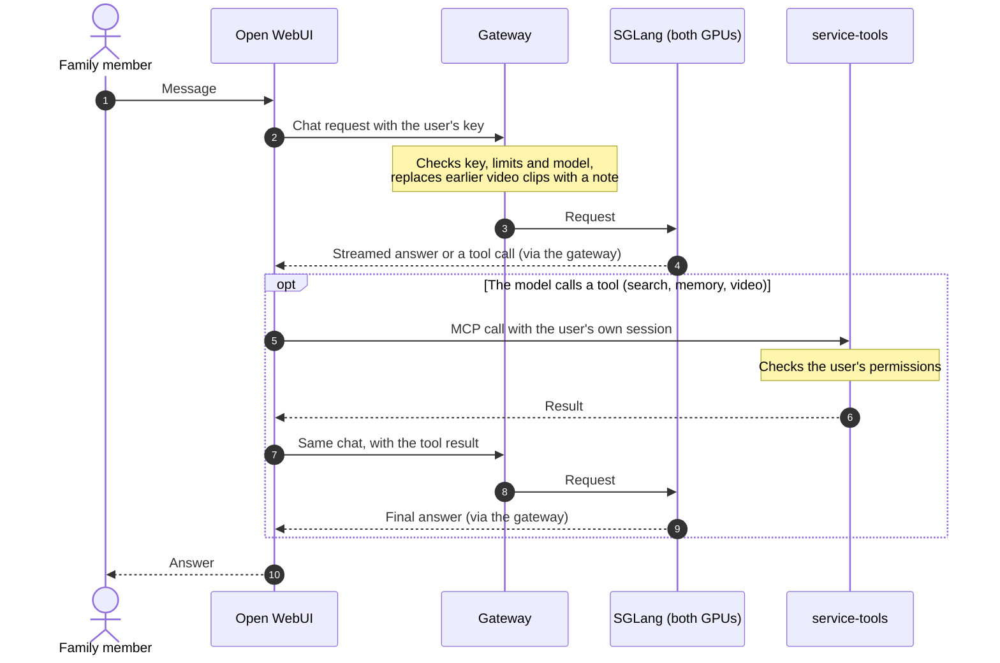
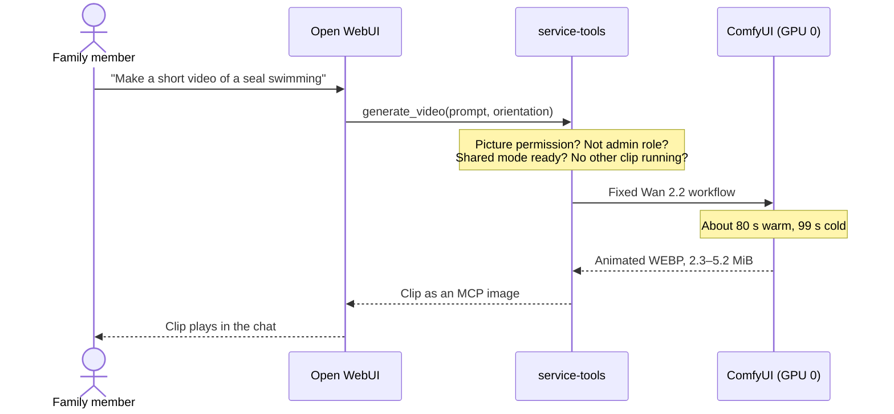

# Family assistant

The family assistant is a private, ChatGPT-style service running on the workstation. In one
Open WebUI chat window, family members can talk to Qwen3.8-27B, make pictures and short
videos, speak instead of typing, search the web and have the assistant remember things.
Nothing leaves the house except web searches and the public pages they read. This page explains what it does, who may do
what, how requests flow, and how it is configured.

It runs in **shared mode** today. [Service modes](MODES.md) explains the alternatives.

<a id="current-delivery-scope"></a>

## What the family can do

| Feature | How to use it | Who |
| --- | --- | --- |
| Chat | Chat with `Qwen3.8-27B-MXFP4`. To change how long it thinks: the **Reasoning effort** slider in the message box (Off, Low, Medium, Max; it starts at Medium). The [ring beside the send button](#context-wheel) shows how full the conversation is; start a new chat when it turns red | Everyone with an account |
| Pictures | Ask for a picture, or use the image button; Qwen-Image makes a 1328×1328 picture in about 65 s (75 s if two are rendering) | Accounts with picture permission (Admin and Parents) |
| Short videos | Ask for a short video; a 5-second clip appears in the chat after about 80 s | Accounts with picture permission and the normal `user` role (the Parents' daily accounts); shared mode only |
| Voice input | The microphone button; speech is transcribed on the workstation | Everyone |
| Web search | Automatic when a question needs current public information (Exa) | Everyone |
| Deep research | Ask it to "research this properly"; a cited report arrives after 2 to 8 minutes, with progress shown under the message ([deep research](#deep-research)) | Everyone with Web Search permission and the normal `user` role; the children confirm first; shared mode only |
| Memory | Ask it to remember something; it recalls it in later chats. Chats in a folder share that folder's memory, so one folder per book or school subject keeps them apart; ask to keep a folder's memory separate from everything else ([chat-folder projects](MEMORY.md#chat-folder-projects)) | Every daily (non-admin) account, private to each person |
| Documents | Upload Markdown or text (up to 8 MiB) to a knowledge collection and ask about it | Everyone, per collection permissions |
| Coding agents | Qwen Code and other IDE agents use the same model through an API key | Accounts given a key; see [coding clients](AGENT-HARNESSES.md) |

**Accounts and groups.** Each person has their own Open WebUI account; sign-up is closed.
Parents are in the `Parents` group and the children in `Family`; everyone can set Reasoning
Effort in Chat Controls. Picture permission is granted per account, to the Admin and Parents
accounts. With [automatic family onboarding](AI-SERVICE.md#automatic-family-onboarding) on, the
two groups also decide who has a gateway key and pictures; nothing else is needed after
creating the account. The tools server (video, memory, search, documents through MCP) refuses every call
from an account with Open WebUI's `admin` role, so the owner uses a daily account for those;
the admin account is for administration and pictures.

## How a request flows

A chat message, including a tool call the model decides to make:



A short video:



If any check fails, the model gets a short error it can explain, such as `video_busy` or
`video_permission_denied`.

## Request paths

| Use | Path | Current boundary |
| --- | --- | --- |
| Conversation | Open WebUI → per-user gateway key → SGLang | Preserve the selected model identity and existing context limits |
| Documents | Open WebUI → CPU Qwen embedding model → embedded Chroma | Preserve document permissions; answer/citation quality remains unqualified |
| Web research | Open WebUI/Qwen Code → shared Exa adapter | Auto search and public-page extraction; one durable request ceiling; Tavily optional |
| Deep research | Open WebUI/Qwen Code → service-tools `deep_research` (MCP) → the shared Exa adapter and the gateway as the calling person | Bounded searches, pages, time and model calls; one run for the whole family at a time; no new egress |
| Memory | Browser and coding clients → service-tools memory tools → Graphiti on Neo4j | Live in the `assistant-memory` experience; per-user memory groups, per chat folder in the browser (the chat ID header, checked with the user's own token); facts are stored only when someone asks |
| Image creation | Open WebUI → service-tools image adapter → ComfyUI on either GPU | Qwen-Image-2512 only; two pictures at once in shared mode (one per GPU), one in split mode |
| Short videos | Open WebUI → service-tools `generate_video` (MCP) → `comfyui-gpu0` | Wan 2.2 T2V A14B; shared mode only; one clip at a time; picture permission |
| Voice input | Browser microphone → Open WebUI → local faster-whisper | CPU transcription on the workstation; audio never leaves it |
| Creative controls | SwarmUI moves to a separate creator mode (planned); family modes no longer run it | No new public ComfyUI port or unauthenticated creative Ingress |
| Spoken answers | Open WebUI browser speech synthesis | Quality and voice availability depend on the browser and operating system |

The family profile adds a common name, four prompt suggestions and an explicit
default model. Signup remains closed. Each person needs a WebUI account and a
mapped gateway key. Image permission remains a separate per-user grant.
Configuration comes from source rather than persisted administrator settings.

The [web-search guide](WEB-SEARCH.md) covers provider-key provisioning, budget
limits, shared coding-client tools and the separate direct Codex OAuth path.
Web results remain temporary prompt evidence; the existing local RAG store and
document permissions remain authoritative. End-to-end search is not yet qualified.

## Deep research

Ask for research ("research this properly", "do a deep dive on…", "compare these carefully")
and the model calls the tool server's `deep_research` tool
([`research.py`](../apps/base/shared-api/research.py)). It plans a few search queries, searches,
reads the pages found, takes short notes from each page and writes a report with numbered
citations `[n]` and a Sources list. Progress appears as status lines under the answer while it
works ("Searching 2 of 3: …", "Reading source 4 of 8: …", "Writing the report from 7 sources").
The model then shows the report.

It is a bounded loop in service-tools, not a new service: search and page reading go through
the same Exa adapter, request ledger and public-URL checks as every other web call, and the
model calls go through the gateway as the person who asked, with their own key.

```mermaid
sequenceDiagram
  actor U as Family member
  participant W as Open WebUI
  participant T as service-tools
  participant E as Exa (shared adapter)
  participant G as Gateway (person's own key)
  U->>W: "Research this properly: …"
  W->>T: deep_research(question, depth)
  Note over T: Web Search permission? Chat ready?<br/>Today's web budget? One run per person,<br/>one for the family at a time
  T->>G: Plan: search queries from the question only
  loop Each query, then each three pages (15 s apart)
    T->>E: Search, then read pages
  end
  loop Each source
    T->>G: Notes from one page (no tools; page text is data)
  end
  T->>G: Report from the notes, citing [n]
  Note over T: Removes citations of unread sources<br/>and foreign links, writes the Sources list
  T-->>W: Status lines during the run, the sources, then the report
  W-->>U: Report with [n] citations and Sources
```

### Bounds

| Depth | Searches | Pages read | Web requests | Run limit | Report |
| --- | --- | --- | --- | --- | --- |
| `quick` | 3 | none: up to 6 search excerpts | 3 | 3 min (1.5 for the report) | 300–500 words |
| `standard` (default) | 3 | up to 8 | 6 | 5.5 min (2.5 for the report) | 500–900 words |
| `deep` | 5 | up to 12 | 9 | 8 min (2.5 for the report) | 800–1,300 words |

- **Web budget.** This feature's provider requests are at least 15 s apart, so it uses at most
  four of the six requests a minute the [shared ledger](WEB-SEARCH.md#limits-and-accounting)
  allows and leaves two for everyone else's searches. If someone else used up the minute, it
  waits for the next one. A run does not start unless the day's remaining requests cover it
  plus ten. A page that cannot be read is replaced by its search excerpt, marked as such.
- **Model time.** One model call at a time per run, on the person's own key (whose limit is
  two at once, so their other chats still work), and one run at a time for the whole family
  (`DEEP_RESEARCH_CONCURRENCY`, 1 or 2; default 1). A call refused with 429 waits 3 s and
  retries: chat goes first. Per step: the plan at effort `low` (at most 2,000 output tokens),
  each source's notes with thinking off (700; the lowest effort if a contract had no thinking
  switch), the report at `medium` (7,000, under the 12,288 cap). Each source contributes at most
  6,000 characters of page text (`WEB_PAGE_CHAR_LIMIT`, its first section) to one notes call and
  at most 1,500 characters of notes to the report; raw pages never reach the report call.
- **Time.** Gathering stops at the run limit minus the report's share; the report call gets
  the rest. If it fails or runs out of time, the notes themselves come back, cited, with the
  Sources list (status `partial`). Every model call is a separate gateway request well inside
  the [time limits](#time-limits). If nothing relevant was found, the tool says so
  (`no_evidence`) and tells the model not to answer from memory as if it had researched.
- **Long tool call.** Open WebUI's MCP transport gives up on a connection that is silent for
  300 s. Clients that accept a streamed answer (Streamable HTTP clients must; checked with the
  `mcp` 2.3.0 client Open WebUI pins) get the result as one Server-Sent Event after comment
  lines every 15 s; others get plain JSON at the end. When the caller goes away (for example
  Stop in the chat), the run is cancelled within 15 s.

Expected time and tokens, **simulated** on 14 November 2026 (not measured on the workstation):
the real loop, request spacing and MCP client (the `mcp` 2.3.0 SDK Open WebUI pins), with a
stand-in model that takes as long as the measured shared-mode rates (prefill 3,600 tokens/s,
decode 86 tokens/s, one stream) for assumed output lengths (plan 450 tokens, notes 200 per
source, report 2,200 / 3,200 / 4,300 including thinking) and Exa answering in 2.5 s (search)
and 4 s (pages). Prompt tokens are a characters/4 estimate.

| Depth | Wall time | Model calls | Prompt tokens | Output tokens | Model time: plan / notes / report |
| --- | --- | --- | --- | --- | --- |
| `quick` | 79 s | 8 | 3,900 | 3,850 | 5 / 15 / 26 s |
| `standard` | 127 s | 10 | 14,100 | 5,250 | 5 / 22 / 37 s |
| `deep` | 188 s | 14 | 20,900 | 7,150 | 5 / 34 / 50 s |

Web pacing dominates; the model is busy for about half the run, one stream at a time. Add the
chat model's own turn that shows the report (about 1,000–2,000 output tokens, 15–25 s). With
other people chatting, decode per stream is slower and runs take longer; the run limits leave
about 2.3–2.6 times these figures.

### Who can use it

Everyone whose effective Open WebUI permissions include **Web Search** (checked with their own
token on `/api/v1/users/permissions`, per call), with the normal `user` role: the tool server
refuses admin accounts, as for its other tools. Accounts that Open WebUI asks to confirm a web
search ([per group](#web-search-confirmation-per-group): the children) get one step first. The
first call searches nothing and returns what the run would do ("up to 5 web searches and 12
pages, about 7 minutes. Start?") with a one-time code; the model asks the person, and only a
second call with that code, from the same account within 15 minutes, runs the question and
depth that were shown. Like the browser dialog it mirrors, this is a prompt to think, enforced
only as far as the model follows it; the access control is the Web Search permission. A stronger
form would be MCP elicitation, which Open WebUI 0.13.3 shows as a dialog, but it needs the tool
server to speak MCP 2025-06-18 instead of 2025-03-26 (a change for every client), so it is not
used. For those accounts the report is also written for a young reader, without graphic or
sexual detail.

It is on in shared mode (`DEEP_RESEARCH_ENABLED` in
[`apps/overlays/assistant-shared`](../apps/overlays/assistant-shared/kustomization.yaml)), which
the family uses; the large and split compositions do not set it. There is no separate per-group
switch: Open WebUI's group permissions are a fixed set, so the Web Search permission decides.
To turn it off, remove the variable and deploy; the tool disappears from the list.

### Safety

- **Page text is data.** Queries are planned from the question alone, before any page is read,
  so a page cannot choose a search term or a URL; pages are only those the search returned.
  Each page goes to its own notes call between random markers, as untrusted data whose
  instructions are never to be followed. No model call in the loop is offered any tool, so a
  page cannot make it call one. The report call sees only the notes, again marked untrusted.
  The tool result tells the chat model the report is evidence, never instructions
  (`content_trust: untrusted-source-text`).
- **No invented sources.** The report may cite only the numbered sources that were read.
  Other numbers, markdown links and bare URLs are removed (counted as `citations_removed` and
  `links_removed`) and any list of sources the model wrote is cut; the Sources list is written
  by service-tools from what it actually read, with each page's site, publication and retrieval
  dates, "search excerpt only" where applicable and "not cited" for sources the report did not
  use. Whether a cited source supports its sentence is the model's work and is not checked.
- **Nothing new leaves the house.** The same provider and ledger as other web calls. Only the
  planned queries are sent (if planning fails, the question's first 200 characters become the
  one query), each checked by the adapter's private-material filter. Model calls stay on the
  workstation.
- **Progress and sources in the chat** are posted with the person's own session token to their
  own message (`/api/v1/chats/{id}/messages/{id}/event`; Open WebUI forwards the chat and
  message ids because `ENABLE_FORWARD_USER_INFO_HEADERS` is on). Open WebUI checks that the
  chat is theirs. Nothing is stored except the 15-minute confirmation codes, in memory.

Each tool call is counted in `workstation_assistant_deep_research_total` by outcome; its web
requests also count in `workstation_assistant_web_requests_total`. `/health` reports runs in
progress. The tool definition adds about 250 tokens to every chat that carries the tool server
(a characters/4 estimate, not measured with the served tokenizer).

### Why a tool and not Open WebUI sub-agents

Open WebUI 0.13.3 has native sub-agents (`ENABLE_SUBAGENTS`, a `delegate_task` tool, background
runs) and skills. They were not used: background sub-agents get no tool servers (so no
`read_web_page`), every sub-agent is a full chat loop that resends its tool definitions on every
step, raw pages land in its context, the number of searches and pages is up to the model, the
limits (`SUBAGENTS_MAX_CONCURRENT`, `_MAX_ASYNC`) are global rather than per person, and the
default sub-agent prompt is written for coding work in a workspace. Open WebUI shows MCP tool progress
only through the status events above (its MCP client ignores progress notifications), so the
tool posts them itself.

### Rollout and acceptance

The code ships in the `gateway-runtime` ConfigMap; no image changes. After the merge, render
the shared composition as usual ([service modes](MODES.md#switch-modes)), diff it against the
running objects as for any rollout (pod resources included), and apply: service-tools restarts with `research.py` and
`DEEP_RESEARCH_ENABLED=true`, and Open WebUI restarts for the API-key allowlist entry
`/api/v1/users/permissions` and the tool server description. A restart of service-tools ends a research
run in progress; the person sees an error and can ask again.

Acceptance, on a Parents daily account with the Workstation tools on:

1. "Research properly: how efficient are home heat pumps below −10 °C, and what helps?" (standard).
2. "Do a deep dive: what changed in the EU's right-to-repair rules for phones in 2025 and 2026?" (deep).
3. "Quick research: what are the current recommendations for children's screen time?" (quick).

For each: status lines appear while it runs; the report has `[n]` citations and a Sources list;
every Sources URL opens the page it names; spot-check three cited sentences against their
pages; note the time and the `tokens`, `provider_requests` and `citations_removed` in the tool
result. Then, on a child's account, check that the first call asks before anything is searched
and that declining searches nothing. While a run is in progress, check that another person's
chat still answers and that a second research request is refused as busy.

## Private coding sandbox (candidate, off by default)

`service render --sandbox-config /private/sandbox.json` adds native Open Terminal
support in coder (large) and family (shared) mode. It writes a separate `sandbox.yaml`; every
Deployment in it starts at zero replicas. Omitting the flag pins an empty
`TERMINAL_SERVER_CONNECTIONS` list, including when persistent WebUI settings exist.
This candidate is not a qualified live service.

The integration uses Open Terminal 0.17.9 and Terminals 0.3.3, pinned by commit in
`infrastructure/ai-stack/stack.lock`. The WebUI fork at `21bc3e3` uses the 0.3
policy API (`/p/sandbox`, `terminal_id`, `/files/cwd` and native OpenAPI tools).
Terminals 0.4 changes that API and must not replace this pin independently.
The Jupyter engine takes one server URL and credentials; it does not provision
isolated user pods. A shared Jupyter or shared Open Terminal process therefore
does not meet this deployment's isolation requirement. A separate Playwright MCP
server is unnecessary: the native command tool can run the installed Playwright
Chromium, and native file tools return its screenshots to the model.

### Who gets what

| Account | Acts as | Egress policy | Home |
| --- | --- | --- | --- |
| WebUI admin role (the admin account is in no group) | Admin | `parents` | Persistent if mapped, else disposable |
| Member of Parents only | Parents | `parents` | Same |
| Member of Family only (the children), with `family_enabled: true` | Family | `family` | Same |
| Member of **both** Parents and Family (the owner's daily account) | Parents with `most-permissive`; Family with `most-restrictive` | Follows the group | Same |
| Anyone else, or Family with `family_enabled: false` | No access | | |

**Group resolution is explicit.** `sandbox.json` must state `family_enabled` and
`group_resolution`; neither has a default. The owner's setting is
`most-permissive` (Admin, then Parents, then Family). It matches how Open WebUI
combines group permissions, which the web search confirmation setting already
relies on. With it the owner's daily account, which is in both groups so that it
sees the children's presets, gets the Parents policy. `most-restrictive` restores
the earlier rule that a Family membership wins; under it the owner's daily
account would get the children's filtered policy.

The homes mapping can name an account's group. An entry's `group` then replaces
the rule for that account, but it only chooses among groups the account holds
in WebUI at that moment. A mapping that names a group the account lacks denies
access; it never grants a wider policy. Map the admin account as `Admin`.

Per-user isolation, resource limits and the idle and lifetime teardown are the
same for every group. The models' content filtering for children is unchanged.
Disabling access does not interrupt a command already running; teardown remains
the backstop. No model grants, gateway keys or cybersecurity-model permissions
change.

### Configuration

Replace the digests and group IDs with owner-verified values. These are
identifiers, not credentials.

```json
{
  "image": "registry.lan.thespry.family/local/assistant-sandbox@sha256:DIGEST_FROM_SIGNED_BUILD",
  "egress_image": "registry.lan.thespry.family/local/sandbox-egress@sha256:DIGEST_FROM_SIGNED_BUILD",
  "parents_group_id": "PARENTS_GROUP_UUID",
  "family_group_id": "FAMILY_GROUP_UUID",
  "family_enabled": true,
  "group_resolution": "most-permissive",
  "egress_service_ips": {"family": "10.43.0.201", "parents": "10.43.0.202"},
  "api_server_cidr": "192.168.30.11/32",
  "api_server_port": 6443,
  "homes": "/home/OWNER/ai-stack/private/sandbox-users.json",
  "family_dns": ["1.1.1.3", "1.0.0.3"]
}
```

`egress_service_ips` are two unused addresses in the cluster's service range, one
per egress policy. Workspaces have no DNS, so they reach their proxy by address;
the render fixes each proxy Service to its address. Choose them from the low end
of the range, which Kubernetes keeps for fixed assignments
(`kubectl get svc -A` shows the addresses in use). `homes` is optional.
`family_dns` is optional: one to four public resolvers that filter for
children; the default is shown.

### Isolation and lifecycle

The upstream orchestrator creates one pod per authenticated user. Chats for that
user share a workspace. Each pod runs as the image's non-login `sandbox`
account, UID/GID 2002 (`SANDBOX_UID` in `lib/workstation/sandbox.py`), from a
read-only image with no service-account token, host mounts or GPU, dropped
capabilities, no privilege escalation and RuntimeDefault seccomp. The account is
never 1000: on the NAS and the workstation that is the owner's admin login, and
the NAS squashes every home write to the sandbox account, so those files would
belong to the owner. 1001 is left for the next person's login; 2000 and 2001 are
the NAS's `k8s-nfs` and `zot-registry` accounts. The controller runs from the
same image as the same account; it mounts no home. Fifteen idle minutes stop and
delete the pod; a two-hour maximum lifetime also ends active work. Background
processes end with the pod.

The trusted controller has a service account restricted to pods, services and
per-workspace API-key Secrets in `assistant-sandbox`. It has no rights on
volume claims. These credentials never enter a workspace. A workspace's own
terminal key grants access only to that workspace. A small ASGI gate checks the
caller's WebUI session, exact user ID and current groups before forwarding to
the native orchestrator. WebUI always asks for the policy named `sandbox`; the
gate replaces it with the account's own policy, so a caller cannot name another
account's home or another group's egress policy. It exposes no policy administration
API. Static tool discovery starts no pod. WebSocket sessions reauthenticate by
reconnecting after at most 60 seconds.

### Files

Each workspace has two volumes:

| Path | Volume | Lifetime |
| --- | --- | --- |
| `/home/user` | The account's claim `sandbox-home-<name>` when the account is in the homes mapping; otherwise a 2 GiB `emptyDir` | A claim outlives every workspace. An `emptyDir` is deleted at teardown |
| `/tmp` (also `TMPDIR`, pip and npm caches) | A 2 GiB `emptyDir` | Deleted at teardown, always |

The homes are NAS datasets, one per user, rendered and applied separately
(see [sandbox homes](HOME-LAB.md#sandbox-homes-per-user-nas-volumes)). The mapping
file lists `webui_user_id`, `name`, `group` and an optional `quota` per user;
`lib/workstation/sandbox_homes.py` reads it. The NAS enforces the quota. The
workspace pod mounts the claim through the node's NFS driver; the workspace's
own network rules do not apply to that mount, and the workspace gains no route
to the NAS. Apply the sandbox bundle first (namespace and quota), then the homes
render. The quota allows 32 claims, the mapping's maximum, and the controller
cannot create one.

An account without a mapping entry still gets a workspace, with a disposable
home, as before. Access is decided by group membership alone; refusing unmapped
accounts would make a group change wait for a storage change. Tell users whose
home is disposable to download wanted files before teardown. Automatic family
onboarding does not create homes; its status lists the members still without
one (`homes_needed`).

A persistent home also keeps whatever a prompt-injected command wrote there,
including shell start-up files. A later workspace starts with those files.
Treat a home as untrusted input, and delete the dataset's contents to reset it.

### Network

The namespace has default-deny policies. Only the controller can open
connections to workspace port 8000. A workspace can open connections to one
place: the egress proxy for its group, on port 4750. It has no DNS, no route to
the node, cluster services, other workspaces, the other group's proxy, the LAN
or the Internet. Chromium and local web servers communicate inside the pod
(`NO_PROXY=localhost,127.0.0.1`). The controller alone can reach WebUI, DNS and
the exact configured API endpoint. There is no public Ingress, NodePort or
browser-debugging listener.

**Egress is open, with blocklists.** A workspace may reach any public host on TCP
80 and 443 through its proxy. An allowlist is not used: it could not keep up
with the registries and documentation of every language in use.
Each group has its own proxy Deployment, `sandbox-egress-parents` and
`sandbox-egress-family`. Which one a workspace gets is decided by which proxy
the NetworkPolicy lets its pod reach, from a label the gate's policy sets.
Nothing the workspace sends can select the other. Workspaces receive
`HTTP_PROXY`, `HTTPS_PROXY` and their lower-case forms.

| | Parents and Admin | Family |
| --- | --- | --- |
| Public hosts | Any, on TCP 80 and 443 | Any, on TCP 80 and 443 |
| Owner's blocklist | `policies.parents.blocked` | `policies.family.blocked` |
| Maintained public blocklists | None | Adult content, gambling, and VPN, proxy and DNS-bypass services (about 100,000 domains) |
| Name resolution | The cluster's DNS | Family-filtering resolvers only; a filtered name is refused |
| Address literals (`https://203.0.113.9/`) | Allowed if public | Refused: no name filter can judge an address |
| Private, LAN, cluster, loopback, link-local, carrier-NAT addresses | Refused | Refused |

The owner's blocklists are in
[`infrastructure/service/sandbox-egress.json`](../infrastructure/service/sandbox-egress.json).
Both start empty. Add a domain to block it and its subdomains for that group;
the change is a reviewed repository change followed by a render and a restart
of that proxy. The file cannot give the Family group the unfiltered policy.

The proxy is [Smokescreen](https://github.com/stripe/smokescreen) (MIT) used as
a library, built by the `egress` pipeline stage with
`infrastructure/ai-stack/egress/main.go`. Open egress keeps every address
protection:

- After resolving a name the proxy refuses private, loopback, link-local,
  carrier-NAT and IPv4-embedding addresses, and the ranges the render passes
  explicitly (`192.168.0.0/16`, `10.0.0.0/8` which holds the pod and service
  ranges, `172.16.0.0/12`, `169.254.0.0/16`, `100.64.0.0/10`, `127.0.0.0/8`).
  It connects to the address it checked, so a name that changes its answer
  cannot redirect the connection.
- The proxy pods' own NetworkPolicy allows DNS and public addresses on TCP 80
  and 443 only, with the same private ranges excepted. The address check does
  not rest on the proxy alone, and no other port is reachable.
- It logs one line per request with the group, the domain and `allow` or
  `deny`. It does not log paths, queries, headers, client addresses, sizes or
  content, and it does not terminate TLS. Requests for its status page (below)
  are not logged. Alloy scrapes
  `workstation_sandbox_egress_requests_total{group,decision}`; domains stay in
  the pod log.
- Each proxy serves at most 256 requests and tunnels at once and 100 new
  requests a second. These bounds are for the whole proxy, shared by the
  workspaces behind it; Smokescreen has no per-client limit.

**Refusals are a plain 403** with one short reason in the body and in the
`X-Sandbox-Blocked` header: `blocked by the family filter`,
`blocked by the sandbox blocklist`, `private address` or
`address literals are not allowed for this group`. `curl` and other HTTP
clients show it. Chromium does not show a proxy's reply to a refused HTTPS
tunnel; it reports `ERR_TUNNEL_CONNECTION_FAILED`. A name that does not exist
gets a 502.

**Why a site failed.** The proxy keeps each workspace's recent refusals and
serves them at `http://sandbox-egress.invalid/blocked`, a name it answers
itself (`.invalid` never resolves, so no real site is shadowed). A workspace
reaches it through its proxy settings, for example `curl -s
http://sandbox-egress.invalid/blocked`; `?host=NAME` asks about one site. The
answer is JSON: `blocked` lists `host`, `reason` and `seconds_ago`, newest
first. Over HTTPS (CONNECT) the page is refused, because the proxy terminates
no TLS. Refusals themselves are unchanged: the same 403, header and body.

The workspace's command and browser tools add the reason to their own results.
[`terminal.py`](../infrastructure/ai-stack/sandbox/terminal.py) wraps Open
Terminal. It reads the JSON results of `run_command`, `get_process_status`,
`browser_action` and `browser_snapshot`. When one contains a failed-tunnel
error, it asks the status page and adds a `sandbox_egress` object to the
result. The errors are Chromium's `ERR_TUNNEL_CONNECTION_FAILED`, curl's
`CONNECT tunnel failed, response 403`, Python's
`Tunnel connection failed: 403`, wget's `Proxy tunneling failed: Forbidden`,
Node's fetch (undici) `Proxy response (403) !== 200 when HTTP Tunneling` and
Node's core https client
`Failed to establish tunnel to HOST via PROXY: HTTP/1.1 403 Forbidden`.

- If the call or its result names a refused host as a whole name (in the
  decoded JSON text, so a host at the start of an output line counts), the object
  lists it under `refused`. Its note says this is the sandbox's policy and
  that retrying will not help.
- Otherwise it lists refusals from the last minute under `possibly_related`.
  Chromium's error also covers a name that does not exist (a 502), so the
  note does not blame them.
- With no refusal on record, the note says the failure is something else.

Other results pass through unchanged.

*Privacy.* The proxy identifies a workspace by the source address of its
connections, which is its pod's address: one pod per account, and each group's
proxy only accepts its own group's workspaces. The page lists only refusals
from the asking address, so a child's workspace never sees another account's
names. Entries hold the logged domain and the short reason, never a path,
query or header. They live in the proxy's memory only: at most 20 per
workspace and 256 workspaces. An entry is dropped once it is 5 minutes old, at
the next refusal or status request or the proxy's sweep each minute. A proxy
restart clears them all.
Requests for the page are neither logged nor counted. Two assumptions hold
this boundary. First, traffic from a pod to the proxy's ClusterIP Service keeps
the pod's address; kube-proxy masquerades only traffic from outside the pod
range and a pod reaching itself. If it did not, every workspace of a group
would share one address. The live probe below checks this. Second, a pod
address is not reused within the 5 minutes: K3s's `host-local` IP allocation
hands out the next free address in turn, so an address returns only after the
node's pod range has cycled. This is not checked live.

**The family filter** has two independent parts.

1. *Filtering DNS.* The family proxy resolves names only through the resolvers
   in `family_dns`, by default Cloudflare for Families (`1.1.1.3`, `1.0.0.3`),
   which blocks malware and adult content. Its NetworkPolicy allows port 53 to
   those addresses and not to the cluster's DNS. Smokescreen does its own
   resolving, so the workspace never asks a resolver. A blocked name comes back
   as `0.0.0.0`, which the proxy refuses like any non-public address and
   reports as the family filter. If the workstation's network is itself under a
   UniFi content filter, the gateway may intercept these queries and answer
   them itself; the result is still a filtered answer.
2. *Maintained blocklists.* Three public lists are baked into the proxy image at
   pinned commits and reread from their maintainers once a day:

   | List | Source | Licence | Entries | Updated |
   | --- | --- | --- | ---: | --- |
   | `nsfw` | HaGeZi DNS Blocklists, NSFW | GPL-3.0 | 78,550 | Several times a day |
   | `bypass` | HaGeZi DNS Blocklists, DoH/VPN/Tor/proxy bypass | GPL-3.0 | 16,525 | Several times a day |
   | `gambling` | StevenBlack hosts, gambling extension | MIT | 6,744 | About weekly |

   A listed domain blocks its subdomains. The proxy holds the lists as a set and
   checks each label suffix of the requested host, so a request costs a few
   map lookups whatever the list size. Smokescreen's own deny list is a slice
   of globs scanned per request and was not used.

Alternatives considered for the adult-content list:

| List | Entries | Size | Licence | Note |
| --- | ---: | ---: | --- | --- |
| HaGeZi NSFW (chosen) | 78,550 | 1.3 MB | GPL-3.0 | Domain-and-subdomain syntax; frequent updates |
| OISD NSFW | 487,797 | 8.6 MB | GPL-3.0 | Hourly; six times the memory for the same purpose |
| StevenBlack porn extension | 76,811 | 2.0 MB | MIT | Hosts format: exact hosts, not domains |
| Block List Project porn | 953,393 | 18.5 MB | MIT | Last modified in July 2026 |

HaGeZi's gambling list has 656,152 entries (11.6 MB); the StevenBlack gambling
extension was chosen for its size. The DNS filter does not cover gambling.

*How the lists stay current.* The pins are in
[`infrastructure/ai-stack/egress/blocklists.json`](../infrastructure/ai-stack/egress/blocklists.json):
for each list a commit-pinned address, its SHA-256, size, entry count and date,
and the address the maintainer updates. The `egress` stage downloads the pinned
copies, stops on any size or checksum difference, and bakes them into the
image. The running family proxy then rereads each list from its maintainer 30
seconds after start and every 24 hours. A new copy replaces the one in use only
if it was fetched over HTTPS from a public address without a redirect, is under
32 MiB, and holds between half and four times the baked number of entries.
Otherwise the list in use stays, and
`workstation_sandbox_egress_blocklist_refresh_failures_total` counts the
failure. `..._blocklist_refreshed_timestamp_seconds` is 0 while a list is still
the baked copy.

The refresh runs inside the proxy rather than as a CronJob. A separate job would
need its own pod, image and quota share, and a NetworkPolicy cannot name
`raw.githubusercontent.com`, so the job would hold general HTTPS egress. The
proxy already holds exactly that egress and nothing else, so the refresh adds
no new route. The baked copies mean a proxy that cannot reach the list host
still starts with a complete, recent list. Rebuild the image to move the baked
copies; move the pins as `blocklists.json` describes.

*What the family filter does not do.* It judges names, not pages. A site that is
on neither list and not in the resolver's categories is reachable, and so is
any content on a general site (search engines, video sites, forums, GitHub).
New proxy and VPN sites appear faster than lists. The models' own content
filtering for children is separate and unchanged.

**UniFi content filtering** was assessed from Ubiquiti's documentation only. It
is DNS-based: the gateway redirects DNS traffic from the networks or client
devices a policy names and answers it from its filter. It could cover the
children's sandbox traffic only by covering the workstation, because every
pod's traffic leaves with the workstation's address. That would also filter
the adults' workspaces, WebUI's web search and the host. To apply it to the
children's proxy alone, that proxy would need its own identity on the network:
a second interface on a filtered VLAN (Multus with a macvlan attachment), or a
host source-NAT rule to a second address that UniFi treats as a separate
client. Both add a network component to maintain for a result the proxy's own
filter already gives, scoped exactly to the Family group. It is not
recommended. If the same category engine is wanted, set `family_dns` to the
resolvers of the filtering service of choice.

**Threat model with open egress.** Code in a workspace can fetch and run
anything public, including package install scripts, and can send anything it
can read to any public host. What it can read is the user's own workspace and
home. Prompt injection from a fetched page or package is therefore the main
residual risk: it can copy out or destroy that user's files. It gains no
credentials, because none are in a workspace: no service keys, no Kubernetes
identity, no family storage beyond the home, and no route to the LAN, the
node or the cluster. Do not put secrets in a workspace or a home. Chromium runs
headless with its inner sandbox disabled because this image uses the
pod/container security boundary; it is not a second isolation boundary.
Kernel/container escapes remain a shared-host risk.

### Capacity by mode

The pool is two workspace pods, the controller and two proxies, bounded by a
namespace quota. Requests sit at measured use and limits carry the headroom,
as for every workload here except the GPU pods, so the pods are Burstable:

| Pod | Requests (CPU, memory) | Limits (CPU, memory) | Measured, scratch K3s, 14 November |
| --- | --- | --- | --- |
| Workspace (each of two) | 250m, 256 MiB | 2, 4 GiB | 45 to 53 MiB idle; 239 MiB peak running pip, npm and a headless Chromium page |
| Controller | 100m, 192 MiB | 500m, 512 MiB | 135 MB |
| Proxy (each of two) | 50m, 64 MiB | 250m, 128 MiB | Family 36 to 38 MiB with its lists; Parents 11 MiB |
| **Pool** | **0.7 CPUs, 832 MiB** | **5 CPUs, 8,960 MiB** | |

Ephemeral storage is requested at its limit (2 GiB per workspace). The planner
holds the pool's requests even when no workspace runs. Under node memory
pressure Kubernetes evicts Burstable pods that exceed their requests before
Guaranteed ones, so a busy workspace goes before SGLang or a picture
generator. That is the intended priority: a mapped user's home is on the NAS
and only the running session is lost. The measurement is one short tool run; a
long Chromium session or a build will use more than its request, within the
4 GiB limit. The owner set that limit: there are at most six accounts and two
workspace slots, and the memory above the request is overcommitted, not held.

`service plan` counts what K3s admits on: resource **requests**. It reports the
limits beside them, and a plan whose limits sum past the node has the status
`planned-limits-overcommitted`. Give it the node's pod list
(`--node-pods`, from `kubectl get pods -A -o json`) to count the cluster's own
pods, which the offline render cannot know.

The earlier planner and the live session admission disagreed about family mode
for these reasons:

| Difference | Earlier planner | Live admission (`session.sh`) | Now |
| --- | --- | --- | --- |
| Service pods (WebUI, gateway, database, tools, memory) | Limits: 43.5 CPUs, 55.5 GiB for the applications | Requests: 36.1 CPUs, 45.5 GiB | Requests for fit; limits reported |
| SGLang's 16 GiB memory-backed `/dev/shm` on a 14 GiB pod | Refused the plan outright | Not counted; it is charged inside the pod's 14 GiB | Counted inside the pod limit |
| Telemetry | The whole observability source at its limits (10.75 CPUs) and the full reserve (6,656 MiB) | The telemetry pods that run (0.55 CPUs, 704 MiB requested) | Requests of the rendered telemetry pods; the reserve stays on the limit side |
| Cluster services, GPU operator, NFS driver, host collectors | Not counted | 1.2 CPUs, 2.5 GiB requested | Counted with `--node-pods` |
| Alertmanager (zero replicas) | Counted at its limit | Not running | Counted at its request |
| Picture generators and the game | Counted only in the mode that runs them | Same | Unchanged |

Measured on 14 November in family mode: 37.9 of 42 CPUs and 49.9 of 51.3 GiB
requested. The planner now gives the same figures, less Alertmanager's 0.1 CPU
and 128 MiB.

Remaining by requests at 42 CPUs and 51,333 MiB allocatable, with the cluster's
own pods counted, and how far the limits sum past the node:

| Mode and composition | Without the pool | With the pool | Limits past the node, with the pool |
| --- | --- | --- | --- |
| Coder (large), assistant | 21.5 CPUs, 26,308 MiB | 20.8 CPUs, 25,476 MiB | None |
| Coder (large), assistant with memory | 20.0 CPUs, 21,828 MiB | 19.3 CPUs, 20,996 MiB | 891 MiB |
| Family (shared), assistant | 5.5 CPUs, 8,900 MiB | 4.8 CPUs, 8,068 MiB | 2 CPUs, 9,083 MiB |
| Family (shared), assistant with memory (what runs today) | 4.0 CPUs, 4,420 MiB | 3.3 CPUs, 3,588 MiB | 9 CPUs, 18,299 MiB |

**Family mode: the pool fits on requests.** With the pool, family mode keeps
3.3 CPUs and 3,588 MiB unrequested (comfyui-gpu1 at its measured 9 GiB since 14 Nov; it was 516 MiB at 12 GiB). The render accepts `--sandbox-config` in
shared mode, and `workstationctl mode family` passes `MODE_SANDBOX_CONFIG` as
coder mode does. No other workload's budget changed. The margin
rests on overcommit: without the pool family mode's limits already sum 9.1 GiB
and 4 CPUs past the node, and its requests sit 1.5 GiB inside the 6,656 MiB
telemetry reserve. Both are visible in `capacity.json`
(`limits`, `remaining_mib_after_telemetry_reserve`). If two workspaces work
hard while both picture generators are busy, the workspaces are throttled and,
if memory runs short, evicted first.

Switching modes while workspaces run counts their requests (256 MiB each)
against the session admission. During a rollout of the controller or a proxy,
the quota can refuse a new workspace for the few seconds the old pod takes to
stop; the next request succeeds.

### Images and metrics

The `sandbox` and `egress` pipeline stages build from pinned source commits, run
offline smoke tests and scan with the existing Trivy policy and empty exception
lists. `AI_STACK_PUSH=1` then uses the existing signing, SBOM attestation and
signature verification path. Supply the resulting digests to the render; tags
alone are refused.

The egress stage runs the proxy's unit tests, then a smoke test for each group
with no network at all. For the Family group a stand-in resolver answers
`0.0.0.0` for one name; the test requires the family-filter refusal for that
name and for names on the baked lists, the private-address refusal for names
that resolve to LAN, cluster and loopback addresses, and an open path for
everything else. It reads the status page, which must list the refused names
with their reasons and must not count as a request. It then checks that the
proxy's whole output holds only group, domain and decision.

Open Terminal is MIT; Terminals has the Open WebUI Enterprise licence with a
personal, non-commercial-use exception. This image is for the owner's family
installation; organizational deployment needs a separate licence review.
Playwright is Apache 2.0; Smokescreen is MIT. The baked HaGeZi lists are GPL-3.0
and the StevenBlack list is MIT; their headers stay in the files. Chromium and
OS/Python/Node/Go dependencies retain their own licences. The images carry the upstream licence
texts and the pipeline produces SBOMs.

Alloy scrapes `workstation_sandbox_executions_total{group="Admin|Parents|Family"}`
from the controller. It counts authorized native command attempts, including
attempts that fail; counters reset on controller restart. The kubelet collector
retains CPU, memory and throttling metrics for the sandbox namespace. Application
and access logging are disabled in the controller and workspaces: no code,
output, tokens or user IDs are emitted to the telemetry path.

### Owner rollout after merge and qualification

1. Merge and apply the storage work first: the NAS datasets and the homes
   mapping ([sandbox homes](HOME-LAB.md#sandbox-homes-per-user-nas-volumes)).
2. Run `AI_STACK_PUSH=1 bash infrastructure/ai-stack/build-stage.sh sandbox` and
   the same for `egress` on the build host, or accept the digests recorded in
   `versions.lock`. Keep the scan, SBOM, signature verification and
   `image.digest`.
3. Write `sandbox.json`: both digests, the group UUIDs, `family_enabled`,
   `group_resolution`, two free service addresses, the API endpoint, the
   homes mapping path and, if not Cloudflare for Families, `family_dns`.
4. Render the assistant in coder and family mode with `--sandbox-config`, and run
   `service plan` with fresh node resource and telemetry evidence and
   `--node-pods`. Inspect `workloads.yaml` and `sandbox.yaml`.
5. Apply the sandbox bundle through the owner's normal deployment process, then
   the homes render. Apply the bundle's `Namespace` first: until it exists, a
   server-side dry run or `kubectl diff` of the rest of the bundle and of the
   home claims fails. Scale the two proxies and the controller to one replica.
   Set `MODE_SANDBOX_CONFIG` to preserve the config in coder-mode and
   family-mode renders. The mode command does not apply the separate namespace
   bundle.
6. Roll out the rendered WebUI configuration. Select **Private coding workspace**
   in a native-tool-capable chat. Ask it to write a small HTML game, install a
   package, serve the game on loopback, run Playwright, inspect the screenshot
   and describe the result. Check Admin, Parents and Family from separate
   accounts, that a child's account is refused an adult site, and that a file
   in a mapped home survives a teardown.
7. Run the network probe in a live workspace of each group (below).
8. Re-render and apply telemetry from the same source. The controller and proxy
   scrape targets and the kubelet collector's `assistant-sandbox` namespace
   filter are part of the telemetry render; a telemetry render made before the
   sandbox merged has neither, and the sandbox metrics above stay empty.

For rollback, omit `--sandbox-config` (and unset `MODE_SANDBOX_CONFIG`), roll out
the resulting WebUI config, and let the controller reap workspaces before
scaling it and the proxies to zero. Homes are untouched by a rollback; their
volumes are retained even if a claim is deleted.

### Network probe

[`tests/workstation/probe_sandbox_network.py`](../tests/workstation/probe_sandbox_network.py)
runs inside a workspace. It tries direct connections that must fail, asks a
resolver that must not answer, and sends CONNECT requests through the proxy.
It exits 1 on any surprise. On the live cluster, with a workspace pod of a
Family account running, substitute the proxy addresses from `sandbox.json`:

```sh
kubectl -n assistant-sandbox exec -i POD -- python -I - '{
  "closed": {"node API": ["192.168.30.11", 6443], "node kubelet": ["192.168.30.11", 10250],
             "kubernetes service": ["10.43.0.1", 443], "DNS service": ["10.43.0.10", 53],
             "family resolver": ["1.1.1.3", 53], "NAS": ["192.168.30.10", 2049],
             "LAN": ["192.168.1.40", 22], "Internet": ["1.1.1.1", 443],
             "parents proxy": ["10.43.0.202", 4750]},
  "open": {"own proxy": ["10.43.0.201", 4750]},
  "dns": "10.43.0.10",
  "allowed": ["pypi.org", "docs.python.org", "github.com"],
  "denied": ["nudity.testcategory.com", "192.168.1.40.nip.io:22", "192.168.1.40:22",
             "10.43.0.1", "1.1.1.1"]}' < tests/workstation/probe_sandbox_network.py
```

Every denial answered with a 403 must also appear, with its reason, on the
workspace's status page. The probe reports whether the page was readable; an
unreadable page fails every status row. To check that one workspace never sees another's
refusals, run the probe in a second account's workspace of the same group with
`"unlisted": ["NAME"]`, where `NAME` is a refused name only the first workspace
tried in the last five minutes.

`nudity.testcategory.com` is Cloudflare's test name for its adult category and
is on none of the lists, so it checks the DNS filter alone. Add a name from the
`nsfw` list to check the lists. `192.168.1.40.nip.io` is a public name that
resolves to that LAN address. Add a second user's workspace pod address under
`closed` to check cross-user denial. For a Parents workspace swap the two proxy
addresses, move `1.1.1.1` and `nudity.testcategory.com` to `allowed`, and keep
the private names and addresses under `denied`.

### 2026-11-14 evidence

**Scratch cluster.** K3s v1.37.2+k3s1, the live release, in a throwaway QEMU
virtual machine on the workstation with user-mode networking. Rootless Podman
could not host K3s: the user session has no delegated `cpuset` controller. The
rendered bundle was applied unchanged except for image references (local tags
in place of digests). Workspace pods were built by hand from the rendered
policies. Names that resolve to private addresses were public `nip.io` and
`localtest.me` names, and for the Parents proxy also names from a CoreDNS stub.

| Check | Result |
| --- | --- |
| From each workspace, direct: node API, kubelet and SSH; `kubernetes` ClusterIP; DNS service and CoreDNS pod (UDP and TCP); the family resolver; LAN host; VM gateway; `1.1.1.1`; controller pod and service; other user's workspace; an unrestricted pod; the other group's proxy; its own proxy's metrics port | All closed (18 targets per workspace). Name resolution fails |
| The same node, ClusterIP, DNS, LAN and Internet targets from a pod with no policy | All open, so the denials are the policies' |
| Parents workspace through its proxy | `registry.terraform.io`, `releases.hashicorp.com`, `galaxy.ansible.com`, `repo.maven.apache.org`, `plugins.gradle.org`, `crates.io`, `kotlinlang.org`, `github.com`, `example.com`, a public address literal: tunnel. Terraform registry, Maven Central, Ansible Galaxy and the crates index answered 200 to `curl` |
| Family workspace through its proxy | `pypi.org`, `registry.npmjs.org`, `docs.python.org`, `github.com`, `en.wikipedia.org`, `scratch.mit.edu`, `www.bbc.co.uk`: tunnel |
| Family: a site on the `nsfw` list and its `www` subdomain; a VPN service on the `bypass` list; a site on the `gambling` list | Refused, 403 `blocked by the family filter` |
| Family: `nudity.testcategory.com` and `malware.testcategory.com`, on no list, filtered only by the resolver | Refused, 403 `blocked by the family filter`. The Parents proxy tunnels the first |
| Family: public and private address literals | Refused, 403 `address literals are not allowed for this group` |
| Both groups: public names resolving to the LAN, the node, a ClusterIP, the gateway, loopback and `169.254.169.254`; private literals (Parents) | Refused, 403 `private address` |
| Both groups: cluster service names | Refused (Parents 403; Family 502, its resolvers do not know them) |
| A public domain on port 22 | Refused (the proxy's NetworkPolicy) |
| What the client sees | `curl`: `CONNECT tunnel failed, response 403`, the `X-Sandbox-Blocked` header, and for plain HTTP the one-line body. Chromium: `ERR_TUNNEL_CONNECTION_FAILED` for HTTPS; it did not render the body of a refused plain-HTTP page |
| `pip download`, `npm view`, Playwright Chromium in the Family workspace | Work |
| The family lists' daily refresh, read from a pod labelled as Alloy | All three reread from their maintainers 30 seconds after start; no failures |
| Pods | All Burstable with the rendered requests and limits; no restarts |
| Home on a claim, `/tmp` on `emptyDir`, pod deleted and recreated | Home file kept, owned 1000:1000; scratch file gone |
| A third workspace while two run | Refused by the quota |
| The real controller at one replica under restricted Pod Security | Ready, no restarts; reaches both workspaces and nothing else new |
| Proxy logs after all of the above | Only `{group, domain, decision}` lines |

In total 51 of 51 checks were as expected in each workspace. An earlier run of
the same cluster with the first design also checked a workspace pod with no
policy label (no route at all), forged-policy requests to the controller (403)
and that its service account cannot create claims; those parts of the render
did not change.

The home in this test was a local volume, not the NAS: the NFS mount, the
dataset quota and squashed ownership are verified by the storage work, not
here. This evidence predates the move of the sandbox account from UID/GID 1000
to 2002 on 2026-11-15; the same check now expects a home file owned 2002:2002. The scratch node is a VM with K3s defaults, not the live host with its
firewall; run the probe above on the live cluster after applying.

**Images.** `versions.lock` records the two digests the pipeline built, scanned,
signed and pushed. The final sandbox image passed a probe of the actual
upstream Kubernetes pod builder and idle reaper against a fake API: separate
user pod names, the mapped user's claim at `/home/user`, a separate scratch
volume, the egress label and proxy variables, the rendered requests and limits
kept beside upstream's own limit fields, preserved security settings, and idle
deletion. Real controller database migrations and seeding of all four fixture
policies also passed. Trivy passed the existing policy with no exceptions for
both images. The sandbox image has 7 critical findings without available
fixes, 313 high, 674 medium, 971 low and 29 unknown. The egress image has no
findings: it is built with Go 1.26.11 from a Smokescreen commit that vendors
the fixed `logrus`, `golang.org/x/net` and `golang.org/x/text`. Passing the
policy does not mean an image is vulnerability-free.

On 2026-11-15 the sandbox image was rebuilt with the `sandbox` account at
UID/GID 2002 (pipeline key `baecbd9e012f`, digest `sha256:556b91a5…cca7` in
`versions.lock`). The pipeline smoke passed as `--user 2002:2002` and reported
`uid` and `gid` 2002; `id` in the image prints
`uid=2002(sandbox) gid=2002(sandbox) groups=2002(sandbox)`, and the image has no
UID 1000. Trivy counts and the policy result are unchanged. The fake-API probe
of the pod builder above was not repeated for this image.

On 2026-11-16 both images were rebuilt from `3805d1a97c54` for the blocked-site
status page and the tool-result hint (PR #251). The egress stage (key
`7abee9dd9aa3`, digest `sha256:3f6bb7ce…8746`) ran `go vet` and the unit tests
under Go 1.26.11 on Linux, where the cross-workspace subtest that connects from
`127.0.0.2` runs and passed. Its smoke read the status page in both groups. The
sandbox stage (key `edcc35e92216`, digest `sha256:9823c172…b17a`) passed its
smoke as `--user 2002:2002` through the wrapped `terminal.py`. Both passed the
Trivy policy with no exceptions; the egress image has no findings, and the
sandbox image's critical and high counts are unchanged (newer database: 701
medium, 973 low, 44 unknown). Both were signed, attested and verified. The
hint inside a live Chromium workspace was not checked.

The earlier native-tool smoke still stands: `/execute` wrote and served **Star
catcher**, Playwright 1.65.2 clicked three stars and observed the win state, and
the native file tool returned the PNG ([captured screenshot](assets/sandbox-game-20261114.png)).
That was an assistant-authored tool smoke, not a qualified SGLang/WebUI
conversation.

**Still unverified:** a workspace created by the controller for a real WebUI
session, including the gate's group and policy choice against a live WebUI;
cross-account behaviour in WebUI; NAS-backed homes in a workspace; the network
probe on the live node; the family resolvers as reached from the live network
(a UniFi content filter there may answer in their place); controller restart
and reconciliation with live workspaces; workspace memory under a long
Chromium session or a build; and a complete model-driven chat that installs a
package and builds a game.

## Select and render

Use the existing [service setup](AI-SERVICE.md) for private DNS, TLS, credentials,
retained storage, account bootstrap and owner handover. Supply actual site values
and existing claim metadata; do not apply example DNS or invent a new identity.

```sh
./bin/workstationctl service render /private/service-site.json /private/assistant-large \
  --experience assistant --mode large --existing-claims /private/service-pvcs.json
./bin/workstationctl service render /private/service-site.json /private/assistant-split \
  --experience assistant --mode split --existing-claims /private/service-pvcs.json
```

The live service is rendered with `--serving-profile` (see the [serving contract](#serving-contract)
and the shared-mode command in [service modes](MODES.md#switch-modes)).
The two commands above, without a profile, are the older compositions: `large` with the
Qwen3.8-27B-FP8 image and no pictures, and `split` with Qwen3.5-9B on one GPU and pictures on
the other. Neither silently swaps the chat model to make room for a picture.

Both renders keep application replicas at zero. Use `service plan` with fresh
resource evidence and the selected telemetry composition before activation.
The workstation has 64 GB installed RAM. The retained Linux-visible observation
is about 62 GiB.
Existing split limits exceed the reviewed CPU budget; this change does not lower
them to obtain admission. Shared UI configuration is not physical GPU ownership.

### Admin Panel settings

Open WebUI keeps its Admin Panel settings across restarts and deployments
(`ENABLE_PERSISTENT_CONFIG=true`). The settings the deployment sets itself stay owned by
the deployment. Before Open WebUI starts, `apps/components/assistant/pin-config.py`
re-applies them from the environment:

- the gateway connection and its keys;
- sign-up and the default role;
- the default user permissions;
- the tool server, web search and page loader;
- model defaults and prompt suggestions;
- the reviewed RAG profile;
- the [tool-use system prompt](#tool-use-system-prompt) and the
  [built-in tool categories](#built-in-tools-in-a-chat) on the default model's record;
- which groups [search the web without the confirmation](#web-search-confirmation-per-group).

About 56 of Open WebUI's roughly 450 settings are owned this way. Change those in
source (`assistant.env`, `webui.yaml`, `rag.env`), not in the Admin Panel: an
Admin Panel change to one of them lasts only until the next deployment. That is
also how a rotated key or a changed permission default reaches Open WebUI. Every
other setting (interface, banners, image options, evaluations and so on) is
changed in the Admin Panel and kept.

The render (`lib/workstation/service.py`) names every variable it gives Open WebUI in
`WEBUI_PINNED_ENV`, names only. The script reads the installed Open WebUI's `config.py`
to find which settings those variables feed. Its first log line lists them. Group
permissions, model records and access grants were always stored in the database
and are unaffected, except for three fields described in the next sections: a model
record's `params.system` and `meta.builtinTools`, and one group permission
(`features.web_search_without_confirmation`). With persistent config on, the database
also holds the connection keys, so treat `webui.db` backups as secrets.

### Tool-use system prompt

[`apps/components/assistant/system-prompt.md`](../apps/components/assistant/system-prompt.md)
tells the model how to use the tools it has: look up anything current, versioned, niche or
uncertain and cite it; check memory, project passages and attachments before asking; run or
test what it builds where a tool allows, and say what it could not verify. It names no model
and no tool, and it grants nothing: filters and permissions are unchanged. It costs about
217 prompt tokens on every request (measured with the served tokenizer on 14 November 2026).

Open WebUI 0.13.3 has no global system prompt. A `system` entry in `DEFAULT_MODEL_PARAMS`
is dropped before the request is built; only the `params.system` of a stored model record is
applied on the server. `pin-config.py` therefore writes the file to the record of each model
in `DEFAULT_MODELS` at every start, changing that one field only. Its log line reports
`updated`, `unchanged` or `no model record` per model. A missing record is never created,
because creating one decides who may use the model: create it in **Admin Panel → Settings →
Models** and restart Open WebUI. A failure to write the prompt is logged and does not stop
the start.

| Request | What the model receives |
| --- | --- |
| Browser chat, no personal system prompt | The prompt, then anything Open WebUI adds for enabled features (code interpreter notes, tool-server instructions) |
| Browser chat with a system prompt from Settings or Chat Controls, or a folder prompt | The prompt first, then the person's own text. Theirs is kept whole and comes later, so it wins where the two disagree |
| API or IDE client through Open WebUI (`/api/chat/completions`, `/openai/chat/completions`) | The prompt first, then the client's own system message. The client's tools pass through unchanged |
| Titles, tags and follow-up suggestions | The prompt too (Open WebUI applies a model's prompt to its background tasks); they offer no tools |
| Coding clients that call the gateway directly (Qwen Code) | Not affected: they do not pass through Open WebUI |

Change the text in source. An edit in the Admin Panel lasts until the next start, like the
other owned settings. `{{CURRENT_DATE}}` is filled in by Open WebUI for each request.

### One web search in a chat

A chat offers the model one web search: Open WebUI's own `search_web`, which calls
service-tools (`/webui/search`) and so shares the provider, budget and metrics with every
other client. The tool server's `search_web` is hidden from Open WebUI by
`function_name_filter_list` in `TOOL_SERVER_CONNECTIONS`; before, the model saw both and
used either. Coding clients that connect to the MCP endpoint themselves still get it. The
built-in search is the one kept because it is the one the interface controls: the web search
toggle, the per-group `Web Search` permission, the confirmation prompt and the sources listed
under an answer all belong to it, and it also works for the admin account, which the tool
server refuses.

Two page readers remain on purpose. Open WebUI's `fetch_url` returns the first section of a
page (6,000 characters); the tool server's `read_web_page` is the only way to continue a
long page, so it is not hidden. To hide it as well, add `!read_web_page` to the filter.

### Web search confirmation per group

Before a web search runs, the chat page asks the person to confirm
(`ENABLE_WEB_SEARCH_CONFIRMATION=true`). Upstream Open WebUI 0.13.3 sends that setting to
every browser alike. The workstation fork adds a group permission,
`features.web_search_without_confirmation` (**Web Search Without Confirmation** under
**Admin Panel → Users → Groups → a group → Permissions**), that lifts it:

| Account | Confirmation |
| --- | --- |
| Member of a group on the list (Parents) | Not asked, also when the account is in Family as well: the most permissive group wins, as for every Open WebUI permission |
| Member of Family only (the children), or of no group | Asked. This is the default: the permission is off unless a group grants it |
| Admin | Not asked. Open WebUI exempts admins from every feature permission |

The list is `WEB_SEARCH_WITHOUT_CONFIRMATION_GROUPS` in
[`assistant.env`](../apps/components/assistant/assistant.env), group names separated by
commas. At every start `pin-config.py` grants the permission to those groups and removes it
from every other group, so the list is the whole truth and a grant made in the Admin Panel
lasts until the next start. Its log line reports `granted`, `unchanged`, `removed` or
`no group` per group. An empty list means everybody but the admin confirms. This is a
permission, so a failure to write it stops the start, unlike the prompt and the tool
categories. Never put the children's group on the list.

The server works out the answer for the signed-in account and sends it with the page
configuration (`/api/config`), so a change reaches a browser on its next page load. The
confirmation itself remains a dialog in the browser, as upstream: it is a prompt to think,
not an access control. What a group may do is still decided by its **Web Search**
permission and enforced on the server.

### Built-in tools in a chat

Every tool a chat offers is described to the model in the prompt, on every turn. Open WebUI
adds its own tools by category, and a model record can switch categories off
(`meta.builtinTools`; **Admin Panel → Settings → Models → the model → Builtin Tools**).
`MODEL_BUILTIN_TOOLS_OFF` in `assistant.env` lists the categories the default model's chats
do not carry. `pin-config.py` writes exactly that list to the record at every start, next to
the prompt, and reports `updated`, `unchanged` or `no model record`, plus any name the
installed Open WebUI no longer knows (`unknown`).

| Category | Tools | State | Why |
| --- | --- | --- | --- |
| `web_search`, `image_generation`, `code_interpreter` | `search_web`, `fetch_url`, `generate_image`, `execute_code` | on | Used daily |
| `knowledge`, `files` | Knowledge-base search and reading (eight tools); attached-file tools when a chat has files | on | Project collections and uploads |
| `time`, `user_input`, `chats`, `tasks` | Timestamps, `ask_user`, past-chat search, task lists | on | Small and used |
| `memory` | Open WebUI's own memory tools | on, not offered | Offered only with the Memory toggle; family memory is the tool server's (`recall_memory`, `remember`) |
| `notes` | `search_notes`, `view_note`, `write_note`, `replace_note_content` | **off** | One note exists; the model also reached for `write_note` when asked to build a page |
| `calendar` | Four event tools | **off** | No calendar events |
| `automations` | Five automation tools (Parents and the admin only) | **off** | No automations |
| `skills`, `tools` | `create_skill`, `create_tool` | **off** | No skills or tools were ever created |
| `channels`, `notifications` | Channel search, `notify` | **off** | Channels and webhooks are disabled anyway; off here so enabling the feature does not add tools unnoticed |

The tool server's tools (project passages, handoffs, memory, video, long pages) are not
built-in tools and are unaffected. Chat-folder memory (14 November) added
`set_project_memory_mode` and longer memory descriptions: about 940 characters, roughly
230 tokens by a four-characters-per-token estimate, not measured on the served model. Switching a category off removes tools from chats only:
Notes, the calendar and automations still work in the interface, and the note editor's own
assistant keeps its note tools. To bring a category back, remove it from the list and
deploy.

Measured on the served model on 14 November 2026 (the same request with and without the
tool list), the definitions cost:

| Account | Before | After |
| --- | --- | --- |
| Child (Family) | 37 tools, 7,660 tokens | 28 tools, 5,540 tokens |
| Parent (Parents and Family) | 42 tools, 8,638 tokens | 28 tools, 5,540 tokens |
| Admin | 43 tools, 8,826 tokens | 28 tools, 5,540 tokens |

Of the 5,540 that remain, the tool server's eleven tools take about 2,580 and the eight
knowledge tools about 1,510. Open WebUI's tool search (`ENABLE_TOOL_SEARCH`) would defer
nine more definitions behind a `search_tools` and `call_tool` pair and bring the total to
about 3,990 tokens. It is left off: the model would need two extra steps to reach knowledge
retrieval and `ask_user`, and that path has not been tested with the served model.

### Theme

Open WebUI wears OpenMettle's look throughout: ivory and graphite neutrals, one vermilion accent, and Mettle the robot as the app icon and the assistant's avatar. The fork supplies the chat area, the welcome and the icons; [`apps/components/assistant/theme/`](../apps/components/assistant/theme/README.md) retints the rest of the app (sidebar, settings, sign-in). Each user's Light, Dark or OLED choice still applies. The research behind the design is in [`plans/openmettle-design-20261115.md`](../plans/openmettle-design-20261115.md). The earlier Family AI theme (sprout mark, deep greens) is retired.

### OpenMettle theme

The fork carries OpenMettle's theme and identity (fork commits on
`workstation/reasoning-controls`: `ab3186bb34e5` the chat theme, `fa1bf005570b` the
branding switch and footer, `7be5703691a2` the art and icon rework, `cf2e76e5e9ac` plain-text
replies, `e42bed1d97fe` the message for accounts the gateway has not set up). OpenMettle is a
fork of Open WebUI, and the page always says so.

| Part | What the family sees | Where | Switch |
| --- | --- | --- | --- |
| Palette | Ivory (#F2EBDD, #FAF7F1) and graphite (#24272C, #191C21) in every view: chat, sidebar, settings, sign-in. Vermilion only for the send button, the wordmark, links, selected borders and focus outlines. Green success dots, red errors and amber warnings keep their meaning | Chat area: fork. Rest: `theme/custom.css` | Always |
| Welcome | Above a new chat: Mettle at 128 px in a soft pool of light with a contact shadow, the OpenMettle wordmark and "Bring out the best in your AI.". When the only model wears the default icon, the small avatar beside the model name is hidden so Mettle appears once. A single 420 ms fade-and-rise, none with reduced motion | Fork | Always |
| Replies | Assistant replies are the text alone, with the action toolbar underneath, when one model answered the whole chat. The model's avatar and name come back for an arena reply, a turn sent to several models, or a chat where replies (on any branch) came from more than one model. The name stays in the reply's timestamp tooltip and in a heading screen readers announce | Fork | `OPENMETTLE_BRANDING` |
| Footer | Under the chat and in **Settings → About**: `OpenMettle v0.1.0-dev · a fork of Open WebUI v0.13.3 (License) · <commit>`. The commit is the fork commit the image was built from; a build without one says "dev build". Selectable for a bug report | Fork | Always |
| Name | "Family AI (OpenMettle)" in the title, sidebar, sign-in page and install manifest, instead of "Family AI (Open WebUI)". Browser notifications end in "/ OpenMettle" | Fork | `OPENMETTLE_BRANDING` |
| Text | Interface text that names the application says OpenMettle, for example "OpenMettle can use tools provided by any OpenAPI server." Text about the Open WebUI project keeps its name: the Open WebUI Community, translation and sponsorship notes, plugin version requirements | Fork | `OPENMETTLE_BRANDING` |
| Icons | Mettle's head as the browser-tab icon, sidebar mark, sign-in mark, model avatar (Open WebUI's fallback for a model without its own picture), splash and install icons. The switch replaces only Open WebUI's stock files; a deployment that mounts its own icons keeps them | Fork | `OPENMETTLE_BRANDING` |
| About | The community link points to github.com/OpenMettle. Open WebUI's copyright notice, its licence link and "Created by Tim J. Baek" stay | Fork | `OPENMETTLE_BRANDING` |

`OPENMETTLE_BRANDING` is a fork setting, off by default so that a copy of the fork keeps
Open WebUI's branding. This deployment turns it on in
[`apps/components/assistant/webui.yaml`](../apps/components/assistant/webui.yaml). Open
WebUI's licence (clause 4) allows replacing its branding only while the deployment has at
most 50 end users in any rolling 30 days, or with the copyright holder's written permission
or an enterprise licence. If that stops being true, set it to `'false'`. Unchanged either
way: the page title before the app has loaded ("Open WebUI", from the static page shell),
the server's console banner and API documentation title, and the icon Open WebUI sends to
outside services in webhook messages.

**Assets.** The fork's `static/static/openmettle/` holds the welcome art (`mettle.webp`,
256 × 256 lossless WebP shown at 128 px) and the icon set (`brand/`). All come from one
MIT-licensed original in [OpenMettle/.github](https://github.com/OpenMettle/.github) at
commit `c643d355` (`assets/brand/current/openmettle-avatar-transparent.png`, 1254 × 1254),
cropped to the head (the original has about 27% empty margin) and resized:

| Output | Treatment |
| --- | --- |
| `favicon.ico` (16, 32, 48), `favicon-96x96.png`, `favicon.svg` | Bare head, tight crop; the ivory rim and red tab read on light and dark tabs |
| `favicon.png` (sidebar, sign-in, model avatar), `apple-touch-icon.png` | Head at 78% on an ivory tile, inside the circle avatars crop to |
| `web-app-manifest-*.png`, `logo.png` | Head at 62% on ivory, inside the 80% safe zone of maskable icons |
| `splash.png`, `splash-dark.png`, `mettle.webp` | Bare head with more room around it |

The licence file sits beside them, and `provenance.json` records the original's size and
sha256 and each output's sha256. The fork's `scripts/openmettle/render_assets.py`
regenerates them with Pillow.

**Contrast** (WCAG 2.x). Measured in the rendered page (computed colours against the
element's own background) and on the palette:

| Pair | Light | Dark |
| --- | --- | --- |
| Sidebar chat titles, headings | 9.7:1 | 12.1:1 |
| Sidebar section labels and times (Open WebUI's tertiary grey) | 5.2:1 | 6.8:1 |
| Tertiary grey on the ivory chat area | 4.7:1 | 8.2:1 (on graphite) |
| Welcome tagline, footer | 5.3:1 | 8.5:1 |
| Links and accent text (vermilion 600 / 400) | 6.1:1 on white, 5.1:1 on ivory | 7.1:1 |
| Send icon on the vermilion button (graphic, 3:1 needed) | 4.4:1 | 4.4:1 |
| Send button against the composer | 3.7:1 | 3.8:1 |
| Vermilion outlines and borders (3:1 needed) | 3.9:1 on white, 3.3:1 on ivory | 4.4:1 |
| Keyboard focus outline (vermilion; some sidebar controls use their own grey) | 3.9:1 on white, 3.3:1 on ivory | 4.4:1 |

Light mode darkens Open WebUI's greys 400–700 so tertiary text reaches 4.5:1; upstream's
sit at 2–3:1. Open WebUI bakes the focus outline and form placeholder colours into its
stylesheet at build time, so `custom.css` sets those two explicitly. Not raised: the few
settings fields that use `placeholder:text-gray-300`, and disabled controls, which upstream
also leaves faint.

**Accounts the gateway has not set up.** A chat account with no gateway key gets HTTP 403
`browser_user_not_provisioned` from the gateway's `/webui/v1` route, on its model list and on chat
calls. The fork remembers that refusal per user for five minutes, only for the connection whose
URL ends in `/webui/v1`. A chat message from that account then fails with "This account isn't set
up for chat yet — please ask a parent.", whether or not another user has already filled the shared
model list; title generation is skipped without an error; and Open WebUI's log records the gateway
code (never headers or keys). Other gateway refusals keep their upstream error, for example 401
`invalid_application_credential` (Open WebUI's own key is wrong for everyone), which is logged as
an error. Other providers keep Open WebUI's messages, which now name the model. The fix is to add
the account to the gateway's browser mapping.

**Reverting.**

- Name, text and icons only: set `OPENMETTLE_BRANDING` to `'false'` in `webui.yaml` and
  deploy. The title reads "Family AI (Open WebUI)" and Open WebUI's icons return; palette,
  welcome and footer stay.
- Palette only: remove the `webui-theme` ConfigMap entry and mount; Open WebUI's greys and
  blue return outside the chat area.
- Unprovisioned-account message only: pin `open-webui:e586f0d59c50@sha256:f95eba78447a62624352190a78840f6f6bedfaedff2e6cd92199e1ae68af1245`
  (fork commit `cf2e76e5e9ac`); those accounts see "Model '' was not found" again.
- Plain-text replies only: pin `open-webui:411fe4974c28@sha256:0f6dba18dc8597c373a56d43d65becc7dfeb932e91e8f9da6920b4ac2b904b00`
  (fork commit `7be5703691a2`), or set `OPENMETTLE_BRANDING` to `'false'`, which also brings
  back Open WebUI's name and icons.
- Everything: pin `open-webui:c75701350acc@sha256:bd4e2abc0cb6a95e8910d764fa2d897a32d07d1bf63492950f6a0e00ec8f37ab`
  (fork commit `fa1bf005570b`), in `versions.lock`, `infrastructure/ai-stack/stack.lock` and
  the two kustomizations, or revert the change that introduced it.

### API keys

Users can create API keys (`USER_PERMISSIONS_FEATURES_API_KEYS`). With endpoint
restrictions on, a key reaches only the paths in `API_KEYS_ALLOWED_ENDPOINTS`
(`apps/overlays/service/webui.yaml`). Open WebUI 0.13.3 matches an entry exactly or
as `entry + "/"`, never by HTTP method. The list is a deployment-owned setting
([above](#admin-panel-settings)): change it in source, because an Admin Panel edit
lasts only until the next deployment.

| Entries | For |
| --- | --- |
| `/api/v1/users/user/status`, `/api/v1/retrieval/query/collection`, `/api/v1/files`, `/api/v1/knowledge/` | service-tools and coding clients (knowledge listing only) |
| `/api/models`, `/api/chat/completions` | the JetBrains ACP agent's chat (`Drgr33nSenior/openwebui-acp-agent`) |
| `/api/version`, `/api/config`, `/api/v1/tools/`, `/api/v1/chats`, `/api/tasks/chat` | the ACP agent's server-tools mode |

`/api/v1/chats` must be a prefix to reach `/api/v1/chats/{id}`, so a key can do anything
its owner can do to their own chats, including deleting them all. Treat a saved key
like the account's password.

<a id="native-candidate-integration"></a>

## The served model

The chat model comes from the [AI serving stack](../infrastructure/ai-stack/README.md): an
image built from [`stack.lock`](../infrastructure/ai-stack/stack.lock) (SGLang main with the
gfx1201 patch series, PyTorch 2.16 nightly for ROCm 10.3.0-dev) and the
[serving profile](../infrastructure/ai-stack/serving/qwen3.8-27b-mxfp4-tp2.json), which is
`qualified`: arm `UQSB` for shared mode and `UQLB` for large mode, both on 13 November 2026.
The earlier op234 candidate is described under [History](#history-the-op234-candidate).

### Serving contract

`service render --serving-profile` reads the AI-stack serving profile, its model
catalogue and `stack.lock`, and builds one contract
(`serving-contract.json`). Every consumer in that render comes from it: the
persistent SGLang Deployment, the gateway policy, the LiteLLM route, the Open
WebUI defaults, the Qwen Code client values (`client.conf`) and the
`service-tools` contract metric. The serving owner's files are read, never
edited, and their `render.py` builds the launch argv and environment, so the
Deployment starts exactly what the qualification Job starts.

```sh
./bin/workstationctl service render /private/service-site.json /private/assistant-contract \
  --experience assistant --mode large --existing-claims /private/service-pvcs.json \
  --serving-profile infrastructure/ai-stack/serving/qwen3.8-27b-mxfp4-tp2.json \
  --runtime-image registry.lan.thespry.family/local/sglang-gfx1201@sha256:DIGEST_FROM_SERVING_OWNER
```

| Contract field | Source |
| --- | --- |
| `contract` (`<profile>.<arm>`), `selection` | Profile name and the arm the profile marks `default`, unless `--arm` names one |
| `model` (alias, checkpoint and draft revisions) | Profile `served_model_name`; model catalogue |
| `tokenizer`, `chat_template` | Catalogue file identities; accepted reasoning values from the template itself (below) |
| `runtime` | `--runtime-image` (lab registry or its `ghcr.io` copy, pinned by digest); SGLang commit, patch series and GPU target from `stack.lock`; digest of the launch argv and environment |
| `parsers` | Profile `--reasoning-parser`, `--tool-call-parser`, `--grammar-backend` |
| `reasoning` | Profile `--default-chat-template-kwargs`; template-accepted efforts; client mapping |
| `budgets`, `concurrency`, `deadlines` | Profile context, pool and running-request limits; `--output-tokens` (default 12,288, at most half the context, unqualified); gateway admission 4; [time limits](#time-limits): 600 s to first content, 300 s idle between chunks, 3,600 s overall, so Max (effort `xhigh`, which runs to the context limit with no output cap) can finish; ordinary replies keep the 12,288 cap |
| `assets`, `requirements` | Model and draft paths from the argv; `ai-models` claim from `k8s/models.yaml`; GPU count, groups and node label from the profile, `render.py` and `stack.lock` |

`status` is `incomplete` while a deployment input is missing, `provisional`
when the inputs are present but the profile is not `qualified` or the catalogue
is not promoted, and `active` only when both are. An incomplete render still
writes every consumer so it can be reviewed, but the Deployment image is
`registry.invalid/…:CONTRACT-INCOMPLETE`, replicas stay zero, and
`evidence.json` lists `missing_inputs`. The catalogue's promoted value is
assumed to be `selected`; any status other than `candidate` or `selected` is
refused until the serving owner names it.

The render cannot silently target the older FP8/32K profile. It replaces the
FP8 LiteLLM route, gateway allowlist, Open WebUI default, memory extraction
model and client model, drops the unused FP8 `sglang-profile` ConfigMap, and
then refuses to write anything if `Qwen3.8-27B-FP8` remains in the rendered
configuration or any layer disagrees with the contract (route, gateway and
client context, output cap, input budget, deadline order, request defaults,
Deployment argv). The gateway reads the rendered `gateway-policy.json` at
startup and replaces its source defaults, so an FP8 request is refused as
`unknown_model`. The 9B split route is kept. The contract needs both GPUs, so
`--mode split` is refused. Virtual keys allowlisted only for the FP8 alias do
not reach the new alias: issue keys for `Qwen3.8-27B-MXFP4` with
`service provision` (the alias is now in its allowlist) and revoke the old ones
as before.

### Reasoning effort

There is one chat model; a **Reasoning effort** slider in the message box chooses how long it
thinks: **Off**, **Low**, **Medium** (where it starts), **Max**. The slider comes from the model
itself: the gateway declares the levels it accepts in its model list (`supportedReasoningEfforts`
with display labels, and `defaultReasoningEffort`), and our Open WebUI
build (the `webui` [AI-stack stage](../infrastructure/ai-stack/README.md), from the fork
`Drgr33nSenior/open-webui`) turns that declaration into Model Controls. An admin who defines
Model Controls for the model in Workspace → Models replaces the declared slider. The older
**Chat Controls → Advanced Params → Reasoning Effort** field still works. The gateway accepts:

| Value | Request |
| --- | --- |
| *(unset)* or `low` | the contract's request default: thinking at `low` effort, output capped at 12,288 tokens |
| `medium` | thinking at `medium` effort, same cap |
| `high` or `xhigh` | thinking at `xhigh`, no output cap: runs until done, the context is full, or a [time limit](#time-limits) (silent 5 minutes, or 60 minutes overall) |
| `none` | no thinking (`enable_thinking: false`) |

Two defaults are kept apart. The level the gateway *declares* (`declared_reasoning_effort` in
`gateway-policy.json`, from `CHAT_REASONING_EFFORT` in `lib/workstation/service.py`) is
`medium`: Open WebUI starts the slider there and sends it with every chat in which nobody
moved the slider, including API clients that use `/api/chat/completions` without naming an
effort. The level the gateway *applies* to a request that names none is still the contract's
`low`: Open WebUI's titles, tags and follow-up suggestions, its `/openai` proxy route and
coding clients that call the gateway directly. A person who has already moved the slider
keeps their choice.

Any other value is refused with `invalid_reasoning_effort`. Chat Controls and Params are
enabled for every user (`USER_PERMISSIONS_CHAT_CONTROLS`/`_PARAMS`, pinned in
`apps/components/assistant/assistant.env`), so the Family group has the control too.

### Context wheel

A small ring beside the send button shows how full the conversation's context is. Point at
it (or focus it with the keyboard) for the numbers, for example "41,200 of 88,480 tokens
(46%), including instructions and tools". A click opens Open WebUI's own status panel
(the `/status` command).

| Part | Source |
| --- | --- |
| Tokens used | The newest reply on the branch on screen that reported usage: its `prompt_tokens` plus `completion_tokens`, as SGLang counted them. The prompt already holds the system prompt, the tool definitions, attached files and every earlier message |
| Capacity | `context_window` minus `max_output_tokens` from the gateway's model list: 100,768 − 12,288 = 88,480 in family mode, 262,112 − 12,288 = 249,824 in coder mode. Without `max_output_tokens` the whole window counts |
| Colour | Grey below 75%, amber from 75%, red from 90%. Amber and red also print the percentage beside the ring, and red adds "start a new chat" to the tooltip |

What it does not show:

- **It is measured, not live.** The ring moves when a reply finishes. Text being typed, a
  file just attached and a reply still streaming are not counted until the next reply
  reports usage. Before the first reply the ring is empty and says so.
- **It reads the last model call of a turn.** A turn that used tools made several calls;
  the ring shows the last one, which contains the others. Open WebUI's `total_tokens` adds
  the calls together and is not used.
- **Thinking is counted once.** A reply's thinking is part of `completion_tokens`, and Open
  WebUI by default does not send it back on the next turn, so the next prompt can be
  smaller than the ring suggested.
- **Max effort has more room than the ring says.** At Max the gateway sets no output
  allowance, so a request is refused only when the prompt alone exceeds the window. The
  ring keeps the 12,288-token reserve for every effort.
- **A regenerated or edited turn** shows the branch on screen, not its siblings. A preset
  uses its base model's fields when the account can see the base model.

The ring appears only for a model whose list entry carries `context_window`. Nothing is
requested or stored for it: the browser reads the chat and the model list it already holds. Each person can
hide it under **Settings → Interface → Show Context Usage**. Upstream Open WebUI 0.13.3
shows a token count in its status panel and a percentage only with context compaction
enabled (it is not, here); the ring is the fork's addition and reuses upstream's usage
reader.

The earlier `· Think` and `· Fast` model presets are retired. A deployment that still has
them keeps them in Open WebUI's database: an admin deletes them under **Admin Panel →
Settings → Models** (or Workspace → Models). Nothing re-creates them.

### Time limits

A streamed reply is never cut while it keeps producing output. The gateway enforces three
budgets (`gateway-policy.json`, from the serving contract), the shape the OpenAI and
Anthropic SDKs use:

| Budget | Value | Ends a request that… | Error |
| --- | --- | --- | --- |
| First content | 600 s | has produced nothing yet (queue, prefill, start of thinking) | 504 `first_token_deadline` |
| Idle | 300 s | streamed, then went silent; reasoning counts as output | stream ended without `[DONE]` |
| Overall | 3,600 s | is still running after an hour (a backstop) | 504 `request_deadline`, or the stream ends |

A non-streamed reply sends nothing until it is complete, so only the overall cap bounds it.
LiteLLM ends 10 s earlier at each matching limit (`stream_timeout` 590 s per chunk wait,
`timeout` 3,590 s). Traefik's `writeTimeout` (3,660 s) is an absolute limit on writing a
response, so it stays above the overall cap; its `readTimeout` (300 s) covers slow
uploads. Open WebUI sets no timeout of its own. Its stream idle setting is a socket-read
timeout shared with tool calls (a video returns only when done), and the gateway already
enforces these budgets.

### Shared mode (chat and pictures together)

`--mode shared` keeps the two-GPU contract model and adds image generation in the VRAM
it leaves free on both cards. It renders the profile's shared default arm, UQSB (`--arm`
can still choose another); the large mode renders the general default, UQLB (FP8 KV, the
model's full 262,112-token context). Each arm has its own qualification record on its own
image, so each mode's contract is `active`:

```sh
./bin/workstationctl service render /private/service-site.json /private/assistant-shared \
  --experience assistant --mode shared --existing-claims /private/service-pvcs.json \
  --serving-profile infrastructure/ai-stack/serving/qwen3.8-27b-mxfp4-tp2.json --arm UQSB
```

- Arm `UQSB` holds 201,600 tokens (100,768 per conversation) in the memory `UQS` used for
  163,840 (81,888 per conversation): the DFlash draft's cache is bundled to 43,008 tokens
  (serving patches 0028-0030). Free memory per card after startup is unchanged (8.36 GB
  against 8.35 GB on 2026-11-13); `UQS` left 9.04 GB in its 2026-11-11 qualification.
  Measured live with `UQS` on 2026-11-13 (32,624 MiB per card; `UQSB` leaves the same):

  | | Pictures card (`gpu-1`, then SwarmUI) | Video card (`gpu-0`, `comfyui-gpu0`) |
  | --- | --- | --- |
  | In use before any picture | 25,585 MiB | 25,121 MiB |
  | Peak | 29,885 MiB (two pictures at once) | 31,913 MiB (a 5-second clip) |
  | Free at the peak | 2,739 MiB | 711 MiB |
  | Kept after use (models stay loaded) | +3,371 MiB | +2,227 MiB |

  The pool costs about 21 KiB per token per card (FP8 target and draft KV), so 1 GiB is
  about 50,000 tokens. The video card has no room to grow the memory the pool uses, so
  shared mode's extra context comes from bundling the draft cache, not from the image
  generators' share. For longer contexts, use large mode (262,112 per conversation, no
  pictures or video).
- `comfyui-gpu1` (`apps/base/comfyui-gpu1`) uses `gpu-1`. A second ComfyUI
  (`apps/base/comfyui-gpu0`) uses `gpu-0`, the matching gap SGLang leaves there. service-tools
  sends each picture straight to one of them.
- The rendered gateway policy lists the contract model in `image_models`, so the gateway
  accepts `ready <model> --images` for it. Other modes keep images on the 9B split profile.
- Image access stays per user: bind the Admin and Parents accounts with
  `service browser-bind --images`, or let
  [automatic family onboarding](AI-SERVICE.md#automatic-family-onboarding) set it from the groups. Video uses the same permission, but as an MCP tool it
  also refuses the `admin` role, so videos need a daily account.
- Shared mode needs the `assistant` or `assistant-memory` experience and a serving
  profile.

Moving between shared and large mode needs a fresh render and apply first; see
[service modes](MODES.md). Within a shared render, start it with `session switch shared` once
the host config sets
`SESSION_IMAGE2_DEPLOYMENT=comfyui-gpu0` beside `SESSION_IMAGE_DEPLOYMENT=comfyui-gpu1`
(docs/AI-SERVICE.md step 8). The switch:
- refuses unless the running contract model is `Qwen3.8-27B-MXFP4` on `gpu-0` and
  `gpu-1`, with each image generator on one of those cards and on different cards;
- checks CPU and memory for all three pods together, before anything stops;
- starts SGLang first, so it sizes its KV pool before any image VRAM is in use, then
  `comfyui-gpu1`, then `comfyui-gpu0`;
- admits images at the gateway only after all three are ready. If either generator
  fails to start, the session is marked failed and the gateway stays closed.

`maintenance`, `split` and `ai` stop the second generator with everything else.

#### Elastic chat cache (shared mode default since 14 November)

With serving patches 0031-0033, SGLang can back an extra "tail" of KV cache in the memory the
ComfyUIs are not using. The tail only holds more cached conversations, so returning to an older
chat skips re-reading it; the context a conversation may use stays at the arm's base (100,768).
`service-tools` hands the memory back and forth (`apps/base/shared-api/kv_tail.py`):

- **Before a picture or clip** it asks SGLang to release the tail through the gateway's
  `/_service/kv_tail` route (service key only; status, shrink and grow, nothing else reaches
  SGLang). SGLang moves any running chat's cache out of the tail, then answers once both cards
  show the memory free. The picture waits at most 15 seconds for that answer; otherwise it is
  refused with `chat_memory_busy` or `chat_memory_unconfirmed` and never reaches ComfyUI. A chat
  is never paused or cut off.
- **After 10 minutes with no picture or clip** it asks each ComfyUI to unload its models
  (`POST /free`), waits until each holds less than 1.5 GiB, then asks SGLang to grow the tail. The
  first picture after a quiet spell reloads its models from NVMe; a run of pictures does not.
- **Self-healing:** service-tools never trusts its own idea of the tail. Every picture or clip asks
  SGLang to release it (a released tail answers in milliseconds), and every quiet spell it reads
  SGLang's state and grows the tail again if a restart or anything else released it.

Shared mode renders arm `UQSE` (UQSB plus the tail), which sets
`SGLANG_GFX1201_ELASTIC_KV_BASE_TOKENS` and, through the render, `KV_TAIL_ENABLED=true` on
service-tools. A grow without a size takes the largest tail that fits both cards (384,127 tokens on
14 November). SGLang refuses the tail at startup unless a same-address remap self-test passes,
which needs the amdgpu TLB-fence fix. B2 GPU results are in the serving repository's
`docs/ELASTIC-KV-TAIL-20261114.md`. State is in `/health` (`kv_tail`), SGLang's `GET /kv_tail`
and the `workstation_assistant_kv_tail_*` metrics. Rollback: render shared mode with `--arm UQSB`
on its own image; nothing else changes.

#### Short videos (shared mode)

In shared mode the assistant can make a 5-second silent clip in the chat. `service-tools` lists
an MCP tool, `generate_video`, when `VIDEO_ENABLED=true` (the shared overlay sets it). The model
calls the tool when someone asks for a video. The clip appears in the chat as an animated WEBP:
Open WebUI stores an MCP `image` result under the requesting user and shows it inline.

**Model and settings.** The model is Wan 2.2 T2V A14B (catalog entry
`infrastructure/ai-stack/models/wan2.2-t2v-a14b.json`):

- the two 14B experts in ComfyUI's fp8-scaled repack;
- lightx2v's 4-step distill LoRAs (`1217`);
- umt5-xxl fp8 as the text encoder;
- the Wan 2.1 VAE.

The operator-owned workflow is `apps/base/shared-api/wan-t2v-workflow.json`. `video.py` checks
it against `video-profile.json` at startup. Its settings:

- 4 steps, split 2 + 2 between the high-noise and low-noise experts;
- euler/simple sampler, shift 5, CFG 1;
- 81 frames at 16 fps.

Callers choose only the prompt and an orientation: landscape 832x480, portrait 480x832 or
square 624x624. No size has more pixels than the measured 832x480.

**Access.** Video access follows picture access:

- only users bound with `service browser-bind --images` may call the tool, and like every MCP
  tool it refuses the `admin` role, so in practice the Parents' daily accounts;
- the gateway must be `ready` with images on the contract model;
- one clip runs at a time.

Open WebUI stores each clip as a chat file, so its `RAG_FILE_MAX_SIZE` cap (8 MiB) bounds the clip; a
5-second clip is 2.3-5.2 MiB at WEBP quality 80, larger for busy scenes. The profile's `max_bytes` matches that cap, so a
larger clip fails as `video_artifact_too_large` instead of an upload error in the chat.

On every later turn Open WebUI resends each clip in the chat to the model as base64. The gateway
accepts chat bodies up to 64 MiB (other routes keep 1 MiB) and replaces each animated WEBP with a
one-line note before the model sees it; still images, such as an uploaded photo, pass unchanged.
A chat with many clips can still reach 64 MiB and fail with `request_too_large`: start a new chat.

Busy, not-ready and permission refusals come back as tool errors the model can explain. Like
every service-tools MCP tool, an account with the Open WebUI `admin` role is refused; use the
daily account.

**Where it runs.** The clip runs on `comfyui-gpu0`, so pictures and videos on `gpu-0` share
one queue. That ComfyUI reads the Wan files from the local-NVMe `creative-models` volume
(`Video/`), not from the NAS. With `--fast-disk` it streams the experts from disk on every
step instead of holding 28.6 GB in RAM.

**Staging the models.** Stage them once on the workstation, as root, then hand them to the
pod's user:

```sh
sudo python3 infrastructure/ai-stack/models/stage-video.py \
  infrastructure/ai-stack/models/wan2.2-t2v-a14b.json \
  /var/lib/rancher/k3s/storage/<creative-models pv>_ai-home-lab_creative-models/Video
sudo chown -R 1000:1000 /var/lib/rancher/k3s/storage/<creative-models pv>_ai-home-lab_creative-models/Video
```

Add `--check` to verify the staged files without downloading. The stage is about 36.8 GB,
fetched from pinned revisions and checked against each file's sha256.

**Measured on 2026-11-12** (R9700, shared mode, a 5-second 832x480 clip, chat idle at
86 tok/s):

| `comfyui-gpu0` setting | Clip | Chat decode during the clip |
| --- | --- | --- |
| ComfyUI 0.45 defaults + `--fast-disk` | 92–102 s | 13–14 tok/s |
| + `--use-ck-attention` | 71–76 s | 21–24 tok/s |
| + `HSA_CU_MASK=0:0-47` (shipped) | 78–82 s | 34–35 tok/s |

- **Why chat slows.** SGLang's two TP ranks run in lockstep, so a clip that saturates one card
  slows every chat token. The compute-unit mask keeps 16 of the 64 CUs out of ComfyUI's reach.
  A 32-CU mask was worse on both measures (104 s, 15 tok/s).
- **ck attention.** It is not bit-identical to PyTorch attention: same-seed frames differ by
  14–17 dB PSNR, and an SDXL picture by 25.8 dB. Side by side, the clips (including faces) and
  the SDXL portraits were of the same quality, and SDXL time did not change (about 9.4 s in
  the test pod).
- **Other options tried.** FP8 matmul (`--fast fp8_matrix_mult`) gave no gain, and `--fast`
  with every feature took 203 s. AOTriton flash attention is already in use: 0.28 s per
  attention call, whatever the layout.
- **LoRA choice.** The Comfy-Org v1.1 LoRAs run at the same speed as the `1217` LoRAs.
- **Memory.** Anonymous memory peaked at 7.3 GiB with SDXL and Wan in one process. Each clip
  reads 25–47 GB from the NVMe. Clips measure 2.3–5.2 MiB.

To check `comfyui-gpu0`'s queue before blaming the tool, use the `/queue` command in the
picture recovery steps below. A cancelled chat request drops its clip from the queue, or
interrupts it if it is the job running now (ComfyUI's `/interrupt` with that `prompt_id` only).

#### Reasoning parameters

The catalogue's `chat_template.jinja` (git blob `c0c686f9…`, 8,952 bytes; the
same bytes as the FP8 checkpoint's template) was read directly:

- thinking is on unless `enable_thinking` is false;
- `reasoning_effort` defaults to `xhigh` and accepts only `xhigh`, `medium`
  and `low` (lines 46–49); any other value, including `high` and numeric
  efforts, raises a template error;
- it also reads `preserve_thinking` (line 116), which clients may not set.

SGLang at the pinned commit (`fcb32746…`) accepts the tiers `none`, `minimal`,
`low`, `medium`, `high`, `xhigh`, `ultra` and `max`, or a float from 0 to 0.99
(`entrypoints/openai/protocol.py`, `ReasoningEffortTier`), and passes the
effort to the template as `reasoning_effort` (`serving_chat.py`
`_apply_jinja_template`). The template, not SGLang, therefore limits the
values, and the gateway's `high` → `xhigh` mapping is still required. The
contract derives that mapping from the template's accepted list.

The pinned `serving_chat.py` lets `--default-chat-template-kwargs` override a request's
effort at render time. On 11 November 2026 a server-default `reasoning_effort: low` was
confirmed to replace every per-request choice (identical output at `low` and `xhigh`). The
profile's server default is therefore only `{"enable_thinking": true}`, and the gateway
applies the default effort (`low`) to requests that name none, so Think's `xhigh` now
reaches the template. Sampling is left to the checkpoint's generation defaults.

### Request profile and transport

The baseline recipe is thinking enabled at low effort with greedy decoding.
The selected arm was throughput-measured with a sampled profile (temperature
0.7, top_k 20, top_p 0.95); the menu labels that as a separate recipe.

| Layer | Behaviour at the pinned versions |
| --- | --- |
| Open WebUI 0.13.3 (fork) | Copies `DEFAULT_MODEL_PARAMS` (sampling only: no effort or thinking switch, which would contradict the slider's Off) to the top level of each request; the reasoning slider adds `reasoning_effort` (the declared default, `medium`, when untouched); background tasks send none; sends `max_tokens`; drops prior reasoning on the next turn |
| Gateway boundary | Accepts `reasoning_effort` `low`, `medium`, `high` and `xhigh`; sends `high` as `xhigh`, the nearest level the template accepts. Turns `none` (an IDE's *Thinking off*) into `enable_thinking: false` with no effort, and refuses it with `enable_thinking: true`. Accepts `chat_template_kwargs` with only a boolean `enable_thinking`; refuses other fields |
| LiteLLM 1.109.1 | `drop_params: false`; forwards `reasoning_effort` and `max_completion_tokens` unchanged; passes `top_k` and `chat_template_kwargs` through `extra_body` |
| SGLang 0.5.21 (op234, historical) | Passes `reasoning_effort` and `chat_template_kwargs` to the template |
| SGLang `fcb32746…` (AI stack, live) | Same, plus server defaults from `--default-chat-template-kwargs`; see [Reasoning parameters](#reasoning-parameters) |

Without parser flags, SGLang returns reasoning and tool-call markup in
`content`, and `finish_reason` stays `stop`. The persistent descriptor adds
`--reasoning-parser qwen3 --tool-call-parser qwen3_coder`. These are the
parsers of the existing service profile and match the template format. The
descriptor records them as a labelled deviation from the measured CLI. The
frozen serving benchmark contract is unchanged.

Admission and execution are separate limits. The gateway admits four
concurrent requests, and the native runtime runs two. With four active
requests, two wait in the native queue and count against the client deadline.

### Acceptance suite

The menu is [assistant-quality.json](../infrastructure/sglang/assistant-quality.json).
It has 15 unique tasks: the eight original cases and seven held-out tasks.

- Python and Go bug fixes, each with real tests.
- Terraform and Ansible compatibility fixes, checked with `terraform validate`
  and `ansible-playbook --syntax-check`.
- Kubernetes troubleshooting from supplied evidence.
- Version selection.
- Incident analysis.

Repetitions are counted separately from tasks. Human-rubric items stay
`needs-review` until a person decides.

```sh
./bin/workstationctl service acceptance plan /private/acceptance-plan.json \
  --model Qwen3.8-27B-MXFP4 --tokenizer-dir /private/model-tokenizer
./bin/workstationctl service acceptance run /private/gateway-run.json \
  --boundary gateway --base-url https://API_HOST --model Qwen3.8-27B-MXFP4 \
  --key-file /private/virtual-key
```

Each run names one boundary: `direct`, `gateway` or `webui-api`. An
unreachable endpoint gives `NOT RUN`. The report contains the following:

- Task pass rate, tool round-trip success, grounded-answer accuracy,
  abstention, truncation and time to a usable answer.
- Request and response hashes, finish reasons, token counts and the elapsed
  time for each attempt.

A second, smaller menu checks tool-use behaviour
([assistant-behaviour.json](../infrastructure/sglang/assistant-behaviour.json)): questions
about current or versioned facts should produce a web search call, a request to build
something should end in a verification attempt or a plain statement of what was not
verified, questions about remembered or project facts should produce a retrieval call, and
two stable questions should be answered without any tool. Each case is one request with a
fixed tool list; no tool runs. The tool-use system prompt is sent unless
`--no-system-prompt` selects the comparison arm.

```sh
./bin/workstationctl service acceptance behaviour /private/behaviour-prompt.json \
  --boundary direct --base-url http://SGLANG:30000 --model Qwen3.8-27B-MXFP4
./bin/workstationctl service acceptance behaviour /private/behaviour-bare.json \
  --boundary direct --base-url http://SGLANG:30000 --model Qwen3.8-27B-MXFP4 --no-system-prompt
```

Through `webui-api` Open WebUI adds the pinned prompt itself, so use `--no-system-prompt`
there. The report gives a pass rate and a tool-call rate per case. The verification case
uses a text pattern to recognise "could not verify" statements and records the matched
words for a person to check.

Code and configuration answers pass only when the task's real tests or
validators pass inside the network-free Linux sandbox. That sandbox uses the
serving project's pinned grader design: bubblewrap with every namespace
unshared, a cleared environment and a timeout. On other hosts, those tasks
are `NOT RUN`. The coding-client and browser scenarios in the menu are manual
checklists for the preferred client (Qwen Code): repository edits, a
failed-test-to-fix cycle, interrupt and resume, and context compaction.

## Pinned inputs and gates

The new experience pins Open WebUI **0.13.3** from the workstation fork
(`Drgr33nSenior/open-webui`, commit `e42bed1d97fe8066340ec6eb3542ae5510e67fae`: upstream
`b0e6098e9409` plus provider-declared Model Controls, four dependency fixes, the
[per-group web search confirmation](#web-search-confirmation-per-group), the
[context wheel](#context-wheel), the [OpenMettle theme](#openmettle-theme) and the message for accounts the
[gateway has not set up](#openmettle-theme)), built,
scanned and signed by the `webui` AI-stack stage as
`registry.lan.thespry.family/local/open-webui:ae0a56a00c2d@sha256:a4249f6de80af53ab11192d8994db06898b4fe469cc054ee7958f61604913dfa`.
The legacy `service` experience retains its previous selection. The older RAG
functional gate is evidence for its recorded image, not qualification of 0.13.3.
Run a fresh UI/account, upload/ACL, retrieval, web-search/tool and image-return
gate before use.

`apps/base/shared-api/image-profile.json` records the Qwen-Image-2512 picture files (name and
SHA-256 of the model, LoRA, text encoder and VAE), the workflow, sizes and sampling settings. The adapter loads and
checks the operator-owned workflow at startup, copies it for each request and
records its hash in health/in-flight evidence. Clients cannot choose a workflow,
checkpoint, URL or unqualified model. Declared hashes do not prove installed
weights; the existing creative staging and runtime checks remain required.
Cancellation uncertainty retains the durable in-flight marker and blocks another
job. An interrupt acknowledgement is not proof that GPU work has stopped.

The adapter runs one picture at a time, or two in shared mode (`IMAGE_CONCURRENCY=2`
on `service-tools`), one per picture ComfyUI. Each running picture owns its own
marker under `/state`: `image-inflight.json` for the first and `image-inflight-1.json`
for the second. A marker no running request owns blocks new pictures in every mode
(HTTP 503 `image_backend_needs_operator_check`, no `Retry-After`; a full adapter
returns 429 `image_busy` instead). `/health` reports `image_active`, `image_slots` and
`image_recovery_required`. A cancelled picture also keeps its marker, because
ComfyUI acknowledging an interrupt does not prove the GPU work stopped.

To recover, confirm both backends are idle, then remove the stale marker:

```sh
for d in comfyui-gpu1 comfyui-gpu0; do
  kubectl -n ai-home-lab exec deploy/$d -c comfyui -- /SwarmUI/dlbackend/ComfyUI/venv/bin/python -c \
    "import json,urllib.request; q=json.load(urllib.request.urlopen('http://127.0.0.1:7821/queue',timeout=5)); print(len(q['queue_running']), len(q['queue_pending']))"
done
kubectl -n ai-home-lab exec deploy/service-tools -c tools -- ls /state      # which image-inflight*.json
kubectl -n ai-home-lab exec deploy/service-tools -c tools -- rm /state/image-inflight-1.json
```

Restarting either image backend while pictures are in flight leaves a marker. A mode
switch therefore waits, once draining refuses new pictures and videos, until service-tools
reports none running (`image_active`, `video_active` on `/health`; up to
`SESSION_MEDIA_DRAIN_SECONDS`, default 1260). If any are still running then, the switch
fails before stopping any workload; as with a chat drain that does not finish, the
gateway stays closed until the switch is run again.

Requested sizes snap to Qwen-Image's trained aspect buckets: 1328x1328 (the default), or the
nearest of 1664x928, 1472x1104 and 1584x1056 (and their portrait forms). Open WebUI's
`generate_image` tool lets the model choose any `WIDTHxHEIGHT`; refusing those made it
retry in a loop. None of the sizes has more pixels than the measured 1328x1328.

## Speech and later model experiments

Voice input is local: Open WebUI's built-in faster-whisper (`Systran/faster-whisper-base`,
CPU int8) loads the pinned, hash-checked model from the RAG models volume
(`rag stage-whisper`, docs/RAG.md), and the microphone is allowed for every account.
Audio never leaves the workstation. Server speech synthesis is not deployed; browser
speech recognition can use external services and is not a local-ASR substitute.
No hosted speech credentials or automatic model downloads are configured.

The refreshed official Qwen sources have incompatible dependency pins:

| Candidate | Pinned source / model revision | Requirement |
| --- | --- | --- |
| Qwen3-ASR-1.7B | Source `7c6daf77a2421100f5fb066495372c00129d39ff`; model `7278e1e70fe206f11671096ffdd38061171dd6e5` | qwen-asr 0.0.6 requires Transformers 4.57.6 |
| Qwen3-TTS-12Hz-1.7B-CustomVoice | Source `022e286b98fbec7e1e916cb940cdf532cd9f488e`; model `0c0e3051f131929182e2c023b9537f8b1c68adfe` | qwen-tts 0.1.1 requires Transformers 4.57.3 |

Use separate environments when packaging these Apache-2.0 candidates. Do not
override their pins or install either into the serving/creative environment.
Their OpenAI-compatible provider wiring, runtime build, quality and resource
admission remain unfinished. This configuration makes no voice latency claim.

Gemma 4, Qwen-Image, FLUX and LTX remain model experiments. Each needs a complete
pipeline memory plan, version-compatible workflow and local quality checks.
Image understanding also needs a qualified multimodal serving route; uploading
an image does not establish that the current text-serving configuration can read
it. No new model collection was downloaded for this starting point.

## Validation and rollback

Run `HOME_LAB_PYTHON=<prepared-python> bash tests/test_assistant_stack.sh` and
`tests/test_shared_service.sh`, then the repository checks. Tests resolve the
generated ConfigMap references and environment precedence, inspect both image
references, preserve ownership/policies/storage, and reject substituted workflows.
These are software checks; browser behavior and physical inference remain separate.

Before first deployment, rollback is a fresh `service render` without
`--experience assistant`. Preserve the generated evidence and previous package.
After an actual WebUI upgrade, use the [backup/restore procedure](SERVICE-RECOVERY.md)
for the database and uploads. Do not point an older image at a migrated database
as a shortcut. No rollback requires deleting a model, cache or PVC.

Sources refreshed 1 November 2026:
[WebUI 0.13.3](https://github.com/open-webui/open-webui/releases/tag/v0.13.3),
[image connector source](https://github.com/open-webui/open-webui/blob/b0e6098e940942281d9c83f3529ea117287a3a22/backend/open_webui/routers/images.py),
[ASR dependencies](https://github.com/QwenLM/Qwen3-ASR/blob/7c6daf77a2421100f5fb066495372c00129d39ff/pyproject.toml),
[TTS dependencies](https://github.com/QwenLM/Qwen3-TTS/blob/022e286b98fbec7e1e916cb940cdf532cd9f488e/pyproject.toml).

## History: the op234 candidate

Before the November 2026 reinstall, the planned chat model was the op234 candidate: the
serving project's selection of 7 November 2026, on SGLang 0.5.21 and Torch 2.14. The
reinstall wiped that runtime, and the AI serving stack replaced it. These notes are kept for
reference; nothing here describes the live service.

### Selection

The serving project records the owner's interim selection until Qwen4 work
resumes. The workstation imports it through
[serving-project.json](../infrastructure/sglang/serving-project.json), which
pins the public records by SHA-256:

| Item | Value |
| --- | --- |
| Serving revision | `3f5ba24` (import `splitk-selection-20261107`, current) |
| Selected arm | Operation 234 `mtp` (physical `kv4`, start 2): three-member cap16 plus S4 split-K down/out |
| Rollback | Operation 232 `mtp` (physical `bf16`, start 1), the previous selection |
| Private pointer | `2fda6127…`; superseded pointers `4e19fc56…` and `fe92916c…` are refused as stale |
| Frozen verdict | `INCONCLUSIVE_PARK`; selection is an owner decision |
| Weights / KV | Qwen3.8-27B Quark MXFP4; explicit BF16 target and draft KV; DFlash width 8; TP2 |
| Limits | Context 131,040; aggregate token pool 262,144; two running requests |
| Native alias | `fp8-serving-screen` (historical name; not the weight precision) |
| Client alias | `Qwen3.8-27B-MXFP4` (proposed; not yet routed) |
| Retained deviations | cap3 recurrent path, `LLVM_PATH`, mandatory startup numerical probes |

The 1 November import of the earlier C4 candidate remains in the tracking file
as a historical import. Its bytes describe that candidate only.

This is a private experimental selection. It is not an installed service.
Natural-answer grades exist for the rollback arm (operation 232) and the
cleanup packet (operation 207). The selected arm has only BetterBench results,
which have no answer-quality oracle. Neither qualifies the browser or
coding-agent workflow; the acceptance suite below does that.

### Runtime identity

The measured runtime was SGLang 0.5.21 at `e00930c5`, Torch 2.14, TheRock
SDK 10.2.0.dev20261020 and Python 3.14.4. Its launch overlaid separately
built site-packages, devel and composition trees on the base image
`1d3ebef7…`, so a version tag cannot identify it. The contract records the
package manifest, model and tokenizer digests, the composition argv digest and
the runtime environment instead.

The checkpoint revision op234 used has no separate `chat_template.jinja`. Its
template is in `tokenizer_config.json` (`b11349aa…`). The template:

- opens the thinking block in the generation prompt, so raw output has no
  opening `<think>` tag;
- accepts `reasoning_effort` values `low`, `medium` and `xhigh` only, and
  raises an error for others, including `high`. The gateway therefore sends
  `high` as `xhigh`, so clients that offer `high` do not get an error;
- renders tool calls as `<tool_call><function=…><parameter=…>` XML and tool
  results as `<tool_response>` blocks.

The AI-stack revision `5233554c…` ships `chat_template.jinja`, listed in the
[model catalog](../infrastructure/ai-stack/models/qwen3.8-27b-mxfp4.json).
The serving research found that it renders identically to Qwen's template and
reads `enable_thinking`, `reasoning_effort` and `preserve_thinking`. Its
`chat_template.jinja` has the same git blob as the template read for this
section, so the accepted values and the `high` to `xhigh` mapping hold for
`5233554c…` (see [Reasoning parameters](#reasoning-parameters)).

### Integration planner

The planner is offline. It authenticates the pointer against the imported
selection, then the package files through the pointer's manifest digest:

```sh
./bin/workstationctl service candidate-plan /private/CANDIDATE-POINTER.json \
  /private/assistant-candidate-plan --pointer-sha256 EXACT_64_HEX_DIGEST \
  --package-root /private/SELECTED-PACKAGE-V2 --output-tokens 4096
```

It writes these files:

- `candidate-contract.json`: allowlisted identities, limits, request defaults,
  parser status, deviations and rollback.
- `candidate-render.json`: inactive gateway, LiteLLM, Open WebUI and client
  values, all derived from that contract, with cross-layer checks.
- `candidate-sglang.yaml`: an inactive persistent Deployment (zero replicas).
- `candidate-runtime.json`: deviations, blockers, readiness and rollback.
- `integration-plan.json`: the comparison with the active profile and the
  evidence levels.

It refuses a stale or superseded pointer, mixed arms, CLI and resolved-limit
drift, a changed package member and any launch flag outside the reviewed set.
It never prints credentials, machine paths or arbitrary CLI values. The status
shows the remaining gate: `blocked-missing-evidence` without `--package-root`,
otherwise `blocked-integration`. `deployment_ready` stays false.
`runtime_observed` stays false until the acceptance suite runs on the native
endpoint.

The active profile (`Qwen3.8-27B-FP8`, 32,768 context, 4,096 output) is not
changed. Rollback before activation is to leave the render unapplied and
re-render the active profile with `service render`.

### Endpoint blockers

These rows describe the op234 package (historical). For the successor, the
AI-stack image replaces the composition image, `render-fetch.py` stages and
verifies the model, and the serving profile records what still needs a GPU
measurement.

| Missing artifact or capability | Affected step |
| --- | --- |
| A runtime image reproducing the measured composition (base `1d3ebef7…`, site-packages, devel and composition trees, package overlays), passed as a local digest | Startup, every native qualification |
| The MXFP4 checkpoint and DFlash draft staged at the rendered `/models` paths and checked against the inventory | Startup |
| A persistent entry that runs the package's startup numerical probes without the campaign client and shutdown (an owner-reviewed serving change) | Readiness |
| Fresh `service plan` capacity with collected memory evidence (64 GB installed; about 62 GiB was last visible to Linux) | Activation |
| Native assistant API and quality-menu results through the gateway and the browser | Activation |

The serving launcher stops its runtime when its bound client finishes. Its
owner, deadline and release checks stay unchanged.
