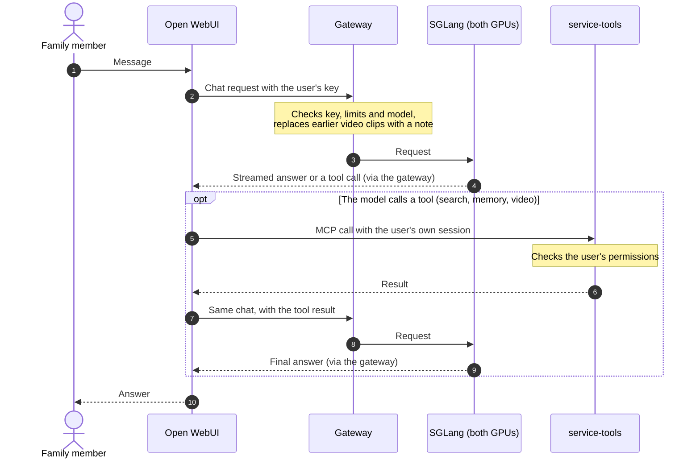
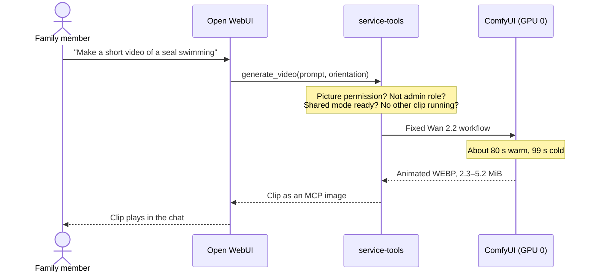

# Family assistant

The family assistant is a private, ChatGPT-style service running on the workstation. In one
Open WebUI chat window, family members can talk to Qwen3.8-27B, make pictures and short
videos, speak instead of typing, search the web and have the assistant remember things.
Nothing leaves the house except web searches and the public pages they read. This page explains what it does, who may do
what, how requests flow, and how it is configured.

It runs in **shared mode** today. [Service modes](MODES.md) explains the alternatives.

<a id="current-delivery-scope"></a>

## What the family can do

| Feature | How to use it | Who |
| --- | --- | --- |
| Chat | Chat with `Qwen3.8-27B-MXFP4`. To change how long it thinks: the **Reasoning effort** slider in the message box (Off, Low, Medium, Max; it starts at Medium) | Everyone with an account |
| Pictures | Ask for a picture, or use the image button; Qwen-Image makes a 1328×1328 picture in about 65 s (75 s if two are rendering) | Accounts with picture permission (Admin and Parents) |
| Short videos | Ask for a short video; a 5-second clip appears in the chat after about 80 s | Accounts with picture permission and the normal `user` role (the Parents' daily accounts); shared mode only |
| Voice input | The microphone button; speech is transcribed on the workstation | Everyone |
| Web search | Automatic when a question needs current public information (Exa) | Everyone |
| Memory | Ask it to remember something; it recalls it in later chats | Every daily (non-admin) account, private to each person |
| Documents | Upload Markdown or text (up to 8 MiB) to a knowledge collection and ask about it | Everyone, per collection permissions |
| Coding agents | Qwen Code and other IDE agents use the same model through an API key | Accounts given a key; see [coding clients](AGENT-HARNESSES.md) |

**Accounts and groups.** Each person has their own Open WebUI account; sign-up is closed.
Parents are in the `Parents` group and the children in `Family`; everyone can set Reasoning
Effort in Chat Controls. Picture permission is granted per account, to the Admin and Parents
accounts. The tools server (video, memory, search, documents through MCP) refuses every call
from an account with Open WebUI's `admin` role, so the owner uses a daily account for those;
the admin account is for administration and pictures.

## How a request flows

A chat message, including a tool call the model decides to make:



A short video:



If any check fails, the model gets a short error it can explain, such as `video_busy` or
`video_permission_denied`.

## Request paths

| Use | Path | Current boundary |
| --- | --- | --- |
| Conversation | Open WebUI → per-user gateway key → SGLang | Preserve the selected model identity and existing context limits |
| Documents | Open WebUI → CPU Qwen embedding model → embedded Chroma | Preserve document permissions; answer/citation quality remains unqualified |
| Web research | Open WebUI/Qwen Code → shared Exa adapter | Auto search and public-page extraction; one durable request ceiling; Tavily optional |
| Memory | Browser and coding clients → service-tools memory tools → Graphiti on Neo4j | Live in the `assistant-memory` experience; per-user memory groups; facts are stored only when someone asks |
| Image creation | Open WebUI → service-tools image adapter → ComfyUI on either GPU | Qwen-Image-2512 only; two pictures at once in shared mode (one per GPU), one in split mode |
| Short videos | Open WebUI → service-tools `generate_video` (MCP) → `comfyui-gpu0` | Wan 2.2 T2V A14B; shared mode only; one clip at a time; picture permission |
| Voice input | Browser microphone → Open WebUI → local faster-whisper | CPU transcription on the workstation; audio never leaves it |
| Creative controls | SwarmUI moves to a separate creator mode (planned); family modes no longer run it | No new public ComfyUI port or unauthenticated creative Ingress |
| Spoken answers | Open WebUI browser speech synthesis | Quality and voice availability depend on the browser and operating system |

The family profile adds a common name, four prompt suggestions and an explicit
default model. Signup remains closed. Each person needs a WebUI account and a
mapped gateway key. Image permission remains a separate per-user grant.
Configuration comes from source rather than persisted administrator settings.

The [web-search guide](WEB-SEARCH.md) covers provider-key provisioning, budget
limits, shared coding-client tools and the separate direct Codex OAuth path.
Web results remain temporary prompt evidence; the existing local RAG store and
document permissions remain authoritative. End-to-end search is not yet qualified.

## Private coding sandbox (candidate, off by default)

`service render --sandbox-config /private/sandbox.json` adds native Open Terminal
support in **large/coder mode only**. It writes a separate `sandbox.yaml`; its
controller Deployment starts at zero replicas. Omitting the flag pins an empty
`TERMINAL_SERVER_CONNECTIONS` list, including when persistent WebUI settings exist.
This candidate is not a qualified live service.

The integration uses Open Terminal 0.17.9 and Terminals 0.3.3, pinned by commit in
`infrastructure/ai-stack/stack.lock`. The WebUI fork at `21bc3e3` uses the 0.3
policy API (`/p/sandbox`, `terminal_id`, `/files/cwd` and native OpenAPI tools).
Terminals 0.4 changes that API and must not replace this pin independently.
The Jupyter engine takes one server URL and credentials; it does not provision
isolated user pods. A shared Jupyter or shared Open Terminal process therefore
does not meet this deployment's isolation requirement. A separate Playwright MCP
server is unnecessary: the native command tool can run the installed Playwright
Chromium, and native file tools return its screenshots to the model.

**Isolation and lifecycle.** The upstream orchestrator creates one pod per
authenticated user. Chats for that user share a workspace. Each pod has its own
2 GiB `emptyDir`, UID/GID 1000, a read-only image, no service-account token, no
host mounts or GPU, dropped capabilities, no privilege escalation and
RuntimeDefault seccomp. Temporary files use the workspace volume. Fifteen idle
minutes stop and delete the pod; a two-hour maximum lifetime also ends active
work. Files and background processes disappear at teardown. Download wanted
files first. There is no shared PVC or automatic upload of family documents.

The trusted controller has a service account restricted to pods, services and
per-workspace API-key Secrets in `assistant-sandbox`. These credentials never
enter a workspace. The workspace's own terminal key grants access only to that
workspace. A small ASGI gate checks the caller's WebUI session, exact user ID and
current groups before forwarding to the native orchestrator. It exposes no policy
administration API. Static tool discovery starts no pod. WebSocket sessions
reauthenticate by reconnecting after at most 60 seconds.

**Access.** WebUI's admin role and the exact Parents group are allowed. Family is
off by default. The render sets native group read grants; the controller repeats
the group check on each HTTP call. Family membership takes precedence over
Parents membership, so adding a child to both does not bypass the switch.
Set `family_enabled` to `true` in the source config, re-render and restart the
controller and WebUI to enable children. Disabling access does not interrupt a
command already running; idle and lifetime teardown remain the backstops.
No model grants, gateway keys or cybersecurity-model permissions change.

Example configuration (replace the example image digest and group IDs with
owner-verified values; these are identifiers, not credentials):

```json
{
  "image": "registry.lan.thespry.family/local/assistant-sandbox@sha256:DIGEST_FROM_SIGNED_BUILD",
  "parents_group_id": "PARENTS_GROUP_UUID",
  "family_group_id": "FAMILY_GROUP_UUID",
  "family_enabled": false,
  "api_server_cidr": "192.168.30.11/32",
  "api_server_port": 6443
}
```

**Network and threat model.** The workspace namespace has default-deny policies.
Only the controller can initiate connections to workspace port 8000. Workspaces
have no egress rules, including DNS, cluster services, other workspaces, LAN and
Internet. Chromium and local web servers communicate inside the same pod.
The controller alone can reach WebUI, DNS and the exact configured API endpoint.
There is no public Ingress, NodePort or browser-debugging listener.

Prompt-injected code and malicious pages can destroy or expose the current user's
workspace through tool responses. They receive no family storage, service keys
or Kubernetes identity. Chromium runs headless with its inner sandbox disabled
because this image uses the pod/container security boundary; it is not a second
isolation boundary. Kernel/container escapes remain a shared-host risk. Do not
upload secrets. NetworkPolicy cannot by itself guarantee denial of traffic to
the hosting node on every CNI. Prove node-address, ClusterIP, DNS, LAN and
cross-user denials in a scratch K3s deployment before live rollout; do not weaken
seccomp or grant `NET_ADMIN` to obtain them.

Default Internet egress is **none**. A package-registry proxy would need exact
PyPI/npm artifact and redirect allowlists, private-address and DNS-rebinding
denials, and no generic CONNECT tunnel. It also introduces package-install
scripts and an exfiltration channel. That is a separate owner decision, as is
unrestricted public Internet access. The image already includes Python, Node,
npm, git, curl, jq, ripgrep, shell/build tools, a Python static server and
Playwright Chromium. Runtime package downloads fail under the default policy.

**Capacity.** A namespace quota bounds the pool to two workspace pods (each
750m CPU / 2 GiB RAM / 2 GiB ephemeral storage) plus one controller (250m CPU /
256 MiB RAM / 256 MiB ephemeral storage). Requests equal limits. Fractional CPU
requests use the shared CPU pool and avoid
the host CPU Manager's whole-core SMT alignment requirement. The planner
reserves the whole 1.75 CPU / 4.25 GiB pool even when no workspace is running.
The session switch's existing all-namespace pod accounting includes active
sandbox pods. Kubernetes admission prevents a sleeping workspace from consuming
unreserved CPU or RAM when other work has filled the node; it may remain pending.

At the tested 42 CPUs and 51,200 MiB allocatable RAM, large mode with the memory
stack, full telemetry (6,656 MiB reserve), Alertmanager and the full pool leaves
**1.75 CPUs and 3,584 MiB**. Builds and VMs require additional admission.
Shared mode is refused: current source declares 43.5 application CPUs and
55.5 GiB application RAM before telemetry or this pool. Its selected 14 GiB
SGLang pod also inherits a 16 GiB memory-backed volume, which the planner refuses.
This feature does not lower existing workload limits to make the test pass.

**Images and metrics.** The `sandbox` pipeline stage builds from the two pinned
source commits, runs the offline native-tool/browser smoke and scans with the
existing Trivy policy and an empty exception list. `AI_STACK_PUSH=1` then uses
the existing signing, SBOM attestation and signature verification path. Supply
the resulting digest to the render; tags alone are refused. Open Terminal is
MIT; Terminals has the Open WebUI Enterprise licence with a personal,
non-commercial-use exception. This image is for the owner's family installation;
organizational deployment needs a separate licence review. Playwright is Apache
2.0; Chromium and OS/Python/Node dependencies retain their own licences. The
image carries the upstream licence texts and the pipeline produces an SBOM.

Alloy scrapes `workstation_sandbox_executions_total{group="Admin|Parents|Family"}`
from the controller. It counts authorized native command attempts, including
attempts that fail; counters reset on controller restart. The kubelet collector
retains CPU, memory and throttling metrics for the sandbox namespace. Application
and access logging are disabled: no code, output, tokens or user IDs are emitted
to the telemetry path. Native command-result buffers remain transient files in
that user's workspace so tool results can be read; they disappear with the pod.

**Owner rollout after merge and qualification:**

1. Run `AI_STACK_PUSH=1 bash infrastructure/ai-stack/build-stage.sh sandbox` on
   the build host. Keep the scan, SBOM, signature verification and `image.digest`.
2. Set the signed digest, actual group UUIDs and API endpoint in `sandbox.json`.
   Choose whether children may use it and whether disposable workspaces suffice.
3. Render the assistant in large mode with `--sandbox-config`, and run
   `service plan` with fresh node resource and telemetry evidence. Inspect both
   `workloads.yaml` and `sandbox.yaml`. Run the scratch K3s denials, quota,
   idle cleanup and cross-account tests before applying either to the live site.
4. Apply the reviewed sandbox bundle through the owner's normal deployment
   process, then start its controller. Set `MODE_SANDBOX_CONFIG` to preserve the
   config in coder-mode renders. The flag deliberately refuses family/shared
   mode until that composition is right-sized and verified. The mode command
   does not apply the separate namespace bundle.
5. Roll out the rendered WebUI configuration. Select **Private coding workspace**
   in a native-tool-capable chat. Ask it to write a small HTML game, serve it on
   loopback, run Playwright, inspect the screenshot and describe the result.
   Verify Admin and Parents access and Family denial from separate accounts.

For rollback, omit `--sandbox-config` (and unset `MODE_SANDBOX_CONFIG`), roll out
the resulting WebUI config, and let the controller reap workspaces before
stopping it. Deleting the namespace or stopping active workspaces loses their
disposable files; retain wanted files first. No rollout or deletion is automatic.

**2026-11-14 scratch evidence.** Rootless Podman on the workstation built candidate
`c37b81317714`, whose local manifest digest is recorded as
`ASSISTANT_SANDBOX_CANDIDATE_IMAGE` in `versions.lock`. It has not been signed or
published. The native `/execute` tool wrote and served **Star catcher**; Playwright
1.65.2 clicked three stars, observed the win state and zero page errors, and the
native file tool returned the PNG. The [captured screenshot](assets/sandbox-game-20261114.png)
shows the disabled star button and “You win!”. This is an assistant-authored tool
smoke, not a qualified SGLang/WebUI conversation. The final image also passed a
probe of the actual upstream Kubernetes pod builder and idle reaper against a fake
API: separate user pod names, preserved security/resources and idle deletion.
Real controller database migrations, policy seeding and application startup also
passed at 250m CPU / 256 MiB RAM, with cluster I/O replaced by a test double.

Trivy passed the existing policy with no exceptions: 7 critical findings without
available fixes, 313 high, 674 medium, 971 low and 29 unknown. Passing that policy
does not mean the image is vulnerability-free. Actual K3s network enforcement,
quota saturation, controller restart/reconciliation, cross-account WebUI behavior,
image signing/promotion and the complete model-driven chat remain unverified.

## Select and render

Use the existing [service setup](AI-SERVICE.md) for private DNS, TLS, credentials,
retained storage, account bootstrap and owner handover. Supply actual site values
and existing claim metadata; do not apply example DNS or invent a new identity.

```sh
./bin/workstationctl service render /private/service-site.json /private/assistant-large \
  --experience assistant --mode large --existing-claims /private/service-pvcs.json
./bin/workstationctl service render /private/service-site.json /private/assistant-split \
  --experience assistant --mode split --existing-claims /private/service-pvcs.json
```

The live service is rendered with `--serving-profile` (see the [serving contract](#serving-contract)
and the shared-mode command in [service modes](MODES.md#switch-modes)).
The two commands above, without a profile, are the older compositions: `large` with the
Qwen3.8-27B-FP8 image and no pictures, and `split` with Qwen3.5-9B on one GPU and pictures on
the other. Neither silently swaps the chat model to make room for a picture.

Both renders keep application replicas at zero. Use `service plan` with fresh
resource evidence and the selected telemetry composition before activation.
The workstation has 64 GB installed RAM. The retained Linux-visible observation
is about 62 GiB.
Existing split limits exceed the reviewed CPU budget; this change does not lower
them to obtain admission. Shared UI configuration is not physical GPU ownership.

### Admin Panel settings

Open WebUI keeps its Admin Panel settings across restarts and deployments
(`ENABLE_PERSISTENT_CONFIG=true`). The settings the deployment sets itself stay owned by
the deployment. Before Open WebUI starts, `apps/components/assistant/pin-config.py`
re-applies them from the environment:

- the gateway connection and its keys;
- sign-up and the default role;
- the default user permissions;
- the tool server, web search and page loader;
- model defaults and prompt suggestions;
- the reviewed RAG profile;
- the [tool-use system prompt](#tool-use-system-prompt) and the
  [built-in tool categories](#built-in-tools-in-a-chat) on the default model's record;
- which groups [search the web without the confirmation](#web-search-confirmation-per-group).

About 56 of Open WebUI's roughly 450 settings are owned this way. Change those in
source (`assistant.env`, `webui.yaml`, `rag.env`), not in the Admin Panel: an
Admin Panel change to one of them lasts only until the next deployment. That is
also how a rotated key or a changed permission default reaches Open WebUI. Every
other setting (interface, banners, image options, evaluations and so on) is
changed in the Admin Panel and kept.

The render (`lib/workstation/service.py`) names every variable it gives Open WebUI in
`WEBUI_PINNED_ENV`, names only. The script reads the installed Open WebUI's `config.py`
to find which settings those variables feed. Its first log line lists them. Group
permissions, model records and access grants were always stored in the database
and are unaffected, except for three fields described in the next sections: a model
record's `params.system` and `meta.builtinTools`, and one group permission
(`features.web_search_without_confirmation`). With persistent config on, the database
also holds the connection keys, so treat `webui.db` backups as secrets.

### Tool-use system prompt

[`apps/components/assistant/system-prompt.md`](../apps/components/assistant/system-prompt.md)
tells the model how to use the tools it has: look up anything current, versioned, niche or
uncertain and cite it; check memory, project passages and attachments before asking; run or
test what it builds where a tool allows, and say what it could not verify. It names no model
and no tool, and it grants nothing: filters and permissions are unchanged. It costs about
217 prompt tokens on every request (measured with the served tokenizer on 14 November 2026).

Open WebUI 0.13.3 has no global system prompt. A `system` entry in `DEFAULT_MODEL_PARAMS`
is dropped before the request is built; only the `params.system` of a stored model record is
applied on the server. `pin-config.py` therefore writes the file to the record of each model
in `DEFAULT_MODELS` at every start, changing that one field only. Its log line reports
`updated`, `unchanged` or `no model record` per model. A missing record is never created,
because creating one decides who may use the model: create it in **Admin Panel → Settings →
Models** and restart Open WebUI. A failure to write the prompt is logged and does not stop
the start.

| Request | What the model receives |
| --- | --- |
| Browser chat, no personal system prompt | The prompt, then anything Open WebUI adds for enabled features (code interpreter notes, tool-server instructions) |
| Browser chat with a system prompt from Settings or Chat Controls, or a folder prompt | The prompt first, then the person's own text. Theirs is kept whole and comes later, so it wins where the two disagree |
| API or IDE client through Open WebUI (`/api/chat/completions`, `/openai/chat/completions`) | The prompt first, then the client's own system message. The client's tools pass through unchanged |
| Titles, tags and follow-up suggestions | The prompt too (Open WebUI applies a model's prompt to its background tasks); they offer no tools |
| Coding clients that call the gateway directly (Qwen Code) | Not affected: they do not pass through Open WebUI |

Change the text in source. An edit in the Admin Panel lasts until the next start, like the
other owned settings. `{{CURRENT_DATE}}` is filled in by Open WebUI for each request.

### One web search in a chat

A chat offers the model one web search: Open WebUI's own `search_web`, which calls
service-tools (`/webui/search`) and so shares the provider, budget and metrics with every
other client. The tool server's `search_web` is hidden from Open WebUI by
`function_name_filter_list` in `TOOL_SERVER_CONNECTIONS`; before, the model saw both and
used either. Coding clients that connect to the MCP endpoint themselves still get it. The
built-in search is the one kept because it is the one the interface controls: the web search
toggle, the per-group `Web Search` permission, the confirmation prompt and the sources listed
under an answer all belong to it, and it also works for the admin account, which the tool
server refuses.

Two page readers remain on purpose. Open WebUI's `fetch_url` returns the first section of a
page (6,000 characters); the tool server's `read_web_page` is the only way to continue a
long page, so it is not hidden. To hide it as well, add `!read_web_page` to the filter.

### Web search confirmation per group

Before a web search runs, the chat page asks the person to confirm
(`ENABLE_WEB_SEARCH_CONFIRMATION=true`). Upstream Open WebUI 0.13.3 sends that setting to
every browser alike. The workstation fork adds a group permission,
`features.web_search_without_confirmation` (**Web Search Without Confirmation** under
**Admin Panel → Users → Groups → a group → Permissions**), that lifts it:

| Account | Confirmation |
| --- | --- |
| Member of a group on the list (Parents) | Not asked, also when the account is in Family as well: the most permissive group wins, as for every Open WebUI permission |
| Member of Family only (the children), or of no group | Asked. This is the default: the permission is off unless a group grants it |
| Admin | Not asked. Open WebUI exempts admins from every feature permission |

The list is `WEB_SEARCH_WITHOUT_CONFIRMATION_GROUPS` in
[`assistant.env`](../apps/components/assistant/assistant.env), group names separated by
commas. At every start `pin-config.py` grants the permission to those groups and removes it
from every other group, so the list is the whole truth and a grant made in the Admin Panel
lasts until the next start. Its log line reports `granted`, `unchanged`, `removed` or
`no group` per group. An empty list means everybody but the admin confirms. This is a
permission, so a failure to write it stops the start, unlike the prompt and the tool
categories. Never put the children's group on the list.

The server works out the answer for the signed-in account and sends it with the page
configuration (`/api/config`), so a change reaches a browser on its next page load. The
confirmation itself remains a dialog in the browser, as upstream: it is a prompt to think,
not an access control. What a group may do is still decided by its **Web Search**
permission and enforced on the server.

### Built-in tools in a chat

Every tool a chat offers is described to the model in the prompt, on every turn. Open WebUI
adds its own tools by category, and a model record can switch categories off
(`meta.builtinTools`; **Admin Panel → Settings → Models → the model → Builtin Tools**).
`MODEL_BUILTIN_TOOLS_OFF` in `assistant.env` lists the categories the default model's chats
do not carry. `pin-config.py` writes exactly that list to the record at every start, next to
the prompt, and reports `updated`, `unchanged` or `no model record`, plus any name the
installed Open WebUI no longer knows (`unknown`).

| Category | Tools | State | Why |
| --- | --- | --- | --- |
| `web_search`, `image_generation`, `code_interpreter` | `search_web`, `fetch_url`, `generate_image`, `execute_code` | on | Used daily |
| `knowledge`, `files` | Knowledge-base search and reading (eight tools); attached-file tools when a chat has files | on | Project collections and uploads |
| `time`, `user_input`, `chats`, `tasks` | Timestamps, `ask_user`, past-chat search, task lists | on | Small and used |
| `memory` | Open WebUI's own memory tools | on, not offered | Offered only with the Memory toggle; family memory is the tool server's (`recall_memory`, `remember`) |
| `notes` | `search_notes`, `view_note`, `write_note`, `replace_note_content` | **off** | One note exists; the model also reached for `write_note` when asked to build a page |
| `calendar` | Four event tools | **off** | No calendar events |
| `automations` | Five automation tools (Parents and the admin only) | **off** | No automations |
| `skills`, `tools` | `create_skill`, `create_tool` | **off** | No skills or tools were ever created |
| `channels`, `notifications` | Channel search, `notify` | **off** | Channels and webhooks are disabled anyway; off here so enabling the feature does not add tools unnoticed |

The tool server's tools (project passages, handoffs, memory, video, long pages) are not
built-in tools and are unaffected. Switching a category off removes tools from chats only:
Notes, the calendar and automations still work in the interface, and the note editor's own
assistant keeps its note tools. To bring a category back, remove it from the list and
deploy.

Measured on the served model on 14 November 2026 (the same request with and without the
tool list), the definitions cost:

| Account | Before | After |
| --- | --- | --- |
| Child (Family) | 37 tools, 7,660 tokens | 28 tools, 5,540 tokens |
| Parent (Parents and Family) | 42 tools, 8,638 tokens | 28 tools, 5,540 tokens |
| Admin | 43 tools, 8,826 tokens | 28 tools, 5,540 tokens |

Of the 5,540 that remain, the tool server's eleven tools take about 2,580 and the eight
knowledge tools about 1,510. Open WebUI's tool search (`ENABLE_TOOL_SEARCH`) would defer
nine more definitions behind a `search_tools` and `call_tool` pair and bring the total to
about 3,990 tokens. It is left off: the model would need two extra steps to reach knowledge
retrieval and `ask_user`, and that path has not been tested with the served model.

### Theme

Open WebUI shows the **Family AI** brand: a sprout-and-speech-bubble mark, a deep-green palette, a green sign-in page and the installed-app name. The files and how to change them are in [`apps/components/assistant/theme/`](../apps/components/assistant/theme/README.md). Each user's Light, Dark or OLED choice still applies, and the theme tints all three. Rebranding is allowed by Open WebUI's licence for deployments with at most 50 end users in a rolling 30 days. The title keeps Open WebUI's own " (Open WebUI)" suffix.

### API keys

Users can create API keys (`USER_PERMISSIONS_FEATURES_API_KEYS`). With endpoint
restrictions on, a key reaches only the paths in `API_KEYS_ALLOWED_ENDPOINTS`
(`apps/overlays/service/webui.yaml`). Open WebUI 0.13.3 matches an entry exactly or
as `entry + "/"`, never by HTTP method. The list is a deployment-owned setting
([above](#admin-panel-settings)): change it in source, because an Admin Panel edit
lasts only until the next deployment.

| Entries | For |
| --- | --- |
| `/api/v1/users/user/status`, `/api/v1/retrieval/query/collection`, `/api/v1/files`, `/api/v1/knowledge/` | service-tools and coding clients (knowledge listing only) |
| `/api/models`, `/api/chat/completions` | the JetBrains ACP agent's chat (`Drgr33nSenior/openwebui-acp-agent`) |
| `/api/version`, `/api/config`, `/api/v1/tools/`, `/api/v1/chats`, `/api/tasks/chat` | the ACP agent's server-tools mode |

`/api/v1/chats` must be a prefix to reach `/api/v1/chats/{id}`, so a key can do anything
its owner can do to their own chats, including deleting them all. Treat a saved key
like the account's password.

<a id="native-candidate-integration"></a>

## The served model

The chat model comes from the [AI serving stack](../infrastructure/ai-stack/README.md): an
image built from [`stack.lock`](../infrastructure/ai-stack/stack.lock) (SGLang main with the
gfx1201 patch series, PyTorch 2.16 nightly for ROCm 10.3.0-dev) and the
[serving profile](../infrastructure/ai-stack/serving/qwen3.8-27b-mxfp4-tp2.json), which is
`qualified`: arm `UQSB` for shared mode and `UQLB` for large mode, both on 13 November 2026.
The earlier op234 candidate is described under [History](#history-the-op234-candidate).

### Serving contract

`service render --serving-profile` reads the AI-stack serving profile, its model
catalogue and `stack.lock`, and builds one contract
(`serving-contract.json`). Every consumer in that render comes from it: the
persistent SGLang Deployment, the gateway policy, the LiteLLM route, the Open
WebUI defaults, the Qwen Code client values (`client.conf`) and the
`service-tools` contract metric. The serving owner's files are read, never
edited, and their `render.py` builds the launch argv and environment, so the
Deployment starts exactly what the qualification Job starts.

```sh
./bin/workstationctl service render /private/service-site.json /private/assistant-contract \
  --experience assistant --mode large --existing-claims /private/service-pvcs.json \
  --serving-profile infrastructure/ai-stack/serving/qwen3.8-27b-mxfp4-tp2.json \
  --runtime-image registry.lan.thespry.family/local/sglang-gfx1201@sha256:DIGEST_FROM_SERVING_OWNER
```

| Contract field | Source |
| --- | --- |
| `contract` (`<profile>.<arm>`), `selection` | Profile name and the arm the profile marks `default`, unless `--arm` names one |
| `model` (alias, checkpoint and draft revisions) | Profile `served_model_name`; model catalogue |
| `tokenizer`, `chat_template` | Catalogue file identities; accepted reasoning values from the template itself (below) |
| `runtime` | `--runtime-image` (lab registry or its `ghcr.io` copy, pinned by digest); SGLang commit, patch series and GPU target from `stack.lock`; digest of the launch argv and environment |
| `parsers` | Profile `--reasoning-parser`, `--tool-call-parser`, `--grammar-backend` |
| `reasoning` | Profile `--default-chat-template-kwargs`; template-accepted efforts; client mapping |
| `budgets`, `concurrency`, `deadlines` | Profile context, pool and running-request limits; `--output-tokens` (default 12,288, at most half the context, unqualified); gateway admission 4; [time limits](#time-limits): 600 s to first content, 300 s idle between chunks, 3,600 s overall, so Max (effort `xhigh`, which runs to the context limit with no output cap) can finish; ordinary replies keep the 12,288 cap |
| `assets`, `requirements` | Model and draft paths from the argv; `ai-models` claim from `k8s/models.yaml`; GPU count, groups and node label from the profile, `render.py` and `stack.lock` |

`status` is `incomplete` while a deployment input is missing, `provisional`
when the inputs are present but the profile is not `qualified` or the catalogue
is not promoted, and `active` only when both are. An incomplete render still
writes every consumer so it can be reviewed, but the Deployment image is
`registry.invalid/…:CONTRACT-INCOMPLETE`, replicas stay zero, and
`evidence.json` lists `missing_inputs`. The catalogue's promoted value is
assumed to be `selected`; any status other than `candidate` or `selected` is
refused until the serving owner names it.

The render cannot silently target the older FP8/32K profile. It replaces the
FP8 LiteLLM route, gateway allowlist, Open WebUI default, memory extraction
model and client model, drops the unused FP8 `sglang-profile` ConfigMap, and
then refuses to write anything if `Qwen3.8-27B-FP8` remains in the rendered
configuration or any layer disagrees with the contract (route, gateway and
client context, output cap, input budget, deadline order, request defaults,
Deployment argv). The gateway reads the rendered `gateway-policy.json` at
startup and replaces its source defaults, so an FP8 request is refused as
`unknown_model`. The 9B split route is kept. The contract needs both GPUs, so
`--mode split` is refused. Virtual keys allowlisted only for the FP8 alias do
not reach the new alias: issue keys for `Qwen3.8-27B-MXFP4` with
`service provision` (the alias is now in its allowlist) and revoke the old ones
as before.

### Reasoning effort

There is one chat model; a **Reasoning effort** slider in the message box chooses how long it
thinks: **Off**, **Low**, **Medium** (where it starts), **Max**. The slider comes from the model
itself: the gateway declares the levels it accepts in its model list (`supportedReasoningEfforts`
with display labels, and `defaultReasoningEffort`), and our Open WebUI
build (the `webui` [AI-stack stage](../infrastructure/ai-stack/README.md), from the fork
`Drgr33nSenior/open-webui`) turns that declaration into Model Controls. An admin who defines
Model Controls for the model in Workspace → Models replaces the declared slider. The older
**Chat Controls → Advanced Params → Reasoning Effort** field still works. The gateway accepts:

| Value | Request |
| --- | --- |
| *(unset)* or `low` | the contract's request default: thinking at `low` effort, output capped at 12,288 tokens |
| `medium` | thinking at `medium` effort, same cap |
| `high` or `xhigh` | thinking at `xhigh`, no output cap: runs until done, the context is full, or a [time limit](#time-limits) (silent 5 minutes, or 60 minutes overall) |
| `none` | no thinking (`enable_thinking: false`) |

Two defaults are kept apart. The level the gateway *declares* (`declared_reasoning_effort` in
`gateway-policy.json`, from `CHAT_REASONING_EFFORT` in `lib/workstation/service.py`) is
`medium`: Open WebUI starts the slider there and sends it with every chat in which nobody
moved the slider, including API clients that use `/api/chat/completions` without naming an
effort. The level the gateway *applies* to a request that names none is still the contract's
`low`: Open WebUI's titles, tags and follow-up suggestions, its `/openai` proxy route and
coding clients that call the gateway directly. A person who has already moved the slider
keeps their choice.

Any other value is refused with `invalid_reasoning_effort`. Chat Controls and Params are
enabled for every user (`USER_PERMISSIONS_CHAT_CONTROLS`/`_PARAMS`, pinned in
`apps/components/assistant/assistant.env`), so the Family group has the control too.

The earlier `· Think` and `· Fast` model presets are retired. A deployment that still has
them keeps them in Open WebUI's database: an admin deletes them under **Admin Panel →
Settings → Models** (or Workspace → Models). Nothing re-creates them.

### Time limits

A streamed reply is never cut while it keeps producing output. The gateway enforces three
budgets (`gateway-policy.json`, from the serving contract), the shape the OpenAI and
Anthropic SDKs use:

| Budget | Value | Ends a request that… | Error |
| --- | --- | --- | --- |
| First content | 600 s | has produced nothing yet (queue, prefill, start of thinking) | 504 `first_token_deadline` |
| Idle | 300 s | streamed, then went silent; reasoning counts as output | stream ended without `[DONE]` |
| Overall | 3,600 s | is still running after an hour (a backstop) | 504 `request_deadline`, or the stream ends |

A non-streamed reply sends nothing until it is complete, so only the overall cap bounds it.
LiteLLM ends 10 s earlier at each matching limit (`stream_timeout` 590 s per chunk wait,
`timeout` 3,590 s). Traefik's `writeTimeout` (3,660 s) is an absolute limit on writing a
response, so it stays above the overall cap; its `readTimeout` (300 s) covers slow
uploads. Open WebUI sets no timeout of its own. Its stream idle setting is a socket-read
timeout shared with tool calls (a video returns only when done), and the gateway already
enforces these budgets.

### Shared mode (chat and pictures together)

`--mode shared` keeps the two-GPU contract model and adds image generation in the VRAM
it leaves free on both cards. It renders the profile's shared default arm, UQSB (`--arm`
can still choose another); the large mode renders the general default, UQLB (FP8 KV, the
model's full 262,112-token context). Each arm has its own qualification record on its own
image, so each mode's contract is `active`:

```sh
./bin/workstationctl service render /private/service-site.json /private/assistant-shared \
  --experience assistant --mode shared --existing-claims /private/service-pvcs.json \
  --serving-profile infrastructure/ai-stack/serving/qwen3.8-27b-mxfp4-tp2.json --arm UQSB
```

- Arm `UQSB` holds 201,600 tokens (100,768 per conversation) in the memory `UQS` used for
  163,840 (81,888 per conversation): the DFlash draft's cache is bundled to 43,008 tokens
  (serving patches 0028-0030). Free memory per card after startup is unchanged (8.36 GB
  against 8.35 GB on 2026-11-13); `UQS` left 9.04 GB in its 2026-11-11 qualification.
  Measured live with `UQS` on 2026-11-13 (32,624 MiB per card; `UQSB` leaves the same):

  | | Pictures card (`gpu-1`, then SwarmUI) | Video card (`gpu-0`, `comfyui-gpu0`) |
  | --- | --- | --- |
  | In use before any picture | 25,585 MiB | 25,121 MiB |
  | Peak | 29,885 MiB (two pictures at once) | 31,913 MiB (a 5-second clip) |
  | Free at the peak | 2,739 MiB | 711 MiB |
  | Kept after use (models stay loaded) | +3,371 MiB | +2,227 MiB |

  The pool costs about 21 KiB per token per card (FP8 target and draft KV), so 1 GiB is
  about 50,000 tokens. The video card has no room to grow the memory the pool uses, so
  shared mode's extra context comes from bundling the draft cache, not from the image
  generators' share. For longer contexts, use large mode (262,112 per conversation, no
  pictures or video).
- `comfyui-gpu1` (`apps/base/comfyui-gpu1`) uses `gpu-1`. A second ComfyUI
  (`apps/base/comfyui-gpu0`) uses `gpu-0`, the matching gap SGLang leaves there. service-tools
  sends each picture straight to one of them.
- The rendered gateway policy lists the contract model in `image_models`, so the gateway
  accepts `ready <model> --images` for it. Other modes keep images on the 9B split profile.
- Image access stays per user: bind the Admin and Parents accounts with
  `service browser-bind --images`. Video uses the same permission, but as an MCP tool it
  also refuses the `admin` role, so videos need a daily account.
- Shared mode needs the `assistant` or `assistant-memory` experience and a serving
  profile.

Moving between shared and large mode needs a fresh render and apply first; see
[service modes](MODES.md). Within a shared render, start it with `session switch shared` once
the host config sets
`SESSION_IMAGE2_DEPLOYMENT=comfyui-gpu0` beside `SESSION_IMAGE_DEPLOYMENT=comfyui-gpu1`
(docs/AI-SERVICE.md step 8). The switch:
- refuses unless the running contract model is `Qwen3.8-27B-MXFP4` on `gpu-0` and
  `gpu-1`, with each image generator on one of those cards and on different cards;
- checks CPU and memory for all three pods together, before anything stops;
- starts SGLang first, so it sizes its KV pool before any image VRAM is in use, then
  `comfyui-gpu1`, then `comfyui-gpu0`;
- admits images at the gateway only after all three are ready. If either generator
  fails to start, the session is marked failed and the gateway stays closed.

`maintenance`, `split` and `ai` stop the second generator with everything else.

#### Elastic chat cache (shared mode default since 14 November)

With serving patches 0031-0033, SGLang can back an extra "tail" of KV cache in the memory the
ComfyUIs are not using. The tail only holds more cached conversations, so returning to an older
chat skips re-reading it; the context a conversation may use stays at the arm's base (100,768).
`service-tools` hands the memory back and forth (`apps/base/shared-api/kv_tail.py`):

- **Before a picture or clip** it asks SGLang to release the tail through the gateway's
  `/_service/kv_tail` route (service key only; status, shrink and grow, nothing else reaches
  SGLang). SGLang moves any running chat's cache out of the tail, then answers once both cards
  show the memory free. The picture waits at most 15 seconds for that answer; otherwise it is
  refused with `chat_memory_busy` or `chat_memory_unconfirmed` and never reaches ComfyUI. A chat
  is never paused or cut off.
- **After 10 minutes with no picture or clip** it asks each ComfyUI to unload its models
  (`POST /free`), waits until each holds less than 1.5 GiB, then asks SGLang to grow the tail. The
  first picture after a quiet spell reloads its models from NVMe; a run of pictures does not.
- **Self-healing:** service-tools never trusts its own idea of the tail. Every picture or clip asks
  SGLang to release it (a released tail answers in milliseconds), and every quiet spell it reads
  SGLang's state and grows the tail again if a restart or anything else released it.

Shared mode renders arm `UQSE` (UQSB plus the tail), which sets
`SGLANG_GFX1201_ELASTIC_KV_BASE_TOKENS` and, through the render, `KV_TAIL_ENABLED=true` on
service-tools. A grow without a size takes the largest tail that fits both cards (384,127 tokens on
14 November). SGLang refuses the tail at startup unless a same-address remap self-test passes,
which needs the amdgpu TLB-fence fix. B2 GPU results are in the serving repository's
`docs/ELASTIC-KV-TAIL-20261114.md`. State is in `/health` (`kv_tail`), SGLang's `GET /kv_tail`
and the `workstation_assistant_kv_tail_*` metrics. Rollback: render shared mode with `--arm UQSB`
on its own image; nothing else changes.

#### Short videos (shared mode)

In shared mode the assistant can make a 5-second silent clip in the chat. `service-tools` lists
an MCP tool, `generate_video`, when `VIDEO_ENABLED=true` (the shared overlay sets it). The model
calls the tool when someone asks for a video. The clip appears in the chat as an animated WEBP:
Open WebUI stores an MCP `image` result under the requesting user and shows it inline.

**Model and settings.** The model is Wan 2.2 T2V A14B (catalog entry
`infrastructure/ai-stack/models/wan2.2-t2v-a14b.json`):

- the two 14B experts in ComfyUI's fp8-scaled repack;
- lightx2v's 4-step distill LoRAs (`1217`);
- umt5-xxl fp8 as the text encoder;
- the Wan 2.1 VAE.

The operator-owned workflow is `apps/base/shared-api/wan-t2v-workflow.json`. `video.py` checks
it against `video-profile.json` at startup. Its settings:

- 4 steps, split 2 + 2 between the high-noise and low-noise experts;
- euler/simple sampler, shift 5, CFG 1;
- 81 frames at 16 fps.

Callers choose only the prompt and an orientation: landscape 832x480, portrait 480x832 or
square 624x624. No size has more pixels than the measured 832x480.

**Access.** Video access follows picture access:

- only users bound with `service browser-bind --images` may call the tool, and like every MCP
  tool it refuses the `admin` role, so in practice the Parents' daily accounts;
- the gateway must be `ready` with images on the contract model;
- one clip runs at a time.

Open WebUI stores each clip as a chat file, so its `RAG_FILE_MAX_SIZE` cap (8 MiB) bounds the clip; a
5-second clip is 2.3-5.2 MiB at WEBP quality 80, larger for busy scenes. The profile's `max_bytes` matches that cap, so a
larger clip fails as `video_artifact_too_large` instead of an upload error in the chat.

On every later turn Open WebUI resends each clip in the chat to the model as base64. The gateway
accepts chat bodies up to 64 MiB (other routes keep 1 MiB) and replaces each animated WEBP with a
one-line note before the model sees it; still images, such as an uploaded photo, pass unchanged.
A chat with many clips can still reach 64 MiB and fail with `request_too_large`: start a new chat.

Busy, not-ready and permission refusals come back as tool errors the model can explain. Like
every service-tools MCP tool, an account with the Open WebUI `admin` role is refused; use the
daily account.

**Where it runs.** The clip runs on `comfyui-gpu0`, so pictures and videos on `gpu-0` share
one queue. That ComfyUI reads the Wan files from the local-NVMe `creative-models` volume
(`Video/`), not from the NAS. With `--fast-disk` it streams the experts from disk on every
step instead of holding 28.6 GB in RAM.

**Staging the models.** Stage them once on the workstation, as root, then hand them to the
pod's user:

```sh
sudo python3 infrastructure/ai-stack/models/stage-video.py \
  infrastructure/ai-stack/models/wan2.2-t2v-a14b.json \
  /var/lib/rancher/k3s/storage/<creative-models pv>_ai-home-lab_creative-models/Video
sudo chown -R 1000:1000 /var/lib/rancher/k3s/storage/<creative-models pv>_ai-home-lab_creative-models/Video
```

Add `--check` to verify the staged files without downloading. The stage is about 36.8 GB,
fetched from pinned revisions and checked against each file's sha256.

**Measured on 2026-11-12** (R9700, shared mode, a 5-second 832x480 clip, chat idle at
86 tok/s):

| `comfyui-gpu0` setting | Clip | Chat decode during the clip |
| --- | --- | --- |
| ComfyUI 0.45 defaults + `--fast-disk` | 92–102 s | 13–14 tok/s |
| + `--use-ck-attention` | 71–76 s | 21–24 tok/s |
| + `HSA_CU_MASK=0:0-47` (shipped) | 78–82 s | 34–35 tok/s |

- **Why chat slows.** SGLang's two TP ranks run in lockstep, so a clip that saturates one card
  slows every chat token. The compute-unit mask keeps 16 of the 64 CUs out of ComfyUI's reach.
  A 32-CU mask was worse on both measures (104 s, 15 tok/s).
- **ck attention.** It is not bit-identical to PyTorch attention: same-seed frames differ by
  14–17 dB PSNR, and an SDXL picture by 25.8 dB. Side by side, the clips (including faces) and
  the SDXL portraits were of the same quality, and SDXL time did not change (about 9.4 s in
  the test pod).
- **Other options tried.** FP8 matmul (`--fast fp8_matrix_mult`) gave no gain, and `--fast`
  with every feature took 203 s. AOTriton flash attention is already in use: 0.28 s per
  attention call, whatever the layout.
- **LoRA choice.** The Comfy-Org v1.1 LoRAs run at the same speed as the `1217` LoRAs.
- **Memory.** Anonymous memory peaked at 7.3 GiB with SDXL and Wan in one process. Each clip
  reads 25–47 GB from the NVMe. Clips measure 2.3–5.2 MiB.

To check `comfyui-gpu0`'s queue before blaming the tool, use the `/queue` command in the
picture recovery steps below. A cancelled chat request drops its clip from the queue, or
interrupts it if it is the job running now (ComfyUI's `/interrupt` with that `prompt_id` only).

#### Reasoning parameters

The catalogue's `chat_template.jinja` (git blob `c0c686f9…`, 8,952 bytes; the
same bytes as the FP8 checkpoint's template) was read directly:

- thinking is on unless `enable_thinking` is false;
- `reasoning_effort` defaults to `xhigh` and accepts only `xhigh`, `medium`
  and `low` (lines 46–49); any other value, including `high` and numeric
  efforts, raises a template error;
- it also reads `preserve_thinking` (line 116), which clients may not set.

SGLang at the pinned commit (`fcb32746…`) accepts the tiers `none`, `minimal`,
`low`, `medium`, `high`, `xhigh`, `ultra` and `max`, or a float from 0 to 0.99
(`entrypoints/openai/protocol.py`, `ReasoningEffortTier`), and passes the
effort to the template as `reasoning_effort` (`serving_chat.py`
`_apply_jinja_template`). The template, not SGLang, therefore limits the
values, and the gateway's `high` → `xhigh` mapping is still required. The
contract derives that mapping from the template's accepted list.

The pinned `serving_chat.py` lets `--default-chat-template-kwargs` override a request's
effort at render time. On 11 November 2026 a server-default `reasoning_effort: low` was
confirmed to replace every per-request choice (identical output at `low` and `xhigh`). The
profile's server default is therefore only `{"enable_thinking": true}`, and the gateway
applies the default effort (`low`) to requests that name none, so Think's `xhigh` now
reaches the template. Sampling is left to the checkpoint's generation defaults.

### Request profile and transport

The baseline recipe is thinking enabled at low effort with greedy decoding.
The selected arm was throughput-measured with a sampled profile (temperature
0.7, top_k 20, top_p 0.95); the menu labels that as a separate recipe.

| Layer | Behaviour at the pinned versions |
| --- | --- |
| Open WebUI 0.13.3 (fork) | Copies `DEFAULT_MODEL_PARAMS` (sampling only: no effort or thinking switch, which would contradict the slider's Off) to the top level of each request; the reasoning slider adds `reasoning_effort` (the declared default, `medium`, when untouched); background tasks send none; sends `max_tokens`; drops prior reasoning on the next turn |
| Gateway boundary | Accepts `reasoning_effort` `low`, `medium`, `high` and `xhigh`; sends `high` as `xhigh`, the nearest level the template accepts. Turns `none` (an IDE's *Thinking off*) into `enable_thinking: false` with no effort, and refuses it with `enable_thinking: true`. Accepts `chat_template_kwargs` with only a boolean `enable_thinking`; refuses other fields |
| LiteLLM 1.109.1 | `drop_params: false`; forwards `reasoning_effort` and `max_completion_tokens` unchanged; passes `top_k` and `chat_template_kwargs` through `extra_body` |
| SGLang 0.5.21 (op234, historical) | Passes `reasoning_effort` and `chat_template_kwargs` to the template |
| SGLang `fcb32746…` (AI stack, live) | Same, plus server defaults from `--default-chat-template-kwargs`; see [Reasoning parameters](#reasoning-parameters) |

Without parser flags, SGLang returns reasoning and tool-call markup in
`content`, and `finish_reason` stays `stop`. The persistent descriptor adds
`--reasoning-parser qwen3 --tool-call-parser qwen3_coder`. These are the
parsers of the existing service profile and match the template format. The
descriptor records them as a labelled deviation from the measured CLI. The
frozen serving benchmark contract is unchanged.

Admission and execution are separate limits. The gateway admits four
concurrent requests, and the native runtime runs two. With four active
requests, two wait in the native queue and count against the client deadline.

### Acceptance suite

The menu is [assistant-quality.json](../infrastructure/sglang/assistant-quality.json).
It has 15 unique tasks: the eight original cases and seven held-out tasks.

- Python and Go bug fixes, each with real tests.
- Terraform and Ansible compatibility fixes, checked with `terraform validate`
  and `ansible-playbook --syntax-check`.
- Kubernetes troubleshooting from supplied evidence.
- Version selection.
- Incident analysis.

Repetitions are counted separately from tasks. Human-rubric items stay
`needs-review` until a person decides.

```sh
./bin/workstationctl service acceptance plan /private/acceptance-plan.json \
  --model Qwen3.8-27B-MXFP4 --tokenizer-dir /private/model-tokenizer
./bin/workstationctl service acceptance run /private/gateway-run.json \
  --boundary gateway --base-url https://API_HOST --model Qwen3.8-27B-MXFP4 \
  --key-file /private/virtual-key
```

Each run names one boundary: `direct`, `gateway` or `webui-api`. An
unreachable endpoint gives `NOT RUN`. The report contains the following:

- Task pass rate, tool round-trip success, grounded-answer accuracy,
  abstention, truncation and time to a usable answer.
- Request and response hashes, finish reasons, token counts and the elapsed
  time for each attempt.

A second, smaller menu checks tool-use behaviour
([assistant-behaviour.json](../infrastructure/sglang/assistant-behaviour.json)): questions
about current or versioned facts should produce a web search call, a request to build
something should end in a verification attempt or a plain statement of what was not
verified, questions about remembered or project facts should produce a retrieval call, and
two stable questions should be answered without any tool. Each case is one request with a
fixed tool list; no tool runs. The tool-use system prompt is sent unless
`--no-system-prompt` selects the comparison arm.

```sh
./bin/workstationctl service acceptance behaviour /private/behaviour-prompt.json \
  --boundary direct --base-url http://SGLANG:30000 --model Qwen3.8-27B-MXFP4
./bin/workstationctl service acceptance behaviour /private/behaviour-bare.json \
  --boundary direct --base-url http://SGLANG:30000 --model Qwen3.8-27B-MXFP4 --no-system-prompt
```

Through `webui-api` Open WebUI adds the pinned prompt itself, so use `--no-system-prompt`
there. The report gives a pass rate and a tool-call rate per case. The verification case
uses a text pattern to recognise "could not verify" statements and records the matched
words for a person to check.

Code and configuration answers pass only when the task's real tests or
validators pass inside the network-free Linux sandbox. That sandbox uses the
serving project's pinned grader design: bubblewrap with every namespace
unshared, a cleared environment and a timeout. On other hosts, those tasks
are `NOT RUN`. The coding-client and browser scenarios in the menu are manual
checklists for the preferred client (Qwen Code): repository edits, a
failed-test-to-fix cycle, interrupt and resume, and context compaction.

## Pinned inputs and gates

The new experience pins Open WebUI **0.13.3** from the workstation fork
(`Drgr33nSenior/open-webui`, commit `2cd8ab0d79f95cbf6c869e8699a5475038e73e68`: upstream
`b0e6098e9409` plus provider-declared Model Controls, four dependency fixes and the
[per-group web search confirmation](#web-search-confirmation-per-group)), built,
scanned and signed by the `webui` AI-stack stage as
`registry.lan.thespry.family/local/open-webui:0d02ef9cdebe@sha256:e53f34d99004ffa3d33938b8f88f70824ba471cb13de23cd53dcf6aa65a7e462`.
The legacy `service` experience retains its previous selection. The older RAG
functional gate is evidence for its recorded image, not qualification of 0.13.3.
Run a fresh UI/account, upload/ACL, retrieval, web-search/tool and image-return
gate before use.

`apps/base/shared-api/image-profile.json` records the Qwen-Image-2512 picture files (name and
SHA-256 of the model, LoRA, text encoder and VAE), the workflow, sizes and sampling settings. The adapter loads and
checks the operator-owned workflow at startup, copies it for each request and
records its hash in health/in-flight evidence. Clients cannot choose a workflow,
checkpoint, URL or unqualified model. Declared hashes do not prove installed
weights; the existing creative staging and runtime checks remain required.
Cancellation uncertainty retains the durable in-flight marker and blocks another
job. An interrupt acknowledgement is not proof that GPU work has stopped.

The adapter runs one picture at a time, or two in shared mode (`IMAGE_CONCURRENCY=2`
on `service-tools`), one per picture ComfyUI. Each running picture owns its own
marker under `/state`: `image-inflight.json` for the first and `image-inflight-1.json`
for the second. A marker no running request owns blocks new pictures in every mode
(HTTP 503 `image_backend_needs_operator_check`, no `Retry-After`; a full adapter
returns 429 `image_busy` instead). `/health` reports `image_active`, `image_slots` and
`image_recovery_required`. A cancelled picture also keeps its marker, because
ComfyUI acknowledging an interrupt does not prove the GPU work stopped.

To recover, confirm both backends are idle, then remove the stale marker:

```sh
for d in comfyui-gpu1 comfyui-gpu0; do
  kubectl -n ai-home-lab exec deploy/$d -c comfyui -- /SwarmUI/dlbackend/ComfyUI/venv/bin/python -c \
    "import json,urllib.request; q=json.load(urllib.request.urlopen('http://127.0.0.1:7821/queue',timeout=5)); print(len(q['queue_running']), len(q['queue_pending']))"
done
kubectl -n ai-home-lab exec deploy/service-tools -c tools -- ls /state      # which image-inflight*.json
kubectl -n ai-home-lab exec deploy/service-tools -c tools -- rm /state/image-inflight-1.json
```

Restarting either image backend while pictures are in flight leaves a marker. A mode
switch therefore waits, once draining refuses new pictures and videos, until service-tools
reports none running (`image_active`, `video_active` on `/health`; up to
`SESSION_MEDIA_DRAIN_SECONDS`, default 1260). If any are still running then, the switch
fails before stopping any workload; as with a chat drain that does not finish, the
gateway stays closed until the switch is run again.

Requested sizes snap to Qwen-Image's trained aspect buckets: 1328x1328 (the default), or the
nearest of 1664x928, 1472x1104 and 1584x1056 (and their portrait forms). Open WebUI's
`generate_image` tool lets the model choose any `WIDTHxHEIGHT`; refusing those made it
retry in a loop. None of the sizes has more pixels than the measured 1328x1328.

## Speech and later model experiments

Voice input is local: Open WebUI's built-in faster-whisper (`Systran/faster-whisper-base`,
CPU int8) loads the pinned, hash-checked model from the RAG models volume
(`rag stage-whisper`, docs/RAG.md), and the microphone is allowed for every account.
Audio never leaves the workstation. Server speech synthesis is not deployed; browser
speech recognition can use external services and is not a local-ASR substitute.
No hosted speech credentials or automatic model downloads are configured.

The refreshed official Qwen sources have incompatible dependency pins:

| Candidate | Pinned source / model revision | Requirement |
| --- | --- | --- |
| Qwen3-ASR-1.7B | Source `7c6daf77a2421100f5fb066495372c00129d39ff`; model `7278e1e70fe206f11671096ffdd38061171dd6e5` | qwen-asr 0.0.6 requires Transformers 4.57.6 |
| Qwen3-TTS-12Hz-1.7B-CustomVoice | Source `022e286b98fbec7e1e916cb940cdf532cd9f488e`; model `0c0e3051f131929182e2c023b9537f8b1c68adfe` | qwen-tts 0.1.1 requires Transformers 4.57.3 |

Use separate environments when packaging these Apache-2.0 candidates. Do not
override their pins or install either into the serving/creative environment.
Their OpenAI-compatible provider wiring, runtime build, quality and resource
admission remain unfinished. This configuration makes no voice latency claim.

Gemma 4, Qwen-Image, FLUX and LTX remain model experiments. Each needs a complete
pipeline memory plan, version-compatible workflow and local quality checks.
Image understanding also needs a qualified multimodal serving route; uploading
an image does not establish that the current text-serving configuration can read
it. No new model collection was downloaded for this starting point.

## Validation and rollback

Run `HOME_LAB_PYTHON=<prepared-python> bash tests/test_assistant_stack.sh` and
`tests/test_shared_service.sh`, then the repository checks. Tests resolve the
generated ConfigMap references and environment precedence, inspect both image
references, preserve ownership/policies/storage, and reject substituted workflows.
These are software checks; browser behavior and physical inference remain separate.

Before first deployment, rollback is a fresh `service render` without
`--experience assistant`. Preserve the generated evidence and previous package.
After an actual WebUI upgrade, use the [backup/restore procedure](SERVICE-RECOVERY.md)
for the database and uploads. Do not point an older image at a migrated database
as a shortcut. No rollback requires deleting a model, cache or PVC.

Sources refreshed 1 November 2026:
[WebUI 0.13.3](https://github.com/open-webui/open-webui/releases/tag/v0.13.3),
[image connector source](https://github.com/open-webui/open-webui/blob/b0e6098e940942281d9c83f3529ea117287a3a22/backend/open_webui/routers/images.py),
[ASR dependencies](https://github.com/QwenLM/Qwen3-ASR/blob/7c6daf77a2421100f5fb066495372c00129d39ff/pyproject.toml),
[TTS dependencies](https://github.com/QwenLM/Qwen3-TTS/blob/022e286b98fbec7e1e916cb940cdf532cd9f488e/pyproject.toml).

## History: the op234 candidate

Before the November 2026 reinstall, the planned chat model was the op234 candidate: the
serving project's selection of 7 November 2026, on SGLang 0.5.21 and Torch 2.14. The
reinstall wiped that runtime, and the AI serving stack replaced it. These notes are kept for
reference; nothing here describes the live service.

### Selection

The serving project records the owner's interim selection until Qwen4 work
resumes. The workstation imports it through
[serving-project.json](../infrastructure/sglang/serving-project.json), which
pins the public records by SHA-256:

| Item | Value |
| --- | --- |
| Serving revision | `3f5ba24` (import `splitk-selection-20261107`, current) |
| Selected arm | Operation 234 `mtp` (physical `kv4`, start 2): three-member cap16 plus S4 split-K down/out |
| Rollback | Operation 232 `mtp` (physical `bf16`, start 1), the previous selection |
| Private pointer | `2fda6127…`; superseded pointers `4e19fc56…` and `fe92916c…` are refused as stale |
| Frozen verdict | `INCONCLUSIVE_PARK`; selection is an owner decision |
| Weights / KV | Qwen3.8-27B Quark MXFP4; explicit BF16 target and draft KV; DFlash width 8; TP2 |
| Limits | Context 131,040; aggregate token pool 262,144; two running requests |
| Native alias | `fp8-serving-screen` (historical name; not the weight precision) |
| Client alias | `Qwen3.8-27B-MXFP4` (proposed; not yet routed) |
| Retained deviations | cap3 recurrent path, `LLVM_PATH`, mandatory startup numerical probes |

The 1 November import of the earlier C4 candidate remains in the tracking file
as a historical import. Its bytes describe that candidate only.

This is a private experimental selection. It is not an installed service.
Natural-answer grades exist for the rollback arm (operation 232) and the
cleanup packet (operation 207). The selected arm has only BetterBench results,
which have no answer-quality oracle. Neither qualifies the browser or
coding-agent workflow; the acceptance suite below does that.

### Runtime identity

The measured runtime was SGLang 0.5.21 at `e00930c5`, Torch 2.14, TheRock
SDK 10.2.0.dev20261020 and Python 3.14.4. Its launch overlaid separately
built site-packages, devel and composition trees on the base image
`1d3ebef7…`, so a version tag cannot identify it. The contract records the
package manifest, model and tokenizer digests, the composition argv digest and
the runtime environment instead.

The checkpoint revision op234 used has no separate `chat_template.jinja`. Its
template is in `tokenizer_config.json` (`b11349aa…`). The template:

- opens the thinking block in the generation prompt, so raw output has no
  opening `<think>` tag;
- accepts `reasoning_effort` values `low`, `medium` and `xhigh` only, and
  raises an error for others, including `high`. The gateway therefore sends
  `high` as `xhigh`, so clients that offer `high` do not get an error;
- renders tool calls as `<tool_call><function=…><parameter=…>` XML and tool
  results as `<tool_response>` blocks.

The AI-stack revision `5233554c…` ships `chat_template.jinja`, listed in the
[model catalog](../infrastructure/ai-stack/models/qwen3.8-27b-mxfp4.json).
The serving research found that it renders identically to Qwen's template and
reads `enable_thinking`, `reasoning_effort` and `preserve_thinking`. Its
`chat_template.jinja` has the same git blob as the template read for this
section, so the accepted values and the `high` to `xhigh` mapping hold for
`5233554c…` (see [Reasoning parameters](#reasoning-parameters)).

### Integration planner

The planner is offline. It authenticates the pointer against the imported
selection, then the package files through the pointer's manifest digest:

```sh
./bin/workstationctl service candidate-plan /private/CANDIDATE-POINTER.json \
  /private/assistant-candidate-plan --pointer-sha256 EXACT_64_HEX_DIGEST \
  --package-root /private/SELECTED-PACKAGE-V2 --output-tokens 4096
```

It writes these files:

- `candidate-contract.json`: allowlisted identities, limits, request defaults,
  parser status, deviations and rollback.
- `candidate-render.json`: inactive gateway, LiteLLM, Open WebUI and client
  values, all derived from that contract, with cross-layer checks.
- `candidate-sglang.yaml`: an inactive persistent Deployment (zero replicas).
- `candidate-runtime.json`: deviations, blockers, readiness and rollback.
- `integration-plan.json`: the comparison with the active profile and the
  evidence levels.

It refuses a stale or superseded pointer, mixed arms, CLI and resolved-limit
drift, a changed package member and any launch flag outside the reviewed set.
It never prints credentials, machine paths or arbitrary CLI values. The status
shows the remaining gate: `blocked-missing-evidence` without `--package-root`,
otherwise `blocked-integration`. `deployment_ready` stays false.
`runtime_observed` stays false until the acceptance suite runs on the native
endpoint.

The active profile (`Qwen3.8-27B-FP8`, 32,768 context, 4,096 output) is not
changed. Rollback before activation is to leave the render unapplied and
re-render the active profile with `service render`.

### Endpoint blockers

These rows describe the op234 package (historical). For the successor, the
AI-stack image replaces the composition image, `render-fetch.py` stages and
verifies the model, and the serving profile records what still needs a GPU
measurement.

| Missing artifact or capability | Affected step |
| --- | --- |
| A runtime image reproducing the measured composition (base `1d3ebef7…`, site-packages, devel and composition trees, package overlays), passed as a local digest | Startup, every native qualification |
| The MXFP4 checkpoint and DFlash draft staged at the rendered `/models` paths and checked against the inventory | Startup |
| A persistent entry that runs the package's startup numerical probes without the campaign client and shutdown (an owner-reviewed serving change) | Readiness |
| Fresh `service plan` capacity with collected memory evidence (64 GB installed; about 62 GiB was last visible to Linux) | Activation |
| Native assistant API and quality-menu results through the gateway and the browser | Activation |

The serving launcher stops its runtime when its bound client finishes. Its
owner, deadline and release checks stay unchanged.
