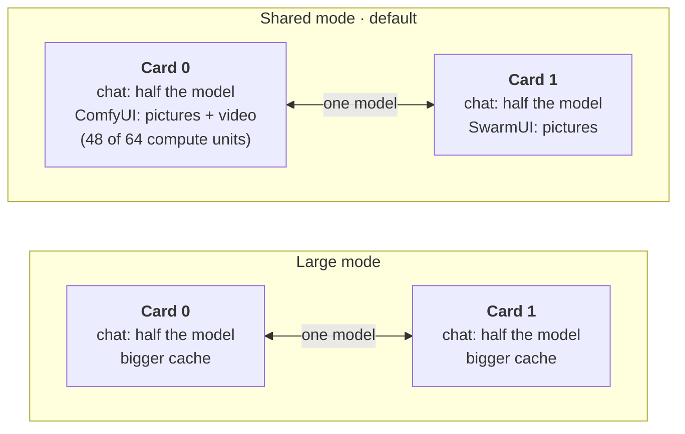
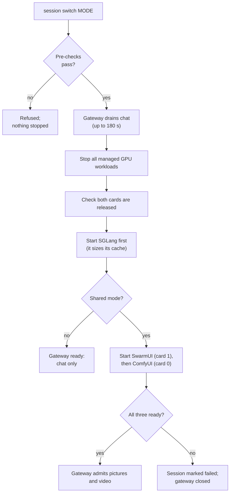

# Service modes

The two Radeon AI PRO R9700 cards (32 GB each) can't run everything at full size at once. A
**mode** decides what they do. **Shared** mode is the family default: chat, pictures and short
videos together. **Large** mode gives both cards to chat alone, for very long conversations
such as working through a whole codebase.

| Mode | Chat model (both cards) | Context per conversation | Pictures | Video | Use it for |
| --- | --- | --- | --- | --- | --- |
| **Shared** (default) | Qwen3.8-27B MXFP4, arm UQS | 81,888 tokens, two conversations at once | Yes, one generator per card | Yes, on card 0 | Everyday family use |
| **Large** | Qwen3.8-27B MXFP4, arm UQL | 262,112 tokens, the model's maximum | No | No | Long documents and coding sessions |
| Split (legacy) | Qwen3.5-9B on one card | 4,096 tokens | Yes, on the other card | No | Kept for comparison; not used day to day |
| Gaming | None | — | No | No | Game streaming; the AI workloads are stopped |
| Maintenance | None | — | No | No | Updates and recovery; every GPU workload is stopped |

The large mode's numbers come from the [serving profile](../infrastructure/ai-stack/serving/qwen3.8-27b-mxfp4-tp2.json)
(arms `UQS` and `UQL`, both qualified on 2026-11-11). Large mode's pool holds one full-length
conversation plus one of about 240K tokens. No mode can go past 262,112 tokens: that is the
model's trained limit (262,144 positions, less a 32-token reserve).

## What each card holds



The chat model is split evenly across both cards (tensor parallel 2), so its cache must be
the same size on each. That is why freeing one card alone gives chat no extra context: a
longer context needs both cards cleared, which is what large mode does.

In shared mode SGLang leaves about 8.35 GB free on each card (measured live). Each picture
generator runs in that gap. Video clips run on card 0 and use at most 48 of its 64 compute
units (`HSA_CU_MASK=0:0-47`), so chat keeps about 34 tokens a second while a clip renders,
instead of 21–24 without the limit. See [short videos](ASSISTANT.md#short-videos-shared-mode).

## Switch modes

One command switches the whole workstation:

```sh
sudo workstationctl mode family        # shared: chat, pictures and video
sudo workstationctl mode coder         # large: chat only, the full 262K context
sudo workstationctl mode gaming        # Steam and Sunshine; AI stopped
sudo workstationctl mode maintenance   # every GPU workload stopped
```

Run it without `--execute` first: it renders, runs every check and prints the plan
without changing anything. Add `--execute` to switch. Chat is unavailable while it runs:
draining takes up to 3 minutes, and SGLang then needs a few minutes to load.

| Mode | Session mode | Render |
| --- | --- | --- |
| `family` | `shared` | `service render --mode shared` (the profile's shared arm, `UQS`) |
| `coder` | `ai` | `service render --mode large` (the profile's default arm, `UQL`) |
| `gaming` | `gaming` | none |
| `maintenance` | `maintenance` | none |

For `family` and `coder` the command:

1. **Renders from this checkout** into `/var/lib/workstation-mode/<time>-<mode>/`, keeping
   the live SGLang image (a mode switch changes the arm, never the image). It refuses
   unless the serving contract is `active`: a qualified profile and a promoted catalogue.
2. **Prepares the render** to apply: the session-managed GPU Deployments at zero (the
   session starts them in order), every other Deployment at its live replica count, so Open
   WebUI and the gateway keep running.
3. **Hands it to `session switch --apply`.** Before anything stops, the session checks the
   templates that will start (qualification, pinned images, security settings, combined CPU
   and memory) and runs a server-side dry run of the whole render. Then it drains chat,
   stops every GPU workload, confirms both cards are free, applies the render, waits for
   the gateway and other services to roll out, and starts SGLang, then the picture
   generators in family mode.
4. **Prints the gateway status** and the new context limit. If you use Qwen Code, refresh
   its settings from the render's `client.conf`.

Each render keeps its `mode-plan.json` and `apply.json` beside it, as a record of what
was applied.

### Before the first switch

These host settings are needed once. Session switches use them for every mode, including
gaming.

1. **The static CPU Manager.** Session control gives each GPU workload whole CPU cores
   and refuses to run under the default `none` policy. Enable it with the Ansible role in a
   maintenance window: every pod restarts once. See
   [CPU Manager migration](AI-PERFORMANCE.md#cpu-manager-migration-and-rollback).
2. **Hardware evidence for each boot.** Enable the unit that collects it at boot:
   `sudo systemctl enable --now workstation-hardware-evidence.service`. It writes
   `/var/lib/workstation-evidence/boot-<boot id>/`, which the command reads. If a
   collection fails, remove that directory and start the unit again.
3. **Host config.** In `/etc/workstation/workstation.conf`, set
   `SESSION_IMAGE2_DEPLOYMENT=comfyui-gpu0` and `MODE_SERVICE_SITE` (the site file the
   service renders use). The [example config](../config/workstation.conf.example) lists
   the optional `MODE_*` overrides.
4. **Gaming only:** the game Deployment must itself be installed and qualified (built
   image, display, input and security). Until then `mode gaming` is refused before
   anything stops; the other modes work without it. Installed later, it is adopted
   while stopped.

### Render modes and session modes

`workstationctl mode` hides this, but the two lower-level steps still exist and can be
run on their own:

| You want | Render with | Session mode |
| --- | --- | --- |
| Shared | `--mode shared` (arm `UQS`) | `shared` |
| Large | `--mode large` (arm `UQL`) | `ai` |
| Split (legacy) | `--mode split` | `split` |
| Gaming or maintenance | (any render) | `gaming`, `maintenance` |

### What a session switch does



The pre-checks are: the same boot as the hardware evidence, enough CPU and memory for every
pod of the mode together, and no GPU user outside the managed workloads. SGLang starts first
so it sizes its cache before any picture memory is in use. If any step fails, the session is
marked failed and the gateway closes for chat and pictures alike until a switch succeeds.

## Planned

- **Switching from a web page.** The [workstation bridge](https://github.com/Drgr33nSenior/Spry.ai-workstation-bridge)
  management UI is intended to let an authorised user change mode in the browser, by calling
  `workstationctl mode` under the same session lock.
