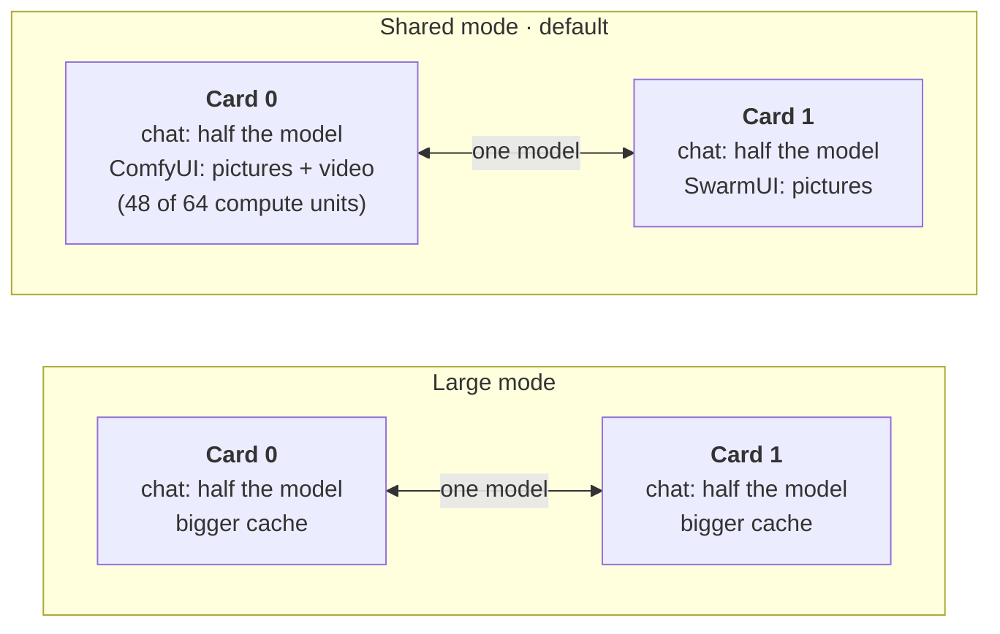
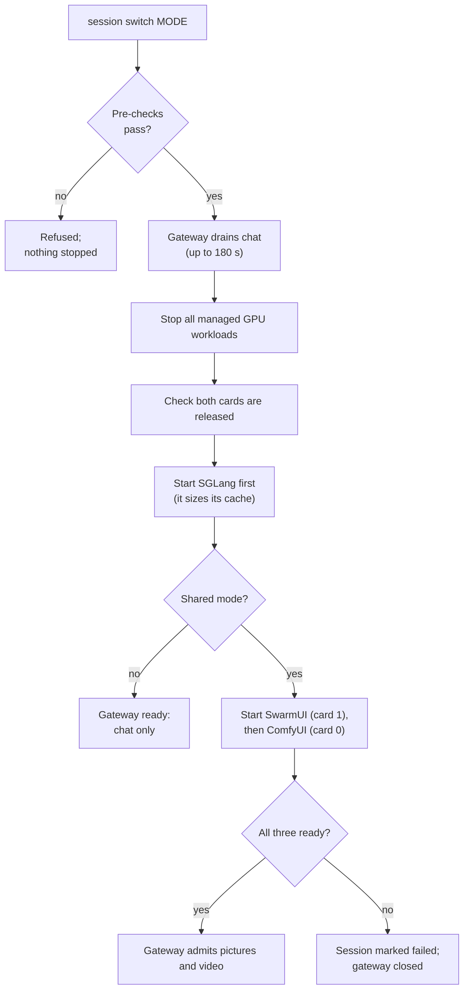

# Service modes

The two Radeon AI PRO R9700 cards (32 GB each) can't run everything at full size at once. A
**mode** decides what they do. **Shared** mode is the family default: chat, pictures and short
videos together. **Large** mode gives both cards to chat alone, for very long conversations
such as working through a whole codebase.

| Mode | Chat model (both cards) | Context per conversation | Pictures | Video | Use it for |
| --- | --- | --- | --- | --- | --- |
| **Shared** (default) | Qwen3.8-27B MXFP4, arm UQS | 81,888 tokens, two conversations at once | Yes, one generator per card | Yes, on card 0 | Everyday family use |
| **Large** | Qwen3.8-27B MXFP4, arm UQL | 262,112 tokens, the model's maximum | No | No | Long documents and coding sessions |
| Split (legacy) | Qwen3.5-9B on one card | 4,096 tokens | Yes, on the other card | No | Kept for comparison; not used day to day |
| Gaming | None | — | No | No | Game streaming; the AI workloads are stopped |
| Maintenance | None | — | No | No | Updates and recovery; every GPU workload is stopped |

The large mode's numbers come from the [serving profile](../infrastructure/ai-stack/serving/qwen3.8-27b-mxfp4-tp2.json)
(arms `UQS` and `UQL`, both qualified on 2026-11-11). Large mode's pool holds one full-length
conversation plus one of about 240K tokens. No mode can go past 262,112 tokens: that is the
model's trained limit (262,144 positions, less a 32-token reserve).

## What each card holds



The chat model is split evenly across both cards (tensor parallel 2), so its cache must be
the same size on each. That is why freeing one card alone gives chat no extra context: a
longer context needs both cards cleared, which is what large mode does.

In shared mode SGLang leaves about 8.35 GB free on each card (measured live). Each picture
generator runs in that gap. Video clips run on card 0 and use at most 48 of its 64 compute
units (`HSA_CU_MASK=0:0-47`), so chat keeps about 34 tokens a second while a clip renders,
instead of 21–24 without the limit. See [short videos](ASSISTANT.md#short-videos-shared-mode).

## How switching works today

Two separate steps decide what runs:

1. **The render** fixes what the workloads are. `service render --mode shared` or
   `--mode large` writes the SGLang Deployment with the matching arm (its cache size), the
   gateway policy (whether pictures are allowed) and the coding clients' context limits.
   Changing between shared and large therefore needs a fresh render and apply.
2. **The session** decides which rendered workloads run. `session switch <mode>` stops every
   managed GPU workload, checks the cards are released, then starts the ones that mode needs.

Render modes and session modes use different names:

| You want | Render with | Session mode |
| --- | --- | --- |
| Shared | `--mode shared --arm UQS` | `shared` |
| Large | `--mode large` (default arm `UQL`) | `ai` |
| Split (legacy) | `--mode split` | `split` |
| Gaming or maintenance | (any render) | `gaming`, `maintenance` |

### Switch between shared and large

Stop the GPU workloads first, so the new chat arm never starts while the picture generators
still hold the cards (large mode leaves almost no free GPU memory). Chat is unavailable from
step 2 until step 5 finishes, typically a few minutes.

1. Render the target mode from the merged `main` checkout. For large mode use
   `--mode large` and drop `--arm UQS`:

   ```sh
   ./bin/workstationctl service render /private/service-site.json /private/assistant-shared \
     --experience assistant-memory --mode shared --existing-claims /private/service-pvcs.json \
     --serving-profile infrastructure/ai-stack/serving/qwen3.8-27b-mxfp4-tp2.json --arm UQS \
     --runtime-image registry.lan.thespry.family/local/sglang-gfx1201@sha256:DIGEST
   ```

2. Put the workstation in maintenance. This drains chat (up to 180 seconds, then in-flight
   requests are cancelled) and stops every managed GPU workload:

   ```sh
   sudo ./bin/workstationctl --config /etc/workstation/workstation.conf session switch maintenance \
     /var/lib/workstation-evidence/hardware-64gb/hardware.json /var/lib/workstation-session --execute
   ```

3. Review the change against the cluster, then apply it. The render leaves replicas at zero,
   which is what maintenance expects:

   ```sh
   kubectl diff -f /private/assistant-shared/workloads.yaml
   kubectl apply --dry-run=server -f /private/assistant-shared/workloads.yaml
   kubectl apply -f /private/assistant-shared/workloads.yaml
   ```

4. Start the new mode: the same `session switch` command with `shared` or `ai` (large) in
   place of `maintenance`.
5. Check the gateway reports `phase: ready`, and in shared mode `images: true`:

   ```sh
   kubectl -n ai-home-lab exec deploy/litellm -c gateway -- python -c \
     "import urllib.request; print(urllib.request.urlopen('http://127.0.0.1:4000/_service/status').read().decode())"
   ```

6. If you use Qwen Code, refresh its settings from the new render's `client.conf`: its
   context limit must match the mode.

### What a session switch does



The pre-checks are: the same boot as the hardware evidence, enough CPU and memory for every
pod of the mode together, and no GPU user outside the managed workloads. SGLang starts first
so it sizes its cache before any picture memory is in use. If any step fails, the session is
marked failed and the gateway closes for chat and pictures alike until a switch succeeds.

## Planned

- **One-command switch.** A single command that renders, applies, switches the session and
  checks the result is the next item on the backlog.
- **Switching from a web page.** The [workstation bridge](https://github.com/Drgr33nSenior/Spry.ai-workstation-bridge)
  management UI is intended to let an authorised user change mode in the browser.

Neither exists yet; until then, use the steps above.
