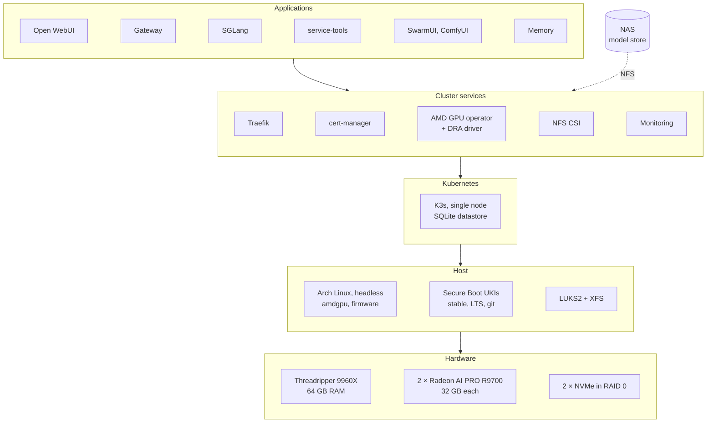
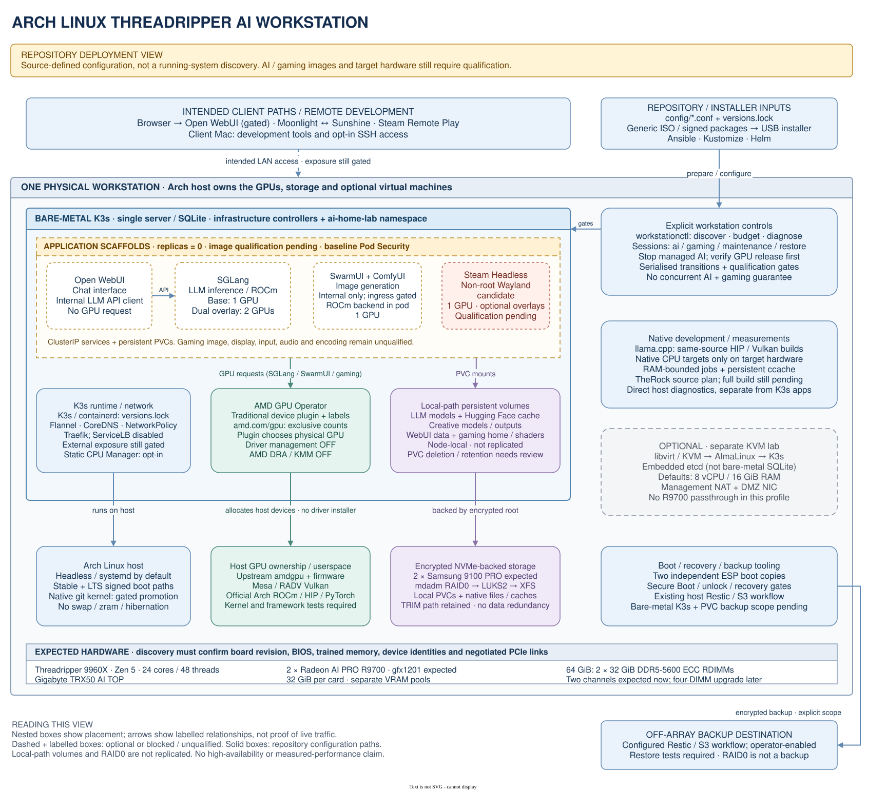

# Workstation stack overview

The workstation from the hardware up. Each layer depends only on the ones below it, which is
why the stable and LTS boot paths come before any container or VM work: nothing above the
host can repair a bad kernel, firmware or PCIe setup.



The applications run in the `ai-home-lab` namespace. The optional AlmaLinux K3s VM lab sits beside this stack, with its own datastore and network
boundaries; it does not run the AI service. The September 2026 draw.io diagram of the earlier
baseline is kept under [Earlier diagram](#earlier-diagram).

## Important boundaries

- The primary AI deployment is bare-metal K3s on Arch. The optional AlmaLinux
  K3s VM is a separate lab with its own datastore and network boundaries.
- Rendered manifests leave replicas at zero; the session tooling starts the workloads a
  mode needs. The serving image and profile are qualified ([serving profile](../infrastructure/ai-stack/serving/qwen3.8-27b-mxfp4-tp2.json));
  the non-root Wayland gaming candidate is not. See [SUNSHINE.md](SUNSHINE.md) for its
  capture, admission and input status.
- The service overlay routes Open WebUI and HTTPS clients through LiteLLM to
  internal SGLang. Traefik serves standard HTTPS (TCP 443) on the node's
  management-VLAN address only (a Service externalIP). SwarmUI drives its own
  ComfyUI on GPU 1 and a second ComfyUI (`comfyui-gpu0`) on GPU 0; the service-tools
  adapter serves pictures to the browser, and video goes straight to `comfyui-gpu0`.
- Arch owns `amdgpu`. The AMD operator manages the DRA driver (`gpu.amd.com`)
  and labels, not host driver installation. Workloads reference the standalone
  claims `gpu-0`/`gpu-1`, which select each R9700 by PCI address; pods sharing a
  claim share the card without VRAM isolation. The two cards have separate VRAM
  pools. Neither labels nor this view prove peer DMA.
- The explicit session command stops managed GPU workloads and verifies release
  before starting the selected workload ([service modes](MODES.md)). It does not
  implement simultaneous one-GPU AI and one-GPU gaming. New managed builds are inhibited during gaming;
  already-running or unrelated builds are not stopped automatically.
- The workstation has 64 GB installed RAM (about 62 GiB visible to Linux, about
  50 GiB that the node reports allocatable to pods). Recollect DIMM population, trained speed and
  Linux-visible capacity before regenerating budgets.
- Node-local PVCs, native caches and files use the encrypted NVMe-backed root.
  PVC size requests are not filesystem quotas. RAID0 has no data redundancy;
  the second ESP provides another boot copy, not another copy of root data.
- `nas-nfs` volumes, such as the AI-stack `ai-models` store, live on the NAS,
  not on that encrypted disk, and NFS traffic is not encrypted. See
  [NAS-backed volumes](HOME-LAB.md#nas-backed-volumes-nfs-csi).
- Host Restic is supplemented by [service capture and isolated recovery](SERVICE-RECOVERY.md).
  Application writers are quiesced before SQLite/token/PVC capture. Off-array
  credentials and a real restore acceptance remain required.

The view omits the retained Intel-only legacy commands, detailed port rules,
individual PVC sizes, family account overlays and the [telemetry composition](TELEMETRY.md).
Versions belong to the linked locks, not diagram labels. See the linked source guides
for those details. Solid boxes identify repository configuration paths, not
qualified deployment status. Dashed boxes also carry an explicit optional,
blocked or unqualified label; colour alone does not convey status.

## Source map

| Diagram area | Repository evidence |
| --- | --- |
| Installation, headless host and boot | [Architecture](ARCHITECTURE.md), [host example](../infrastructure/host/install.conf.example), [ISO workflow](ISO.md) |
| K3s runtime and networking | [Home-lab guide](HOME-LAB.md), [K3s configuration template](../infrastructure/ansible/roles/k3s_baremetal/templates/config.yaml.j2) |
| GPU operator and driver ownership | [values.yaml](../infrastructure/gpu-operator/values.yaml), [DeviceConfig](../infrastructure/gpu-operator/deviceconfig.yaml), [chart lock](../infrastructure/gpu-operator/chart.lock) |
| AI applications and internal API | [SGLang](../apps/base/sglang/deployment.yaml), [Open WebUI](../apps/base/open-webui/deployment.yaml), [SwarmUI](../apps/base/swarmui/deployment.yaml) |
| Gaming and admission | [Steam Headless](../apps/base/steam-headless/deployment.yaml), [namespace policy](../apps/base/namespace.yaml), [home-lab guide](HOME-LAB.md) |
| Sessions and resource/build gates | [session implementation](../lib/workstation/session.sh), [workstation configuration](../config/workstation.conf.example), [AI audit](AI-PERFORMANCE.md) |
| Native tools and qualification | [ROCm guide](ROCM.md), [host packages](../templates/workstation/packages.pacman), [version lock](../versions.lock) |
| Storage, backups and optional VM | [Architecture](ARCHITECTURE.md), [home-lab guide](HOME-LAB.md), [operations](OPERATIONS.md) |

## Earlier diagram

The draw.io diagram below records the infrastructure baseline of September 2026. It predates
the gateway, service-tools, GPU sharing with DRA and the second ComfyUI, so use the Mermaid
diagram above for the current stack.



[Open the PNG preview](diagrams/workstation-stack.png) or the
[draw.io source](diagrams/workstation-stack.drawio).

### Regenerate the previews

Use an existing draw.io desktop CLI. These commands render local diagram files;
they do not run the installer or contact a cluster. From the repository root:

```sh
xmllint --nonet --noout docs/diagrams/workstation-stack.drawio
drawio --disable-update --export --format svg --theme light --embed-svg-fonts false --border 20 --output docs/diagrams/workstation-stack.svg docs/diagrams/workstation-stack.drawio
drawio --disable-update --export --format png --theme light --scale 1.5 --border 20 --output docs/diagrams/workstation-stack.png docs/diagrams/workstation-stack.drawio
```

Inspect the rendered previews after changes. XML parsing alone does not verify
layout or application acceptance. The diagram uses generic local shapes and
fonts; it requires no downloaded icons or remote images.
