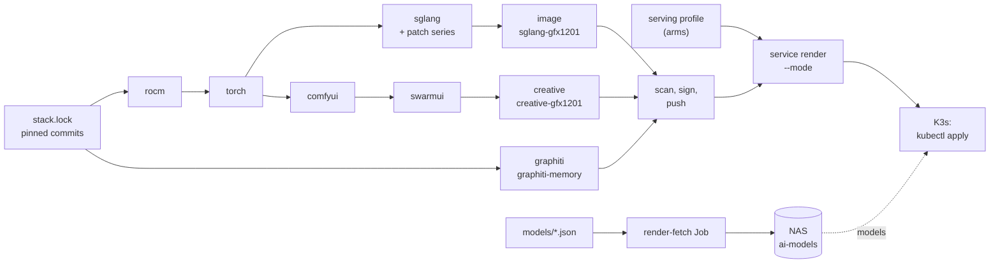

# AI serving stack pipeline

Builds the gfx1201 SGLang serving and picture images from upstream `main` of every
component and stages models (on the NAS; the Wan video stack on local NVMe), so upgrades and model swaps are a
repeatable routine rather than a hand-assembled runtime.

| Input | Pinned by |
| --- | --- |
| ROCm (TheRock), PyTorch, TorchVision, SGLang | Full commit in [`stack.lock`](stack.lock), refreshed from `main` |
| Triton | The commit the pinned PyTorch names in `.ci/docker/ci_commit_pins/triton.txt` |
| Build container | TheRock CI's image digest at the pinned TheRock commit |
| Runtime base | `python:3.14-slim-trixie`, resolved to a digest |
| SGLang patch series | Content hash of the serving repository's `serving/patches/sglang-main` |
| Models | Repository revision plus every file's published hash, in [`models/`](models) |



The left half builds images; the right half turns a pinned image, the serving profile and
staged models into the running service.

## Stages

`build-all.sh` runs the stages in order on the workstation, each in the
pinned build container under rootless Podman. Stage outputs live under
`~/ai-stack/builds/<stage>-<key>/out/`, where the key hashes every pin that
affects the stage. A stage whose key already has a `RECEIPT.json` is reused, so
a refresh that only moves SGLang rebuilds only the SGLang stage and the image.

| Stage | Produces |
| --- | --- |
| `rocm` | ROCm SDK Python packages for gfx1201 from TheRock |
| `torch` | PyTorch, Triton and TorchVision wheels, built with TheRock's helpers |
| `sglang` | The patched SGLang and gfx1201 AOT kernel wheels, plus the complete resolved wheelhouse |
| `image` | `registry.lan.thespry.family/local/sglang-gfx1201:<key>`, installed offline from the wheelhouse |
| `comfyui` | A complete wheelhouse for ComfyUI as SwarmUI self-starts it, on the same ROCm and PyTorch builds, plus the pinned ComfyUI source |
| `swarmui` | SwarmUI built self-contained with the pinned .NET SDK image, with the offline-pip guard patch |
| `creative` | `registry.lan.thespry.family/local/creative-gfx1201:<key>`: SwarmUI plus ComfyUI, installed offline |
| `graphiti` | `registry.lan.thespry.family/local/graphiti-memory:<key>`: the [memory service](../../docs/MEMORY.md) from `infrastructure/graphiti` and its hashed lock; CPU only, independent of the ROCm stages, with an offline import smoke test (`graphiti/smoke.py`) |

Each stage also records its progress for monitoring: `stage-metrics.py` writes
`/var/lib/workstation-ai-stack/ai-stack.prom`, which node-exporter reads. The
Workloads dashboard shows each stage as building, succeeded or failed, with its
duration and compiler-cache hit ratio. The alert rule for a failed or stuck
stage lives in the NAS repository,
[HP-ProliantGen10-DebianNAS](https://github.com/Drgr33nSenior/HP-ProliantGen10-DebianNAS),
not here. node-exporter reads the directory through
`--collector.textfile.directory` in
[`host-metrics.yaml`](../observability/host-metrics.yaml); the series are named
`workstation_ai_stack_*`. Create the directory once, owned by the build
user (the postinstall `telemetry-apply` gate prints the same command):

```sh
sudo install -d -m 0755 -o "$USER" -g "$USER" /var/lib/workstation-ai-stack
```

Without it, builds still run and only print a warning.

Each receipt records its inputs and the SHA-256 of every output. The sglang
receipt's wheelhouse list is the resolved dependency lock for the image.

## Routine update

From a checkout of this repository, with the serving repository beside it:

```sh
infrastructure/ai-stack/refresh.sh ../Spry.ai-rdna4-serving   # rewrite pins, print the diff
bash tests/test_ai_stack.sh
infrastructure/ai-stack/sync.sh zarren@gr33nstein ../Spry.ai-rdna4-serving
```

Then on the workstation:

```sh
systemd-run --user --unit=ai-stack-build --collect \
  bash ~/ai-stack/pipeline/current/build-all.sh
journalctl --user -fu ai-stack-build
```

`sync.sh` copies the pipeline to a content-addressed directory and points
`current` at it, so a build that is already running keeps its own scripts.
Commit the refreshed `stack.lock` with the receipts' outcome.

If a patch in the series stops applying, the `sglang` stage stops at
`git apply --check`. Port the patch in the serving repository, or delete it if
upstream absorbed the change, then refresh again to pick up the new series hash.

The `image` stage is keyed by the sglang stage plus `stack.lock`,
`image/Containerfile` and `image/smoke.py`, so a change to any of them builds,
smoke-tests and (with push) publishes a new tag.

### Image generation stages

SwarmUI checks its ComfyUI environment on every start and runs `pip install`
for anything missing. The image must never install at runtime, so:

- `comfyui/requirements.py` reads SwarmUI's required-package lists from the
  pinned SwarmUI source and merges them with ComfyUI's `requirements.txt`
  (dropping torch, torchvision and torchaudio, which the pipeline supplies or
  does not build). `comfyui/build.sh` resolves that against the torch stage.
- `creative/check_swarm_deps.py` repeats SwarmUI's start-up checks, including
  how it parses versions, when the image is built; the build fails on a gap.
- `swarmui/offline-pip.patch` makes SwarmUI throw instead of calling pip.

The `creative` stage's GPU smoke test (`creative/smoke.py`) checks FP16 work on
the GPU, runs ComfyUI's `--quick-test-for-ci` (all built-in nodes must import),
then starts SwarmUI with `creative/Backends.fds` and waits until it reports its
self-started ComfyUI backend up. `creative/Backends.fds` must stay identical to
`apps/base/swarmui/Backends.fds` (tested). No model is loaded; SDXL generation
is qualified on the cluster.

Set `AI_STACK_PUSH=1` for the `image` stage to push it to the lab registry.
This needs a one-time `podman login registry.lan.thespry.family` as the
publisher account.

### Scanning and signing

With `AI_STACK_PUSH=1` the `image`, `creative` and `graphiti` stages, after their smoke
tests (GPU for the first two, offline imports for `graphiti`), run the same `publish`
path (each with its own scan allowlist):

1. Scans the image with Trivy (`TRIVY_IMAGE` in `stack.lock`) and writes, under
   the image stage's `builds/image-<key>/out/scan/`, the full report (`vulns.json`), a CycloneDX
   SBOM, a cosign vulnerability predicate and the scanner/database versions.
2. Applies [`image/scan-policy.py`](image/scan-policy.py): the push stops for a
   CRITICAL finding with a fixed version available unless
   [`image/scan-allowlist.json`](image/scan-allowlist.json) covers it. Every
   allowlist entry needs `id` (and optionally `package`), `reason`, `reviewed`
   and `expires`; expired entries stop applying. Other findings are recorded,
   not blocking.
3. Pushes the image, then signs it and attests the SBOM and the vulnerability
   report with cosign (`COSIGN_IMAGE`), and verifies all three against
   [`signing/cosign.pub`](signing/cosign.pub). The stage writes `image.digest`
   only after verification, so a failed step reruns next time.

[`signing/signing-config.json`](signing/signing-config.json) lists no
transparency log or timestamp service, so nothing is uploaded to Rekor or any
other public service; signatures and attestations are stored beside the image
in the lab registry. Verification therefore uses `--insecure-ignore-tlog`.

One-time setup on the build host, in an interactive terminal:

```sh
infrastructure/ai-stack/signing/init-key.sh   # prompts for a new passphrase
```

It writes the passphrase-encrypted private key to
`~/.config/ai-stack/signing/cosign.key` and seals the passphrase for this user
with `systemd-creds --user`, so unattended builds can sign. Keep a copy of the
passphrase in your password manager: the sealed copy is bound to this host and
user. Commit the printed public key as `signing/cosign.pub`. Pushing stops with
a message until all three exist.

Before deploying an image, verify it:

```sh
infrastructure/ai-stack/signing/verify-image.sh registry.lan.thespry.family/local/sglang-gfx1201@sha256:<digest>
```

A cluster admission policy that rejects unsigned `local/` images is a planned
follow-up; until then this check is the enforcement point.

### Publishing an image

To let others run the stack, the owner copies one verified image to GitHub's
registry and hands out a standalone folder:

```sh
# On the workstation, after `podman login ghcr.io -u <owner>` with a classic
# token that has write:packages:
infrastructure/ai-stack/publish/publish.sh \
  registry.lan.thespry.family/local/sglang-gfx1201@sha256:<digest> ghcr.io/<owner>/sglang-gfx1201
# Anywhere:
infrastructure/ai-stack/serving/render.py standalone \
  infrastructure/ai-stack/serving/qwen3.8-27b-mxfp4-tp2.json \
  ghcr.io/<owner>/sglang-gfx1201@sha256:<digest> --serving ../Spry.ai-rdna4-serving --out <folder>
```

`publish.sh` verifies the lab image, stops on any Trivy secret finding, then
`cosign copy`s the image with its signature and attestations, so the public
digest equals the lab digest and verifies with `signing/cosign.pub`. The first
push creates a private package; make it public on GitHub. The standalone
folder (`run.sh serve|bench`, the default arm's exact arguments and
environment, the model revisions, the bench bundle, `cosign.pub` and a README)
needs only podman or docker and the two models; it never names lab hosts.

## Models

Each catalog entry pins a model and an optional draft: repository, revision and
every file's hash. It holds no serving settings; those go in a profile under
[`serving/`](serving). To add one, for example a Qwen4 checkpoint:

```sh
infrastructure/ai-stack/models/inventory.py OWNER/NAME FULL_COMMIT > /tmp/inventory.json
```

Copy the inventory into a new `models/<alias>.json` beside the existing entry,
add a `serving/<profile>.json` for it, and run the tests. Use `--exclude` for
files the runtime never reads.

| Entry | Used by |
| --- | --- |
| `qwen3.8-27b-mxfp4.json` | SGLang, via `serving/qwen3.8-27b-mxfp4-tp2.json` (model plus DFlash2 draft) |
| `sdxl-base-1.0.json` | The creative image's ComfyUI, via `apps/base/shared-api/image-profile.json` (single-file checkpoint only; a test keeps the two hashes equal) |
| `wan2.2-t2v-a14b.json` | `comfyui-gpu0` for chat video (`generate_video`). Staged with `stage-video.py` onto the local-NVMe `creative-models` volume, not the NAS: see [short videos](../../docs/ASSISTANT.md#short-videos-shared-mode) |

To stage it on the NAS:

```sh
kubectl apply -f apps/base/namespace.yaml                     # once; owns ai-home-lab
kubectl apply -f infrastructure/ai-stack/k8s/models.yaml      # once
infrastructure/ai-stack/models/render-fetch.py \
  infrastructure/ai-stack/models/<alias>.json infrastructure/ai-stack/stack.lock | kubectl apply -f -
```

**Namespace.** [`apps/base/namespace.yaml`](../../apps/base/namespace.yaml) is
the only definition of the `ai-home-lab` Namespace, with Pod Security
`enforce: restricted` (audit and warn `restricted`), the level the live
namespace already enforces. `k8s/models.yaml` holds the `ai-models` claim and
`model-fetch-egress`, which gives fetch Job pods public HTTPS (TCP 443, private
and reserved ranges excluded) through the namespace's default-deny; it
references that Namespace. The rendered fetch, qualification and bench
Jobs and the `apps/` workloads set the fields the restricted level requires;
confirm admission with `kubectl apply --dry-run=server` before the first apply.

The `ai-models` claim uses the `nas-nfs` StorageClass from
[`infrastructure/nfs-csi/`](../nfs-csi); install it first
([NAS-backed volumes](../../docs/HOME-LAB.md#nas-backed-volumes-nfs-csi)).

The Job downloads into the `ai-models` volume at
`<owner>/<name>/<revision>/`, checks each file's size and hash, and writes
`VERIFIED.json` last. Earlier revisions stay in place for rollback.

## Serving

A serving profile in [`serving/`](serving) is the single record of the
server's flags and environment for one model on this hardware. Each setting
carries its value, reason, source (usually a file in SGLang at the pinned
commit) and confidence, and says whether a GPU measurement still has to settle
it. Settings deliberately left out, and variables that must stay unset, are
recorded too. The research behind the current profile is in
[`serving/RESEARCH-20261108.md`](serving/RESEARCH-20261108.md); the op234
runtime it replaces is guidance there, not a target. The model catalog keeps
only model and draft identity.

A profile has **arms**: named sets of settings, each measured and qualified on its own. Three
matter today for `qwen3.8-27b-mxfp4-tp2`:

| Arm | Used for | Chat cache | Context per conversation | Qualified |
| --- | --- | --- | --- | --- |
| `UQS` | Shared mode (`shared_default`) | FP8, pool capped at 163,840 tokens | 81,888 tokens, two conversations | 2026-11-11: C1 / C2 135.1 / 224.8 tokens/s |
| `UQL` | Large mode (`default`) | FP8, 524,288 tokens requested; 502,093 fitted at qualification (one full conversation plus one of about 240K) | 262,112 tokens (the model's maximum) | 2026-11-11: C1 / C2 133.8 / 229.9 tokens/s |
| `Y` | Previous default | BF16, 262,144-token pool | 131,040 tokens | 2026-11-10: C1 / C2 139.2 / 254.7 tokens/s |

All three carry every adopted gfx1201 optimisation (arm `Y`'s set, below). `UQS` and `UQL`
add the FP8 cache, which serving patches 0026 and 0027 read back as BF16 so the attention
maths and speed match a BF16 cache. Which mode uses which arm, and how to switch, is in
[service modes](../../docs/MODES.md).

The other arms record how each optimisation was introduced and measured. Arm `A` is the
baseline every arm is compared with; arm `B` (`extra_buffer_lazy` with the overlap
scheduler) is an experiment. They are listed in the [arm reference](#arm-reference).

An arm may list base flags under `drop` (arm `M` drops
`--disable-custom-all-reduce`); `render.py` stops if a dropped flag is not in
the profile.

`serving/render.py` renders a profile:

```sh
# The server command line for the default arm (add --arm B for the experiment).
infrastructure/ai-stack/serving/render.py argv infrastructure/ai-stack/serving/<profile>.json
# A qualification Job (and its probe ConfigMap) for an image pinned by digest.
infrastructure/ai-stack/serving/render.py job infrastructure/ai-stack/serving/<profile>.json \
  registry.lan.thespry.family/local/sglang-gfx1201@sha256:<digest> > qualify-a.json
infrastructure/ai-stack/signing/verify-image.sh registry.lan.thespry.family/local/sglang-gfx1201@sha256:<digest>
kubectl apply -f qualify-a.json
kubectl -n ai-home-lab logs -f job/<name>
```

Before applying the Job:

- Free both GPUs. Only one Job or server can hold them, so stop any gaming
  session and any other SGLang server or GPU Job first.
- Stage the model with `render-fetch.py` and wait for its `VERIFIED.json`.
- The `apps/` layer is not required; the Job needs only the namespace, the
  `ai-models` claim and the image.

Rendered Jobs ship no Service. Their pods carry `ai-stack/sglang-server: "true"`, the
label the serving layer's `sglang` Service selects (`apps/base/sglang/service.yaml`), so
telemetry's `sglang` target and the Workloads dashboard's serving panels follow
whichever server holds the GPUs, without a bench replacing the family service's
routing. Do not run a Job while the serving Deployment is up: only one can hold the
GPUs. Without the `apps/` layer, apply that Service file alone to keep the dashboards.

To clean up a run, including its probe ConfigMap:

```sh
kubectl -n ai-home-lab delete job,configmap -l app.kubernetes.io/name=sglang-qualify
```

The Job runs the server and `serving/qualify.py` in one pod on both GPUs, with
the verified model revision from the `ai-models` volume, a read-only root and
restricted pod security. The probe checks the served name, reasoning output, a
streamed decode, tool-call parsing, a long-context prefill and prefix-cache
reuse, prints one `QUALIFY_RESULT` line and sets the Job's result. The startup
log records the memory pools. Only one Job (or server) can hold both GPUs at a
time. Record each measured result in the profile before changing its status.

The probe's timings are single measurements. For throughput and DFlash
acceptance, use the bench Job. It runs the same pod with `serving/bench.py`,
which replays the BetterBench v0.6.1 profile the op233/op234 selection was
measured with. The client, corpus and profile come unchanged from the serving
repository's `benchmarks/betterbench/native-v2`. The profile is 53 requests:

- eight categories × (one warm-up + three measured), capped at 4096 tokens;
- prefill at 2K, 8K and 16K tokens;
- six requests each at concurrency 1 and 2;
- sampling at temperature 0.7, top-p 0.95, top-k 20 and seed 1729, with
  thinking at low effort and a unique cache salt per request.

`--greedy` runs the same profile at temperature 0, which separates sampling
effects from draft or target defects. `--top-p P` changes only the client's
top-p. Arm `C` is arm A plus `--speculative-use-block-verification`.

Arms `D` to `H` measure the opt-in verify-path ports (serving patches
`0006` to `0009`) against arm A. An arm may set its own environment
variables, which the Job adds to the profile's.

### Arm reference

| Arm | Adds to arm A |
| --- | --- |
| `D` | `SGLANG_GFX1201_SPLITK_DOWNOUT=1` (S4 split-K down/out) |
| `E` | `SGLANG_GFX1201_PACKED_GDN_IN_PROJ=1` (packed GDN input projection) |
| `F` | `SGLANG_GFX1201_FP8_LM_HEAD=1` (FP8 target and draft heads; lossy) |
| `G` | `--enable-linear-replayssm-spec` (GDN ReplaySSM for DFLASH) |
| `I` | `SGLANG_GFX1201_GDN_NORM_QUANT=1` (fused GDN gated-norm MXFP4 quantization) |
| `H` | `D`, `E`, `F` and `I` together (not `G`) |
| `J` | `H` plus `SGLANG_GFX1201_VERIFY_ATTENTION=1` (split-KV verify attention) |
| `K` | `J` plus `SGLANG_GFX1201_SPLITK_WIDE=1` (split-K for QKV, GDN input and gate/up); the RCCL comparison for `M` |
| `L` | `K` with the draft quantized to FP8 at load (`--speculative-draft-model-quantization fp8`); not adopted |
| `M` | `K` with SGLang's custom all-reduce for verify/decode reductions (`SGLANG_GFX1201_PCIE_CUSTOM_AR=1`, `--disable-custom-all-reduce` dropped; serving patch 0014); the comparison for `N` |
| `N` | `M` plus `SGLANG_GFX1201_P1_PREFILL=1` (prefill chunks of 1024-2048 rows on the P1 FP8 GEMM route; serving patch 0015); the comparison for `O` |
| `O` | `N` plus `SGLANG_GFX1201_EXTEND_WARPS8=1` (8-warp prefill attention for head dim 256, C4; serving patch 0016); the comparison for `Q` |
| `P` | `O` with the draft quantized to FP8 at load (as `L`) and `SGLANG_DFLASH_FUSED_KV_FP8=1`, which keeps DFLASH's fused KV materialization for it (serving patch 0017) |
| `Q` | `O` plus `SGLANG_GFX1201_SPLITK_FUSED_REDUCE=1` (split-K verify GEMMs as one kernel with the reduce fused, bitwise equal; serving patch 0018); the comparison for `R` and `S` |
| `R` | `Q` plus `SGLANG_GFX1201_ADD_NORM_MXFP4=1` (the boundary norm read also quantizes to MXFP4 on verify batches, bitwise equal; serving patch 0019); the comparison for `S` |
| `S` | `R` plus `SGLANG_GFX1201_SILU_MUL_MXFP4=1` (SiLU*mul and the down projection's MXFP4 quantization in one kernel on verify batches, bitwise equal; serving patch 0020); the comparison for `T` |
| `T` | `S` plus `SGLANG_GFX1201_VERIFY_ATTENTION_B1_TILE=1` (one-request verify batches run the verify-attention kernel with a wider tile, BT 64 / 8 warps / QC 64; serving patch 0021; not bitwise, so it needs the quality phase); the comparison for `U` |
| `U` | `T` plus `SGLANG_GFX1201_MXFP4_KQ3=1` (verify GEMMs of at most 16 rows run the kq3 kernel over pre-packed weight records, bitwise equal; the records replace the weight and prefill rebuilds it into a scratch, about 26 ms per forward; serving patch 0022); the comparison for `V`-`Y` |
| `V` | `U` plus `SGLANG_GFX1201_EXTEND_TILE32=1` (head-dim-256 prefill attention with a 32 x 32 tile and 4 warps, -11% to -15% per chunk; serving patch 0023; not bitwise, so it needs the quality phase) |
| `W` | `V` plus `SGLANG_GFX1201_P1_FROM_KQ3=1` (P1 expands its FP8 weight directly from kq3 records, removing the prefill weight rebuild, about -27 ms per chunk, bitwise equal; serving patch 0024) |
| `X` | `W` plus `SGLANG_GFX1201_PCIE_CUSTOM_AR_MAX_BYTES=25165824` (prefill-chunk all-reduces on the PCIe custom all-reduce instead of RCCL, about -10 ms per chunk, bitwise equal; serving patch 0025 grows its buffer to the cap) |
| `Y` | `U` plus `SGLANG_GFX1201_P1_FROM_KQ3=1` and the 24 MiB `SGLANG_GFX1201_PCIE_CUSTOM_AR_MAX_BYTES` (0024, 0025) without `V`'s prefill-attention tile; output bitwise equal to `U`; the default from 10 to 11 November |
| `UQS`, `UQL` | `Y` with FP8 target and draft KV read as BF16 (0026, 0027); `UQS` caps the pool for shared mode. The current defaults |

Enable an item in arm A only after its arm matches arm A's quality result and
greedy acceptance.

Measured results for every arm, run by run, are in the
[serving results log](serving/RESULTS.md) (9–11 November 2026). The qualified figures for
the arms in use are the profile's `qualification` records.

After BetterBench, the Job runs the assistant acceptance menu
([`assistant-quality.json`](../sglang/assistant-quality.json) through
`lib/workstation/assistant_acceptance.py`, both unchanged) against the native
endpoint. No speed change is read without a quality result. Code tasks need
the bubblewrap sandbox, which the pod lacks, and long-context cases need a
tokenizer budget. The runner reports both as NOT RUN, never as passed.
`QUALITY_RESULT` lists the pass rate, the tool round-trip, grounded and
abstention rates, and any failed task.
JSON-graded answers wrapped whole in one ```` ```json ```` fence are graded on
their content; `json_fenced_rate` reports how often the model wrapped them
(menu `2026-11-10.1`; before it, a fenced answer failed as "not a JSON
object").

The bench Job fails only when the bench does: a failed BetterBench or
long-context request, or a quality runner error. Graded quality failures are
results in `QUALITY_RESULT`, not Job failures; compare them with arm `A`.

```sh
infrastructure/ai-stack/serving/render.py bench infrastructure/ai-stack/serving/<profile>.json \
  registry.lan.thespry.family/local/sglang-gfx1201@sha256:<digest> --serving <serving-repo> > bench-a.json
kubectl apply -f bench-a.json
kubectl -n ai-home-lab logs job/<name> | grep '^BENCH_RESULT'
kubectl -n ai-home-lab delete job,configmap -l app.kubernetes.io/name=sglang-bench
```

After BetterBench and before the quality phase, a long-context phase sends one
request at each of 32K, 64K and 120K prompt tokens: a unique filler document
with exactly 1024 generated tokens (`min_tokens`). It is not part of op233's
profile and measures verify cost at depth.

`BENCH_RESULT` gives these results:

- the median decode rate for each category;
- C1 and C2 aggregate throughput;
- the median prefill rate at each depth;
- for each long-context depth: prompt tokens, time to first token, decode rate
  and tokens per verify;
- for each phase, the server's generated tokens per verify call (its
  `generation_tokens_total` and `spec_verify_calls_total` counters).

op233/op234 measured C1 96.3–104.3 and C2 172.8–194.5 tokens/s at a 235 W cap
per card. Compare only at a matched cap. `BENCH_RAW` holds the full BetterBench
results, compressed.
